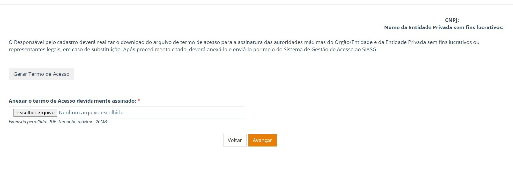
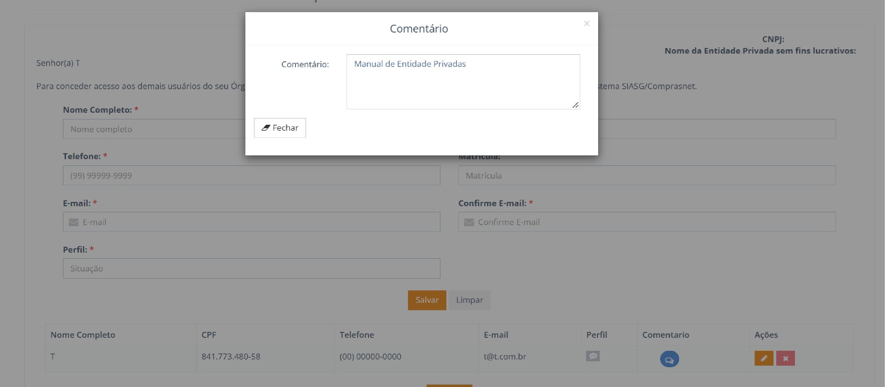
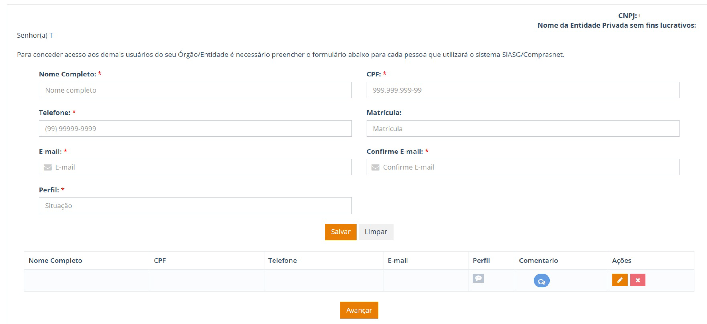
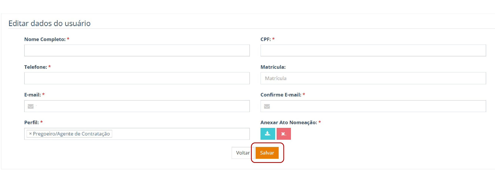
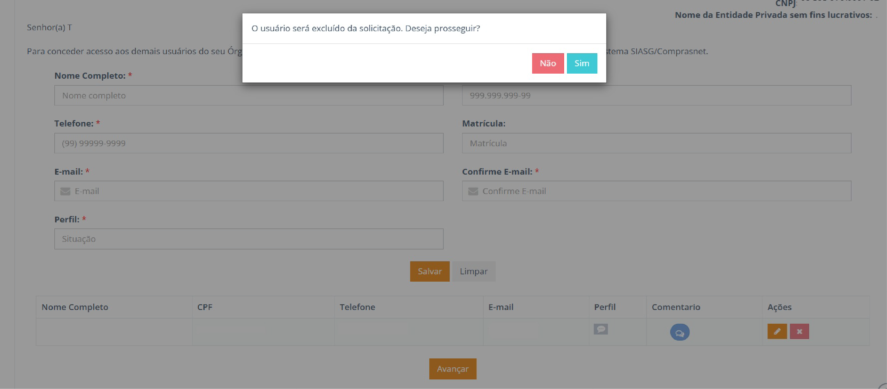
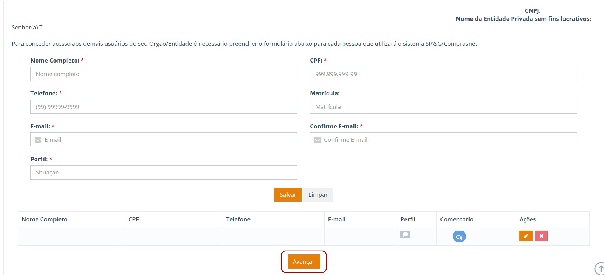
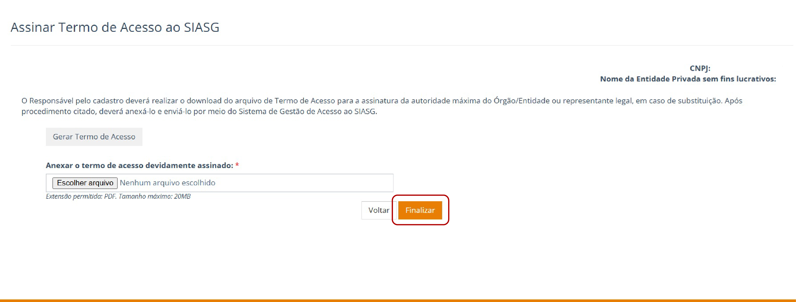
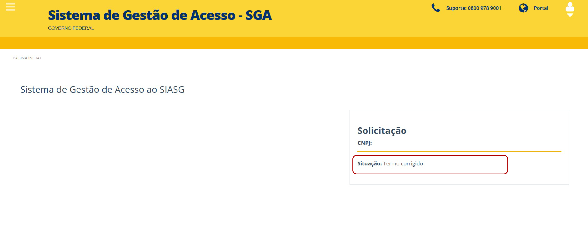

Tamanho do texto:

<button onclick="diminuirFonte()"
style="padding: 6px 12px; font-weight: bold; cursor: pointer; border: 1px solid #ccc; border-radius: 4px; background: #f8f9fa;">
A-
</button>

<button onclick="resetarFonte()"
style="padding: 6px 12px; font-weight: bold; cursor: pointer; border: 1px solid #ccc; border-radius: 4px; background: #f8f9fa;">
A
</button>

<button onclick="aumentarFonte()"
style="padding: 6px 12px; font-weight: bold; cursor: pointer; border: 1px solid #ccc; border-radius: 4px; background: #f8f9fa;">
A+
</button>

<button onclick="window.print()"
style="background-color: #0056b3; color: #ffffff; padding: 6px 16px; border: none; border-radius: 5px; font-size: 14px; cursor: pointer; box-shadow: 0 2px 4px rgba(0,0,0,0.2);">
🖨️ Imprimir ou baixar esta página
</button>

# 13. Acompanhamento da solicitação

Após o encaminhamento do Termo de Acesso, o responsável poderá acompanhar, no Sistema de Gestão de Acesso (SGA), o andamento da solicitação e verificar eventuais pendências identificadas durante a análise.

## 13.1 Situações da solicitação

A tabela a seguir apresenta as principais situações que podem ser exibidas pelo sistema e as respectivas ações esperadas do responsável.

| Situação no sistema | Ação do responsável |
|---------------------|--------------------|
| Aguardando validação | Aguardar a análise da solicitação pelo Ministério da Gestão e da Inovação em Serviços Públicos (MGI), cujo prazo é de até 3 dias úteis. |
| Revalidar termo e usuário | Verificar as pendências relacionadas ao Termo de Acesso ou ao cadastramento dos usuários. |
| Termo e usuário SIASG corrigidos | Após realizar as correções necessárias, encaminhar a solicitação para nova análise pelo MGI. |
| Termo e usuário SIASG válidos | Aguardar a conclusão dos procedimentos necessários para o cadastro da entidade e a criação da Unidade Administrativa de Serviços Gerais (UASG). |
| Aguardando habilitação do(s) usuário(s) SIASG | Aguardar a conclusão da habilitação dos usuários. |
| Processo de solicitação de acesso finalizado | O processo foi concluído, e o sistema estará disponível para utilização conforme os acessos habilitados. |

*Situações da solicitação e ações do responsável.*

!!! note "Nota"

    Os prazos e as situações apresentados no SGA devem ser considerados de acordo com o andamento efetivo da solicitação no sistema.

## 13.2 Tratamento de pendências

Quando a solicitação for devolvida para correção, o responsável deverá consultar a pendência apresentada no SGA e realizar os ajustes necessários antes de encaminhá-la novamente para análise.

### 13.2.1 Termo de acesso sem assinatura

Caso o termo de acesso seja devolvido por ausência de assinatura, o sistema direcionará o responsável para a tela correspondente.

O responsável deverá:

I. realizar o download do termo de acesso;

II. providenciar a assinatura da autoridade competente ou de seu substituto legal;

III. anexar o termo de acesso devidamente assinado no SGA;

IV. prosseguir com o encaminhamento da solicitação.

*Figura 19 - Tratamento de pendência relacionada ao termo de acesso.*

### 13.2.2 Inconsistências no cadastro de usuários

Caso a solicitação seja devolvida em razão de pendências no cadastro de usuários, o sistema direcionará o responsável para a tela correspondente.

*Figura 20 - Inconsistências identificadas no cadastro de usuários.*

Na opção 💬 **"Comentário"**, o sistema apresentará uma mensagem contendo a descrição específica de cada pendência identificada.

Para realizar a correção, o responsável deverá clicar no ícone ✏️ **"Editar"** para alterar o registro do usuário.

*Figura 21 - Ícone de edição do registro de usuário.*

Após realizar as alterações necessárias, clique em **"Salvar"** para registrar as modificações.

*Figura 22 - Botão de salvamento das alterações do usuário.*

Caso seja necessário remover o cadastro do usuário, clique no ícone ❌ **"Excluir"**.

O sistema exibirá a seguinte mensagem:

**"O usuário será excluído da solicitação. Deseja prosseguir?"**

Selecione **"Sim"** para confirmar a exclusão ou **"Não"** para cancelar a operação.

*Figura 23 - Botões para confirmar (sim) ou cancelar (não) a exclusão.*

!!! warning "Atenção"

    Caso a pendência apresentada não possa ser solucionada por meio das funcionalidades disponíveis no SGA, o responsável deverá entrar em contato com a <a href="https://portaldeservicos.gestao.gov.br/" target="_blank" rel="noopener noreferrer"><strong>Central de Atendimento</strong></a>.

## 13.3 Reenvio da solicitação após as correções

Após realizar as correções necessárias, clique em **"Avançar"**. O sistema direcionará o usuário para a próxima tela.

*Figura 24 - Tela de dados cadastrais dos usuários.*

Na etapa seguinte, clique em **"Gerar termo de acesso"**. O sistema exibirá o documento contendo as correções realizadas.

Na sequência, realize o download do Termo de Acesso, providencie as assinaturas necessárias e **anexe o termo de acesso devidamente assinado** ao sistema.

*Figura 25 - Assinatura do Termo de Acesso.*

Por fim, clique em **"Finalizar"** para encaminhar a solicitação corrigida para nova análise.

Após o envio, o sistema exibirá a situação **"Termo e usuário SIASG corrigidos"**.

*Figura 26 - Situação da solicitação: "Termo e usuário SIASG corrigidos".*

## 13.4 Acompanhamento da solicitação

Após o encaminhamento da solicitação, o responsável deverá acompanhar seu andamento no SGA e observar as mensagens e situações apresentadas pelo sistema, conforme descrito na seção **13.1 - Situações da solicitação**.

Quando o termo de acesso e o cadastro dos usuários forem validados, e os procedimentos necessários à habilitação dos acessos forem concluídos, a solicitação será considerada finalizada.

A partir desse momento, o responsável poderá gerenciar os usuários cadastrados e, quando necessário, solicitar novos acessos ao ecossistema Compras.

---

<button onclick="window.print()"
style="background-color: #0056b3; color: #ffffff; padding: 6px 16px; border: none; border-radius: 5px; font-size: 14px; cursor: pointer; box-shadow: 0 2px 4px rgba(0,0,0,0.2);">
🖨️ Imprimir ou baixar esta página
</button>

