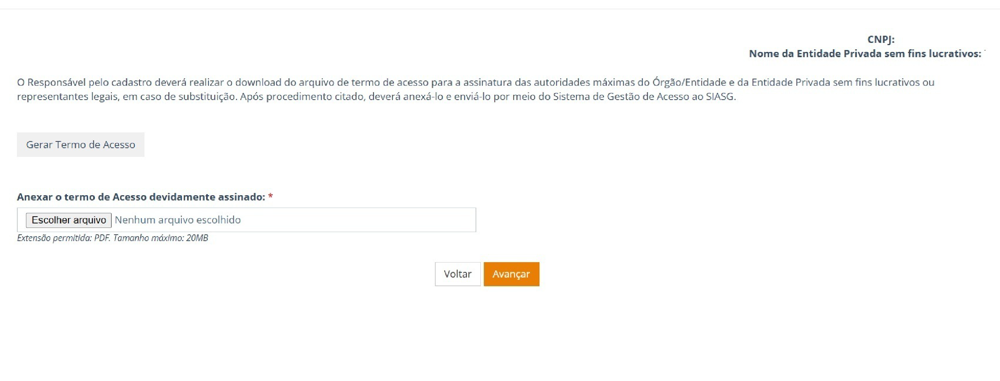
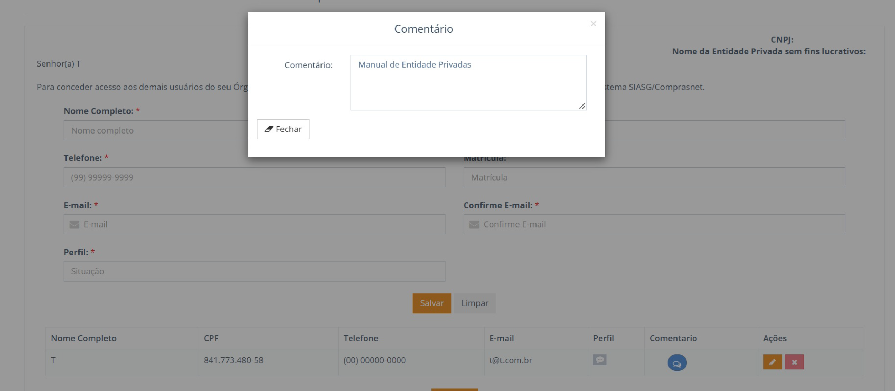
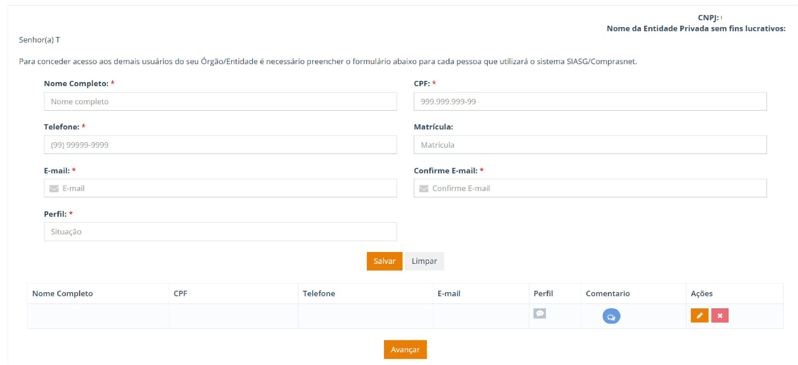
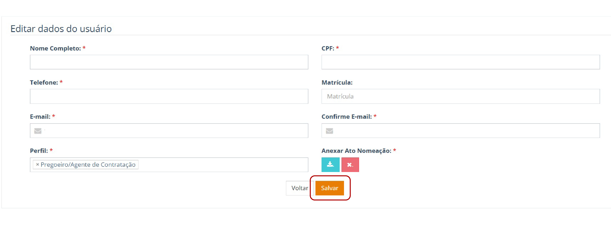
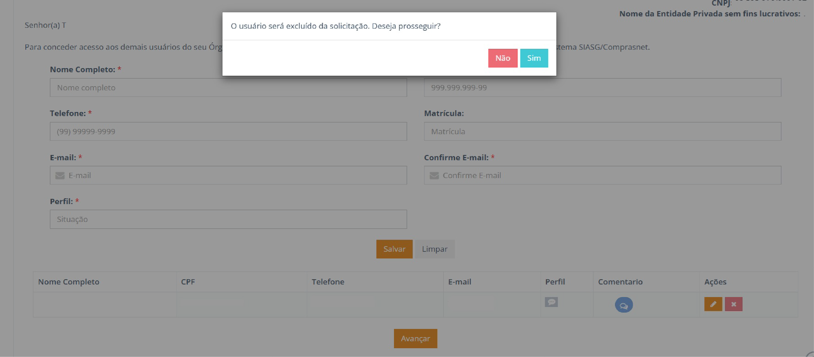
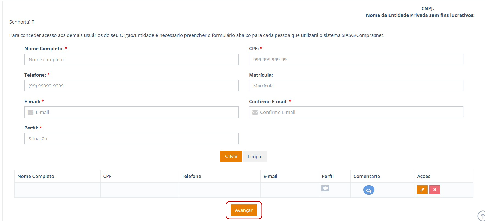
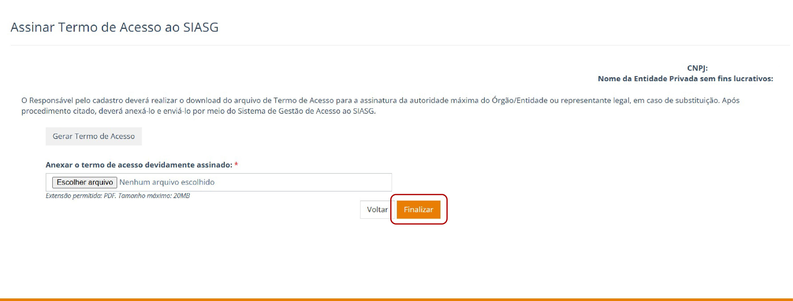
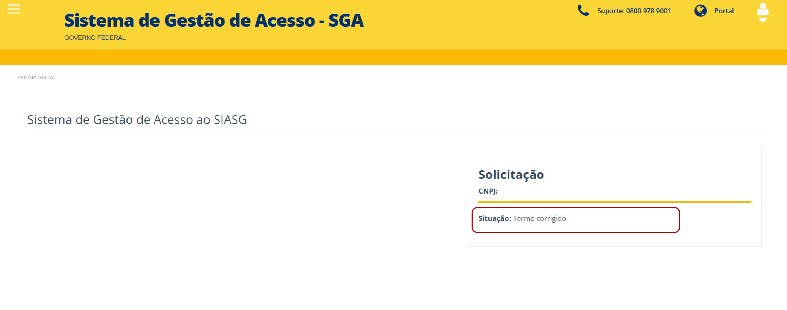

Tamanho do texto:

<button onclick="diminuirFonte()"
style="padding: 6px 12px; font-weight: bold; cursor: pointer; border: 1px solid #ccc; border-radius: 4px; background: #f8f9fa;">
A-
</button>

<button onclick="resetarFonte()"
style="padding: 6px 12px; font-weight: bold; cursor: pointer; border: 1px solid #ccc; border-radius: 4px; background: #f8f9fa;">
A
</button>

<button onclick="aumentarFonte()"
style="padding: 6px 12px; font-weight: bold; cursor: pointer; border: 1px solid #ccc; border-radius: 4px; background: #f8f9fa;">
A+
</button>

<button onclick="window.print()"
style="background-color: #0056b3; color: white; padding: 6px 16px; border: none; border-radius: 5px; font-size: 14px; cursor: pointer; box-shadow: 0 2px 4px rgba(0,0,0,0.2);">

🖨️ Imprimir ou baixar esta página

</button>

# 13. Acompanhamento da Solicitação

Após o encaminhamento do Termo de Acesso, o responsável poderá acompanhar, no SGA, o andamento da solicitação e verificar eventuais pendências identificadas durante a análise.

## 13.1 Situações da solicitação

A tabela a seguir apresenta as principais situações que podem ser exibidas no sistema e a ação esperada do responsável.

| Situação do Sistema | Ação do Usuário |
|--------------------|-----------------|
| Aguardando validação | Aguardar a análise da solicitação pelo MGI (prazo de até 3 dias úteis). |
| Revalidar termo e usuário | Verificar as pendências relacionadas ao Termo de Acesso ou ao cadastro dos usuários. |
| Termo e usuário SIASG corrigidos | Após realizar as correções, encaminhar a solicitação para nova análise pelo MGI. |
| Termo e usuário SIASG válidos | Aguardar os procedimentos necessários para o cadastro da entidade e a criação da UASG (Unidade Administrativa de Serviços Gerais). |
| Aguardando habilitação do(s) usuário(s) SIASG | Aguardar a conclusão da habilitação dos usuários. |
| Processo de solicitação de acesso finalizado | O processo foi concluído e o sistema estará disponível para utilização, conforme os acessos habilitados. |

*Situações da solicitação e ações do responsável.*

!!! note "NOTA"

    Os prazos e as situações apresentadas no SGA devem ser considerados conforme o andamento efetivo da solicitação no sistema.

---

## 13.2 Tratamento de pendências

Quando a solicitação for devolvida para correção, o responsável deverá consultar a pendência apresentada no SGA e realizar os ajustes necessários antes de encaminhar novamente a solicitação para análise.

### 13.2.1 Termo de Acesso sem assinatura

Caso o Termo de Acesso seja devolvido por ausência de assinatura, o sistema direcionará o responsável para a tela correspondente.

O responsável deverá:

I. Realizar o download do Termo de Acesso.    
II. Providenciar a assinatura da autoridade competente ou de seu substituto legal.     
III. Anexar o Termo de Acesso devidamente assinado no SGA.     
IV. Prosseguir com o encaminhamento da solicitação.  

*Figura 19 - Tratamento de pendência relacionada ao Termo de Acesso.*

---

### 13.2.2 Inconsistências no cadastro de usuários

Caso a solicitação seja devolvida em razão de pendências no cadastro de usuários, o sistema direcionará o responsável para a tela correspondente.

*Figura 20 - Inconsistências identificadas no cadastro de usuários.*

Na opção **"Comentário"**, o sistema apresentará uma mensagem encaminhada pelo Ministério, contendo a descrição específica de cada pendência identificada.

Para realizar a correção, o responsável deverá clicar no ícone de **"Editar"** para alterar o registro do usuário.

*Figura 21 -  Ícone de edição do registro de usuário.*

Após realizar as alterações, clique “Salvar” para registrar as modificações.

 *Figura 22 - Ícone de salvamento das alterações do usuário.* 

Caso seja necessário remover o cadastro do usuário, clique no ícone ![](data:image/png;base64,iVBORw0KGgoAAAANSUhEUgAAACUAAAAeCAMAAACc/SdfAAAAAXNSR0IArs4c6QAAAARnQU1BAACxjwv8YQUAAACWUExURffZ3PKnvfKnrv////W6v+pPXOpYZO1lbOtZZOlKVu1ld/B0eOxibOxmc+1xeelMWPe3qe54iux4lu+Up/WimvSNgO14jPONh++aufff8fvw8P7iyvCmyPTJ5//+7f7w3veunO2WvPTV+fv9/vjt///31/q2nO2GnvG93f3ZwfSTif/u0fzw8e+av/ba+/OyzO5rcgAAAOegk6sAAAAydFJOU/////////////////////////////////////////////////////////////////8ADVCY7wAAAAlwSFlzAAAXEQAAFxEByibzPwAAAbpJREFUOE99VItS7CAMbUsLEyC1ruNrva518L2j/v/feZLQ7nqdWQIhHMLJ6bNp2q5rT1vjmp4GT4H8IMOi336gb9e0AwXvwwALR9MSB6R1rukCxZTQMYIGQSOLY0jet6g4hBgAR7SEjlgDWSJOkcKkXDikPJasky11HZSLJMISlnwKWg/7CMGIZPI9siBda5ih+5SVT85CWPCi3vsU86iG7fOU88gpM3NiBBG6jCsmy2LeXPTz5dVFO18DYgEZ11i5cEiQnG5ut3fTv/vdw8xgExQCFl3CI5Yfv8puu30qzy+oaWg6O+ICxnncfN6W4srDdKlMkrhyRckRkPn17cm53TtkKQb0SJcehL96vC+l7PadcFX9qy5F4FiSIKvsZyWTfuCqEvII9Xtco1P1xsarLs2A8Wvbzx+bm376wA02qf/rUrA2ufdYY0LWco1KJXjO2Uc4PSCYVDQuOWVQHtGskk1gMy68XyskDJa9+j/PUTNr9sEWXQfYGDSu535xLSWWUVNlPnAxRC++dl3DKhdR9nhYOtRnABJVnEi+Dk+CUZZJHMm+LXWLCBUb/Camk9bjP+Ec3pXTzbkfh90zLP/xR7QAAAAASUVORK5CYII=) **“Excluir”**. O sistema exibirá a mensagem: 

**“O usuário será excluído da solicitação. Deseja prosseguir?”** 

Selecione **“Sim”** para confirmar a exclusão ou **“Não”** para cancelar a operação. 

*Figura 23 - Ícone de exclusão do cadastro de usuário* 

!!! Warning "Atenção"

    Caso a pendência apresentada não possa ser solucionada pelas funcionalidades disponíveis no SGA, o responsável deverá entrar em contato com a Central de Atendimento: (https://portaldeservicos.gestao.gov.br/)

## 13.3 Reenvio da solicitação após as correções 

Após realizar as correções, clique em **“Avançar”**. O sistema irá direcionar o usuário para a próxima tela. 
    
 

*Figura 24 - Tela de dados cadastrais de usuários* 

Na etapa seguinte, clique em **“Gerar Termo de Acesso”**. O sistema exibirá o documento com as correções realizadas. 

Na sequência, realize o download do Termo de Acesso, providencie as assinaturas e **anexe o Termo de Acesso devidamente assinado no sistema**.

*Figura 25 - Assinatura do Termo de Acesso*

Por fim, clique em **“Finalizar”** para encaminhar a solicitação corrigida para nova análise.  
O sistema exibirá a mensagem **“Termo e usuário SIASG corrigidos”**.

*Figura 26 - Status da solicitação: “Termo e usuário SIASG corrigidos”

## 13.4  Para acompanhar a solicitação 

Após o encaminhamento da solicitação, o responsável deverá acompanhar seu andamento no SGA e observar as mensagens e situações apresentadas pelo sistema, conforme descrito na seção **13.1 – Situações da solicitação**. 

Quando o Termo de Acesso e o cadastro dos usuários forem validados e os procedimentos necessários à habilitação dos acessos forem concluídos, a solicitação será considerada finalizada. 

Após a conclusão, o responsável poderá gerenciar os usuários cadastrados e, quando necessário, solicitar novos acessos ao ecossistema Compras.

---

<button onclick="window.print()"
style="background-color: #0056b3; color: white; padding: 6px 16px; border: none; border-radius: 5px; font-size: 14px; cursor: pointer; box-shadow: 0 2px 4px rgba(0,0,0,0.2);">

🖨️ Imprimir ou baixar esta página

</button>

