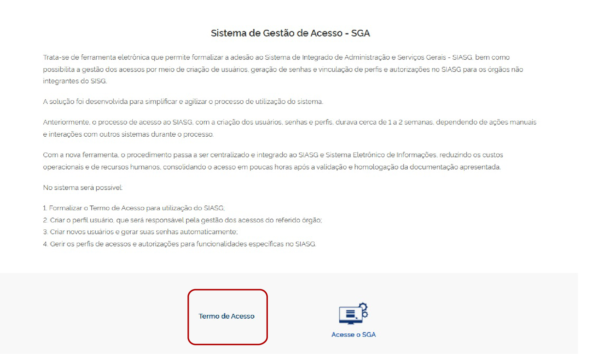
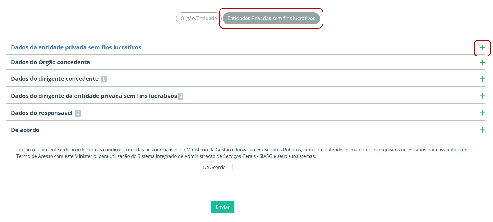
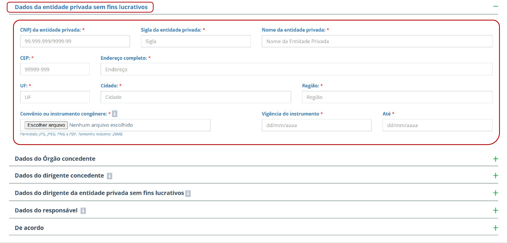

Tamanho do texto:

<button onclick="diminuirFonte()"
style="padding: 6px 12px; font-weight: bold; cursor: pointer; border: 1px solid #ccc; border-radius: 4px; background: #f8f9fa;">
A-
</button>

<button onclick="resetarFonte()"
style="padding: 6px 12px; font-weight: bold; cursor: pointer; border: 1px solid #ccc; border-radius: 4px; background: #f8f9fa;">
A
</button>

<button onclick="aumentarFonte()"
style="padding: 6px 12px; font-weight: bold; cursor: pointer; border: 1px solid #ccc; border-radius: 4px; background: #f8f9fa;">
A+
</button>

<button onclick="window.print()"
style="background-color: #0056b3; color: white; padding: 6px 16px; border: none; border-radius: 5px; font-size: 14px; cursor: pointer; box-shadow: 0 2px 4px rgba(0,0,0,0.2);">

🖨️ Imprimir ou baixar esta página

</button>

# 9. Preenchimento do Formulário (Como realizar a adesão) 

Antes de iniciar a solicitação de adesão ao Sistema de Gestão de Acesso (SGA), a entidade privada sem fins lucrativos deve reunir as informações e os documentos necessários para o preenchimento do formulário. 

A preparação prévia contribui para reduzir a ocorrência de pendências e a necessidade de complementação das informações durante a análise da solicitação. 

## 9.1 Checklist para iniciar a solicitação de Adesão ao SGA

Antes de iniciar a solicitação de adesão ao **Sistema de Gestão de Acesso (SGA)**, reúna as informações e os documentos que poderão ser necessários durante o processo. 

A documentação exigida pode variar de acordo com o **perfil solicitado** e com as responsabilidades atribuídas à **entidade privada sem fins lucrativos** e ao órgão concedente. Por isso, consulte previamente os requisitos específicos do perfil que será solicitado.

### 9.1.1 Acesso ao sistema

☐ Conta Gov.br ativa para acesso ao SGA. 

☐ Conta Gov.br da pessoa indicada pela entidade para realizar a solicitação. 

### 9.1.2 Informações e documentos da entidade

☐ Dados cadastrais da entidade necessários ao preenchimento da solicitação.

☐ Dados cadastrais atualizados e compatíveis com os documentos apresentados. 

☐ Documentos necessários à comprovação da constituição e da representação da entidade, quando exigidos. 

### 9.1.3 Documentos do dirigente da entidade

Para o **dirigente máximo da entidade privada sem fins lucrativos** ou seu **substituto legal**, quando aplicável: 

☐ Termo de Posse, ata de eleição, ato de nomeação ou documento equivalente.

☐ Documento oficial de identificação.

☐ Documento que comprove a condição de substituto legal, quando aplicável.

### 9.1.4 Documentos do dirigente ou representante do órgão concedente

Quando houver participação do órgão concedente no processo

☐ Documento oficial de identificação, quando exigido. 

☐ Documento que comprove a condição de dirigente ou representante do órgão concedente, quando exigido. 

☐ Ato de designação ou documento equivalente, quando exigido para o perfil ou para determinada etapa do processo. 

### 9.1.5 Atos de designação e documentos comprobatórios

Para os perfis que exigem designação formal ou comprovação de atribuições

☐ Ato de designação do responsável, quando aplicável. 

☐ Documento que comprove a vinculação, a representação ou a condição necessária para o exercício do perfil solicitado, quando aplicável. 

☐ Outros documentos comprobatórios eventualmente exigidos para o perfil solicitado. 

!!! warning "Atenção"

    A documentação exigida pode variar conforme o perfil solicitado e a etapa do processo.

### 9.1.6 Assinaturas

☐ Documentos que exigem assinatura devidamente assinados. 

☐ Assinaturas realizadas pelo dirigente máximo, pelo substituto legal ou pela pessoa competente, conforme o caso. 

### 9.1.7 Arquivos para anexação

Antes de anexar os documentos ao SGA: 

☐ Documentos completos e legíveis. 

☐ Arquivos nos formatos aceitos pelo SGA: JPG, JPEG, PNG ou PDF. 

☐ Arquivos com tamanho máximo de 20 MB cada. 

☐ Documentos anexados compatíveis com as informações preenchidas no sistema. 

### 9.1.8 Checklist final

Antes de iniciar a solicitação, confirme: 

☐ Conta Gov.br ativa 

☐ Dados cadastrais da entidade 

☐ Documentos do dirigente da entidade 

☐ Documentos necessários à comprovação da constituição e da representação da entidade, quando aplicável

☐ Documentos do dirigente ou representante do órgão concedente, quando exigidos

☐ Atos de designação e demais documentos comprobatórios exigidos para o perfil, quando aplicáveis

☐ Documentos específicos exigidos para o perfil a ser solicitado

☐ Documentação completa, legível e devidamente assinada, quando necessário

☐ Arquivos nos formatos e dentro dos limites de tamanho aceitos pelo SGA. 

!!! warning "Atenção"

    Reúna todas as informações e documentos antes de iniciar o preenchimento. A ausência de informações ou documentos poderá gerar pendências e necessidade de complementação durante a análise da solicitação.
    

## 9.2 Acesso ao formulário

Para iniciar o processo de adesão, o interessado deverá acessar a página do [**Sistema de Gestão de Acesso (SGA)**](https://www.gov.br/compras/pt-br/sistemas/conheca-o-compras/sistema-de-gestao-de-acesso-ao-siasg-sga) no portal Compras.gov.br.

*Página inicial do Sistema de Gestão de Acesso (SGA).*

---

O formulário eletrônico deverá ser preenchido com todas as informações solicitadas.

Ao selecionar a opção **Entidades Privadas sem Fins Lucrativos**, serão disponibilizadas as seguintes seções:

I. Dados da entidade privada sem fins lucrativos  
II. Dados do órgão concedente  
III. Dados do dirigente concedente  
IV. Dados do dirigente da entidade privada sem fins lucrativos  
V. Dados do responsável  
VI. De acordo

* Seções do formulário de adesão.*

## 9.3 Dados da entidade privada sem fins lucrativos e do Órgão concedente 

Nesta etapa, o usuário deverá preencher o formulário com as informações institucionais para entidade privada e do órgão concedente, conforme os campos disponibilizados. 

 

* Dados da entidade privada sem fins lucrativos *

  
---

<button onclick="window.print()"
style="background-color: #0056b3; color: white; padding: 6px 16px; border: none; border-radius: 5px; font-size: 14px; cursor: pointer; box-shadow: 0 2px 4px rgba(0,0,0,0.2);">

🖨️ Imprimir ou baixar esta página

</button>

