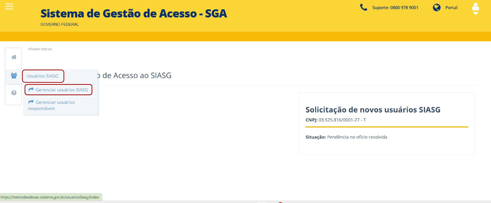
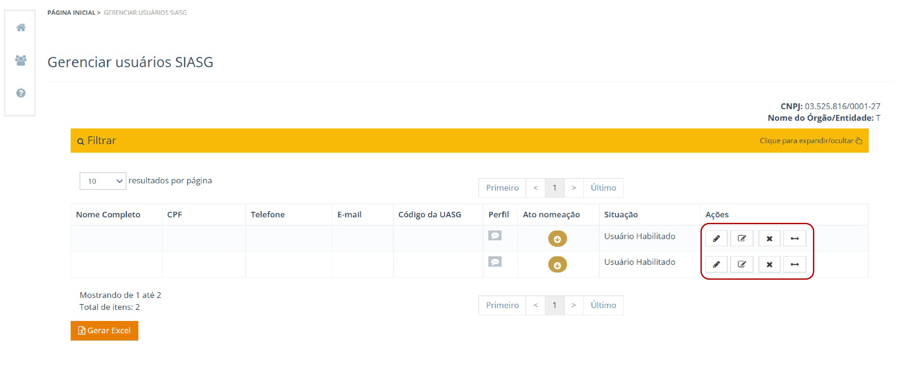
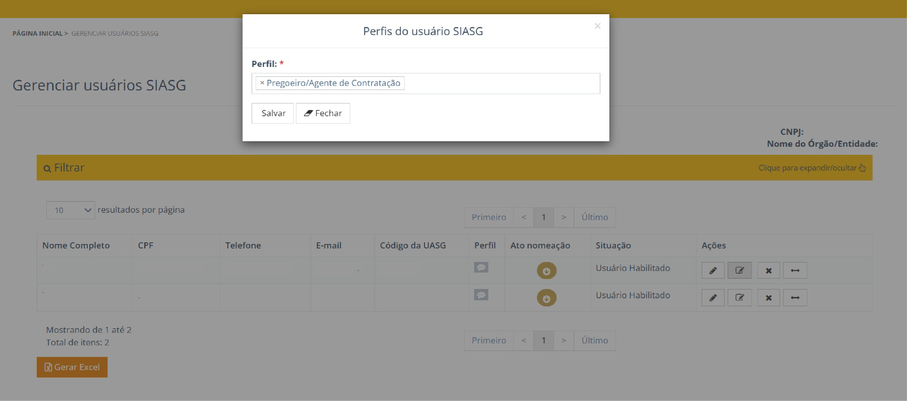
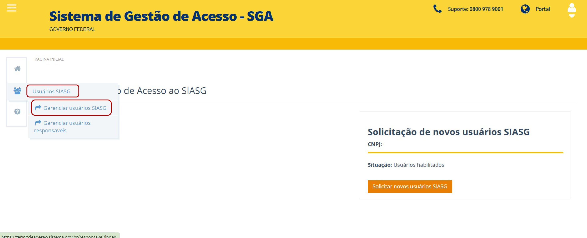
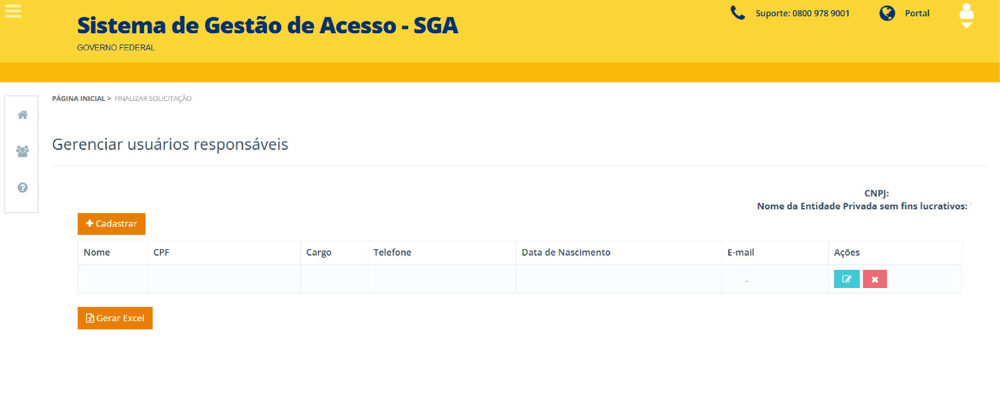
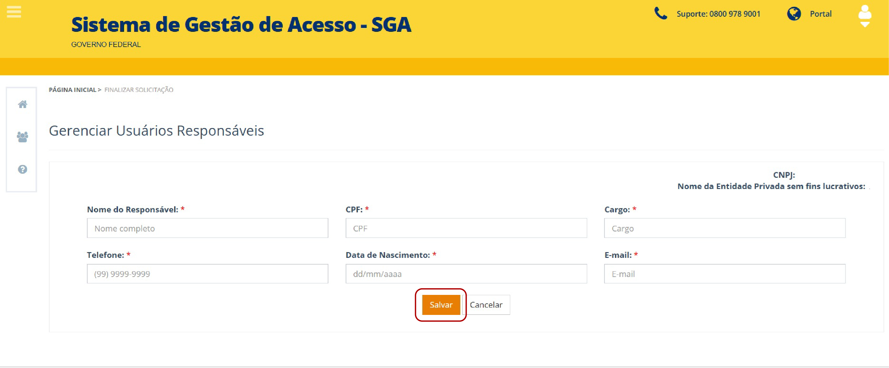
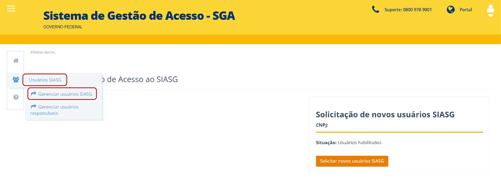
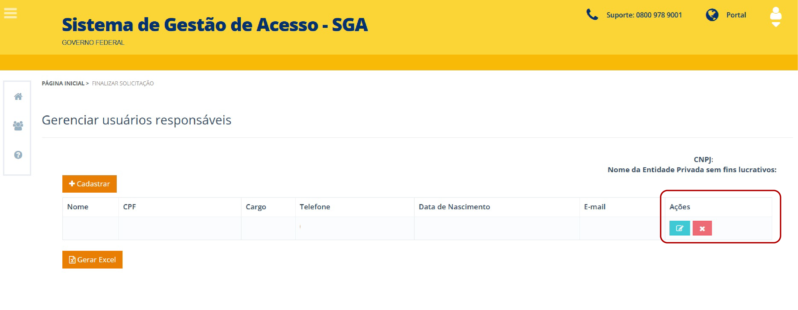
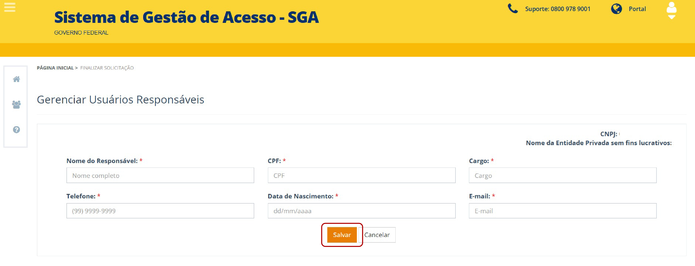
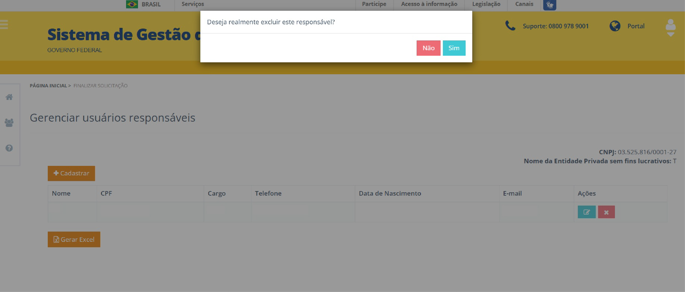

Tamanho do texto:

<button onclick="diminuirFonte()"
style="padding: 6px 12px; font-weight: bold; cursor: pointer; border: 1px solid #ccc; border-radius: 4px; background: #f8f9fa;">
A-
</button>

<button onclick="resetarFonte()"
style="padding: 6px 12px; font-weight: bold; cursor: pointer; border: 1px solid #ccc; border-radius: 4px; background: #f8f9fa;">
A
</button>

<button onclick="aumentarFonte()"
style="padding: 6px 12px; font-weight: bold; cursor: pointer; border: 1px solid #ccc; border-radius: 4px; background: #f8f9fa;">
A+
</button>

<button onclick="window.print()"
style="background-color: #0056b3; color: white; padding: 6px 16px; border: none; border-radius: 5px; font-size: 14px; cursor: pointer; box-shadow: 0 2px 4px rgba(0,0,0,0.2);">

🖨️ Imprimir ou baixar esta página

</button>

# 15. Gestão dos Usuários Cadastrados

Para acessar a funcionalidade de gerenciamento dos usuários, clique no ícone de menu (três barras), localizado no canto superior esquerdo da tela.

Em seguida, clique em **"Usuários SIASG"** e selecione a opção **"Gerenciar usuários SIASG"**.

*Figura 43 – Acesso ao menu “Usuários SIASG” e opção “Gerenciar usuários SIASG”*

*Figura 44 - Ícones de ações do gerenciamento de usuários SIASG*

## Significado das Ações

### Editar dados do usuário

#### Editar cadastro de usuário 

Para editar um usuário já cadastrado, localize o registro desejado e selecione a opção Editar. O responsável pelo cadastro poderá alterar apenas os seguintes dados: 

Nome   
Telefone     
E-mail     
Matrícula    

Após realizar as alterações necessárias, clique em **Salvar** para concluir a atualização do cadastro. 

#### Alterar perfil 

Para alterar o perfil de um usuário, localize o registro desejado e selecione a opção **Alterar Perfil**. 

O sistema exibirá a relação de perfis disponíveis, permitindo selecionar um novo perfil ou modificar o perfil atualmente atribuído ao usuário. Após a seleção, confirme a alteração para que ela seja registrada no sistema. 

*Figura 46 - Seleção e alteração de perfis no gerenciamento de usuários SIASG*  

#### Excluir usuário

Para excluir um registro, clique no ícone correspondente (a letra **"X"**)

O sistema exibirá uma mensagem de confirmação.

Clique em **"Não"** para cancelar o procedimento ou em **"Sim"** para confirmar a exclusão.

!!! warning "Atenção"

    A funcionalidade de alteração da **UASG vinculada ao CPF do usuário** está disponível exclusivamente para a Administração Pública, permitindo ao órgão realizar a gestão de múltiplas UASGs.

Para fins deste manual, **UASG (Unidade Administrativa de Serviços Gerais)** é o código utilizado no SIASG para identificar uma unidade administrativa responsável pela utilização dos sistemas e pela execução de atividades relacionadas à gestão de serviços gerais.

Para as entidades privadas sem fins lucrativos, a criação e a vinculação da UASG são realizadas no processo de adesão, conforme explicado na seção de acompanhamento da solicitação. A entidade não deverá realizar essa alteração diretamente.

Inclusão de Novos Responsáveis para a Gestão de Usuários 

## 15.1 Cadastrar novo responsável  

Se for necessário incluir novos responsáveis, o sistema disponibiliza o ícone de menu (três barras), localizado no canto superior esquerdo. 

Logo depois, clique em **“Usuários SIASG”** e selecione a opção **“Gerenciar usuários responsáveis”**.

*Figura 48 - Acesso ao menu “Usuários SIASG” para gerenciamento de responsáveis*

!!! warning "Atenção"

    O responsável pelo cadastro deve ser pessoa indicada pela entidade privada sem fins lucrativos para realizar a gestão dos usuários e dos respectivos acessos no SGA.

Clique na opção **“Cadastrar”**. Serão exibidos os campos necessários para o cadastro de um novo responsável: 

Nome   
CPF   
Cargo   
Telefone   
Data de Nascimento   
E-mail   

*Figura 49 - Tela de cadastro de usuários SIASG*

Para finalizar o procedimento, clique em **“Salvar”**. 

*Figura 50 - Ação **“Salvar”** no cadastro de responsável*

# 15.2 Alterar ou excluir responsável 

Para alterar ou excluir um responsável, clique no ícone de menu (três barras), localizado no canto superior esquerdo da tela. 

Em seguida, clique em **“Usuários SIASG”** e selecione a opção: **“Gerenciar usuários responsáveis”**.

*Figura 51 - Acesso ao gerenciamento de usuários responsáveis SIASG*

Para alterar os dados do responsável, acesse a coluna **“Ações”** e clique no ícone verde claro (caneta) para editar.

*Figura 52 - Ícone de edição na coluna de ações*

Realize as alterações necessárias e clique em **“Salvar”**. 

*Figura 53 - Ação **“Salvar”** no sistema*

Para excluir um responsável, acesse a coluna **“Ações”** e clique em **“Excluir”** (letra **"x"** branca em um quadrado vermelho). 

O sistema exibirá a mensagem de confirmação: **“Deseja realmente excluir este responsável?** **“Não e Sim”**. 

*Figura 54 - Confirmação de exclusão de responsável* 

!!! warning "Atenção"
   
    Antes de excluir o último responsável cadastrado, a entidade privada sem fins lucrativos deverá cadastrar outro responsável. Dessa     forma, evita-se que a entidade fique sem responsável para realizar a gestão dos usuários e dos respectivos acessos no sistema.    

 ---

<button onclick="window.print()"
style="background-color: #0056b3; color: white; padding: 6px 16px; border: none; border-radius: 5px; font-size: 14px; cursor: pointer; box-shadow: 0 2px 4px rgba(0,0,0,0.2);">

🖨️ Imprimir ou baixar esta página

</button>

