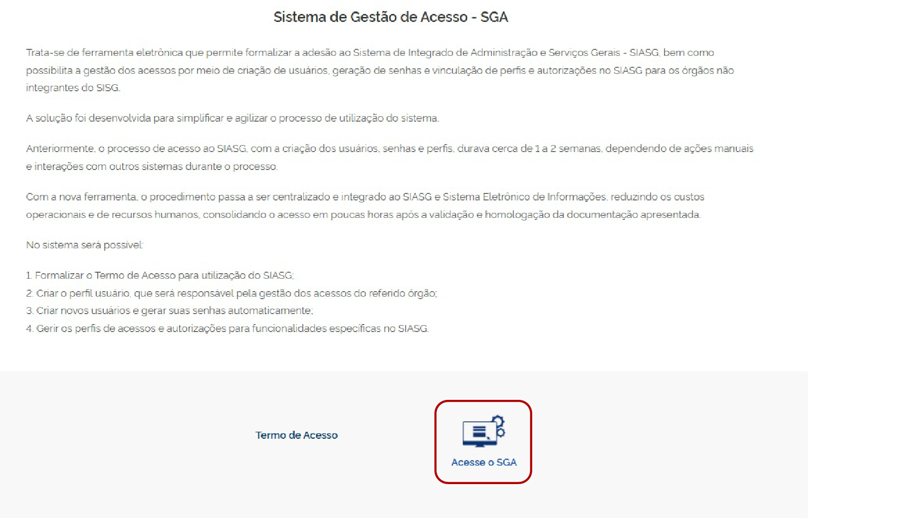
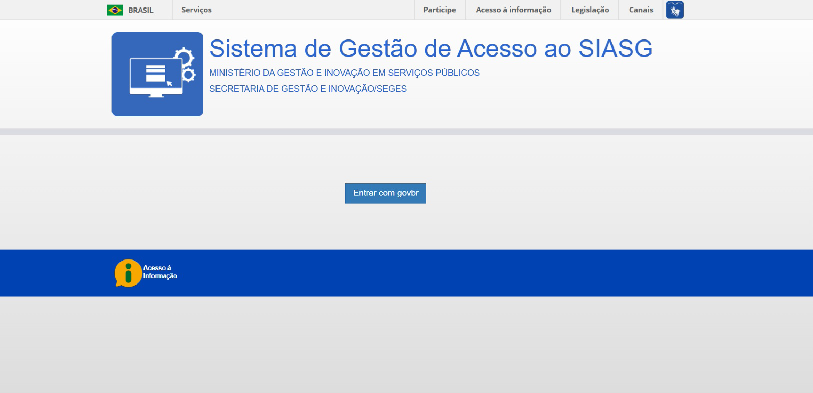

# 15. Acesso ao SGA com Gov.br

<button onclick="window.print()"
style="background-color: #0056b3; color: white; padding: 6px 16px; border: none; border-radius: 5px; font-size: 14px; cursor: pointer; box-shadow: 0 2px 4px rgba(0,0,0,0.2);">

🖨️ Imprimir ou baixar esta página

</button>

Para acessar o Sistema de Gestão de Acesso (SGA), o responsável pelo cadastro deverá utilizar sua conta Gov.br.

1. Acesse a página do Sistema de Gestão de Acesso (SGA) no Portal Compras.
2. Na parte inferior da página, clique em **"Acesse o SGA"**.

[Acessar a página do SGA no Portal Compras](https://www.gov.br/compras/pt-br/sistemas/conheca-o-compras/sistema-de-gestao-de-acesso-ao-siasg-sga/sistema-de-gestao-de-acesso-ao-siasg-sga-1/a-de-gestao-de-acesso-ao-siasg-sga)

*Figura 55 – Acesso ao Sistema de Gestão de Acesso no Portal Compras.*

---

*Figura 56 – Autenticação na plataforma Gov.br.*

!!! note "NOTA!"

    Para realizar a gestão dos usuários e acompanhar ou gerenciar as solicitações no Sistema de Gestão de Acesso (SGA), é necessário que o responsável pelo cadastro possua uma conta ativa na plataforma Gov.br.

   ---

<button onclick="window.print()"
style="background-color: #0056b3; color: white; padding: 6px 16px; border: none; border-radius: 5px; font-size: 14px; cursor: pointer; box-shadow: 0 2px 4px rgba(0,0,0,0.2);">

🖨️ Imprimir ou baixar esta página

</button>

