

Tamanho do texto:

<button onclick="diminuirFonte()"
style="padding: 6px 12px; font-weight: bold; cursor: pointer; border: 1px solid #ccc; border-radius: 4px; background: #f8f9fa;">
A-
</button>

<button onclick="resetarFonte()"
style="padding: 6px 12px; font-weight: bold; cursor: pointer; border: 1px solid #ccc; border-radius: 4px; background: #f8f9fa;">
A
</button>

<button onclick="aumentarFonte()"
style="padding: 6px 12px; font-weight: bold; cursor: pointer; border: 1px solid #ccc; border-radius: 4px; background: #f8f9fa;">
A+
</button>

<button onclick="window.print()"
style="background-color: #0056b3; color: white; padding: 6px 16px; border: none; border-radius: 5px; font-size: 14px; cursor: pointer; box-shadow: 0 2px 4px rgba(0,0,0,0.2);">
🖨️ Imprimir ou baixar esta página
</button>

PÚBLICO-ALVO: ENTIDADES PRIVADAS SEM FINS LUCRATIVOS

# Manual do Sistema de Gestão de Acesso (SGA)

# 1.Apresentação

O Sistema de Gestão de Acesso (SGA) é a ferramenta responsável pelo gerenciamento e controle dos acessos de usuários das entidades privadas sem fins lucrativos ao ecossistema Compras do Governo Federal. 

O Sistema Integrado de Administração de Serviços Gerais (SIASG) compõe o conjunto de sistemas utilizados pela Administração Pública Federal para a execução dos processos relacionados às contratações e às compras governamentais no âmbito do ecossistema Compras. 

O controle de acessos é fundamental para garantir a segurança das informações, a adequada distribuição de responsabilidades e o cumprimento das normas aplicáveis. Nesse contexto, o SGA centraliza o processo de adesão das entidades, abrangendo atividades como o cadastro institucional, a definição de perfis de acesso, a gestão de usuários e a formalização do Termo de Acesso. 

Dessa forma, o SGA contribui para garantir que o acesso às soluções que integram o ecossistema Compras ocorra de maneira segura, controlada, rastreável e em conformidade com a legislação e os normativos vigentes. 

---

# 2.Introdução

O Sistema de Gestão de Acesso (SGA) é a ferramenta responsável pelo gerenciamento e controle dos acessos de usuários das entidades privadas sem fins lucrativos ao ecossistema Compras do Governo Federal. 

O Sistema Integrado de Administração de Serviços Gerais (SIASG) compõe o conjunto de sistemas utilizados pela Administração Pública Federal para a execução dos processos relacionados às contratações e às compras governamentais no âmbito do ecossistema Compras. 

O controle de acessos é fundamental para garantir a segurança das informações, a adequada distribuição de responsabilidades e o cumprimento das normas aplicáveis. Nesse contexto, o SGA centraliza o processo de adesão das entidades, abrangendo atividades como o cadastro institucional, a definição de perfis de acesso, a gestão de usuários e a formalização do Termo de Acesso. 

Dessa forma, o SGA contribui para garantir que o acesso às soluções que integram o ecossistema Compras ocorra de maneira segura, controlada, rastreável e em conformidade com a legislação e os normativos vigentes. 

---

# 3.Lista de Siglas

| Sigla | Significado |
|--------|-------------|
| CGSIL | Coordenação-Geral de Soluções Inovadoras em Logística |
| COQUAT | Coordenação de Qualidade de Atendimento | 
| DELOG | Diretoria de Normas e Sistemas de Logística |
| MGI | Ministério da Gestão e da Inovação em Serviços Públicos |
| SEGES | Secretaria de Gestão e Inovação |
| SERPRO | Serviço Federal de Processamento de Dados |
| SGA | Sistema de Gestão de Acesso |
| SIASG | Sistema Integrado de Administração de Serviços Gerais |
| SISG | Sistema de Serviços Gerais |
| UASG | Unidade Administrativa de Serviços Gerais |
| SoD | Segregação de Funções (Segregation of Duties)|

---

# 4.Glossário

| Termo | Definição |
|--------|------------|
| Autoridade Competente da Entidade Privada | Pessoa que possui competência legal, estatutária, contratual ou administrativa para praticar ou autorizar determinado ato de gestão. |
| Dirigente Concedente | Dirigente máximo do órgão responsável pela autorização e formalização da concessão. |
| Dirigente da Entidade Privada sem Fins Lucrativos | Dirigente máximo da entidade responsável pela sua representação institucional. |
| Entidade privada sem fins lucrativos | Entidade que recebe recursos públicos provenientes de convênios ou instrumentos congêneres e que pode solicitar acesso ao SIASG por meio do SGA. |
| Órgão concedente | Órgão ou entidade pública responsável pela celebração do convênio ou instrumento congênere. |
| Perfil de acesso | Conjunto de permissões atribuídas ao usuário no sistema. |
| Responsável pelo cadastro | Pessoa indicada pela entidade para administrar usuários e acessos no SGA. |
| Substituto Legal | Pessoa designada para exercer temporariamente as atribuições do titular. |
| Termo de Acesso | Documento que formaliza as condições de acesso e utilização do sistema. |
| UASG - Unidade Administrativa de Serviços Gerais | Código utilizado para identificar unidades administrativas no SIASG. |

---

# 5.Objetivo

Este manual foi elaborado com a finalidade de orientar as entidades privadas sem fins lucrativos que recebem recursos públicos por meio de parcerias com a Administração Pública quanto aos procedimentos necessários para utilização do Sistema de Gestão de Acesso (SGA), incluindo: 

I. o preenchimento do formulário de adesão e a geração do Termo de Acesso;

II. o cadastramento e a gestão de usuários;

III. a definição e a atribuição de perfis de acesso;

IV. as orientações relacionadas à gestão dos acessos no ecossistema Compras.gov.br

---

# 6.Enquadramento Institucional e Base Legal

A utilização do Sistema de Gestão de Acesso (SGA) no ecossistema Compras.gov.br deve observar os normativos e as diretrizes aplicáveis às compras governamentais e à gestão de usuários.

O SGA é destinado, entre outros públicos, às entidades privadas sem fins lucrativos que recebem recursos públicos por meio de convênios ou instrumentos congêneres, conforme disposto na Portaria nº 355, de 9 de agosto de 2019.

Os principais normativos relacionados ao tema são:

I – O [Decreto nº 1.094, de 23 de março de 1994](https://www.planalto.gov.br/ccivil_03/decreto/antigos/d1094.htm), que dispõe sobre o Sistema de Serviços Gerais (SISG) e o Sistema Integrado de Administração de Serviços Gerais (SIASG);

II – A [Portaria nº 355, de 9 de agosto de 2019](https://www.gov.br/compras/pt-br/acesso-a-informacao/legislacao/portarias/portaria-no-355-de-09-de-agosto-de-2019), da Secretaria de Gestão do então Ministério da Economia, que institui o Sistema de Gestão de Acesso (SGA) ao SIASG e estabelece as diretrizes e condições para sua utilização, inclusive por entidades privadas sem fins lucrativos que recebem recursos públicos por meio de convênios ou instrumentos congêneres.

---

# 7. Sistema de Gestão de Acesso (SGA)

O **Sistema de Gestão de Acesso (SGA)** é a ferramenta utilizada para solicitar e gerenciar o acesso ao **Sistema Integrado de Administração de Serviços Gerais (SIASG)**. 

No caso das entidades privadas sem fins lucrativos que recebem recursos públicos por meio de convênios ou instrumentos congêneres, o SGA permite solicitar acesso ao SIASG, cadastrar usuários e definir os perfis de acesso necessários à utilização do sistema, conforme as regras vigentes. 

## 7.1 Relação entre SISG, SIASG e SGA

O **Sistema de Serviços Gerais (SISG)** reúne os órgãos e as entidades da Administração Pública Federal direta, autárquica e fundacional responsáveis pela gestão de serviços e recursos administrativos. 

O **Sistema Integrado de Administração de Serviços Gerais (SIASG)** é a plataforma utilizada para realizar atividades relacionadas à gestão de materiais, contratação de serviços e compras governamentais. 

Já o **Sistema de Gestão de Acesso (SGA)** é a ferramenta usada para solicitar e administrar o acesso ao SIASG. Ele atende, entre outros públicos, órgãos e entidades que não integram o SISG e entidades privadas sem fins lucrativos que recebem recursos públicos por meio de convênios ou instrumentos congêneres. 

Os órgãos e as entidades que fazem parte do SISG **não precisam solicitar acesso ao SIASG por meio do SGA**, pois já estão habilitados a utilizar a plataforma em razão de sua participação no sistema. 

## 7.2 Quem deve solicitar adesão

Para os fins deste manual, devem solicitar adesão por meio do SGA as **entidades privadas sem fins lucrativos que recebem recursos públicos por meio de convênios ou instrumentos congêneres e que necessitam utilizar o SIASG**, observadas as regras e os procedimentos aplicáveis. 

A partir do próximo capítulo, são apresentados os procedimentos necessários para a **solicitação de adesão e o gerenciamento dos acessos da entidade no SGA**.

---

# 8.Visão Geral do Processo de Adesão

O processo de adesão ao Sistema de Gestão de Acesso (SGA) compreende etapas que envolvem a verificação da necessidade de acesso, a solicitação institucional, o cadastramento de usuários e perfis de acesso, a formalização do Termo de Acesso, a análise e validação da solicitação, e a habilitação dos acessos, incluindo, quando aplicável, o tratamento de pendências. 

De forma geral, o processo segue as seguintes etapas: 

I – **Verificação da necessidade de acesso**: a entidade privada sem fins lucrativos deve verificar se atende aos requisitos aplicáveis ao serviço ou sistema que pretende utilizar no ecossistema Compras; 

II – **Solicitação de acesso institucional**: preenchimento dos dados da entidade, do Órgão concedente, dos dirigentes e do responsável pelo cadastro, bem como anexação dos documentos exigidos; 

III – **Cadastramento de usuários e perfis**: inclusão dos usuários que utilizarão o ecossistema Compras e indicação dos respectivos perfis de acesso, observados os requisitos aplicáveis; 

IV – **Formalização do Termo de Acesso**: geração, assinatura e encaminhamento do Termo de Acesso pelo SGA; 

V – **Análise e validação**: análise da solicitação pelo Ministério da Gestão e da Inovação em Serviços Públicos (MGI), com verificação das informações e documentos apresentados; 

VI – **Tratamento de pendências**: caso sejam identificadas inconsistências, o responsável pelo cadastro deverá realizar as correções solicitadas e encaminhar novamente a solicitação para análise; 

VII – **Habilitação dos acessos**: após a validação da solicitação, serão realizados os procedimentos necessários para a habilitação dos usuários e respectivos perfis no ecossistema Compras. 

## 8.1 Fluxo de Gestão de Acesso ao SIASG (SGA) ## 

O fluxo a seguir apresenta, de forma consolidada, as principais etapas do processo de gestão de acesso no SGA, desde o início da solicitação pela entidade privada sem fins lucrativos até a habilitação dos usuários. 

O fluxo contempla as etapas de verificação da necessidade de acesso, solicitação institucional, cadastramento de usuários e perfis, formalização do Termo de Acesso, análise e validação, tratamento de pendências, quando aplicável e habilitação dos acessos. 

 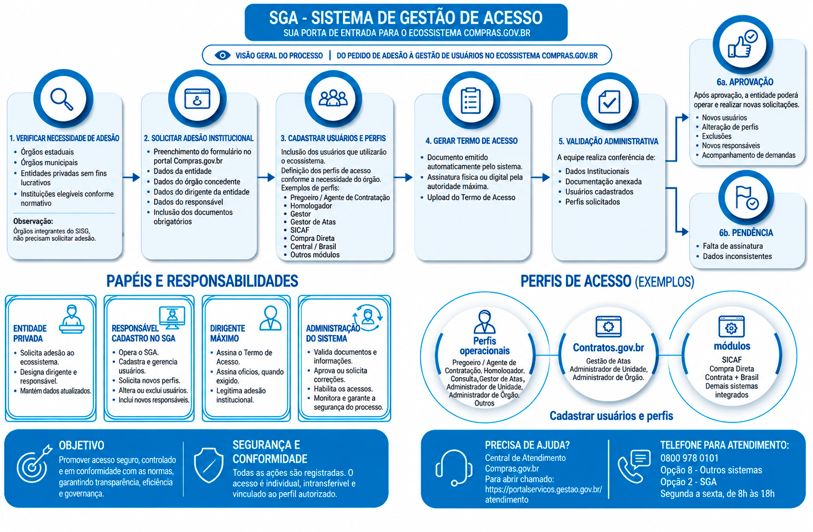
 

* Fluxo de Gestão de Acesso ao SIASG (SGA).*

---

# 9.Preenchimento do Formulário

Antes de iniciar a solicitação de adesão ao Sistema de Gestão de Acesso (SGA), a entidade privada sem fins lucrativos deve reunir as informações e os documentos necessários para o preenchimento do formulário.

A preparação prévia contribui para reduzir a ocorrência de pendências e a necessidade de complementação das informações durante a análise da solicitação.

## 9.1 Checklist para iniciar a solicitação de Adesão ao SGA

Antes de iniciar a solicitação, reúna as informações e os documentos que poderão ser necessários durante o processo.

### 9.1.1 Acesso ao sistema

- Conta Gov.br ativa para acesso ao SGA.
- Conta Gov.br da pessoa indicada pela entidade para realizar a solicitação.

### 9.1.2 Informações e documentos da entidade

- Dados cadastrais da entidade necessários ao preenchimento da solicitação.
- Dados cadastrais atualizados e compatíveis com os documentos apresentados.
- Documentos necessários à comprovação da constituição e da representação da entidade.

### 9.1.3 Documentos do dirigente da entidade

- Termo de Posse, ata de eleição, ato de nomeação ou documento equivalente.
- Documento oficial de identificação.
- Documento que comprove a condição de substituto legal, quando aplicável.

### 9.1.4 Documentos do dirigente ou representante do órgão concedente

- Documento oficial de identificação.
- Documento que comprove a condição de dirigente ou representante.
- Ato de designação ou documento equivalente.

### 9.1.5 Atos de designação e documentos comprobatórios

- Ato de designação do responsável.
- Documento de vinculação ou representação.
- Outros documentos exigidos para o perfil solicitado.

> **Atenção:** a documentação exigida pode variar conforme o perfil solicitado e a etapa do processo.

### 9.1.6 Assinaturas

- Documentos assinados quando exigido.
- Assinaturas realizadas pela autoridade competente.

### 9.1.7 Arquivos para anexação

- Documentos completos e legíveis.
- Arquivos nos formatos JPG, JPEG, PNG ou PDF.
- Arquivos com tamanho máximo de 20 MB.

### 9.1.8 Checklist final

- Conta Gov.br ativa.
- Dados cadastrais da entidade.
- Documentos do dirigente.
- Documentação de representação.
- Documentos do órgão concedente.
- Arquivos válidos e legíveis.

> **ATENÇÃO:** reúna todas as informações e documentos antes de iniciar o preenchimento.

## 9.2 Acesso ao formulário

Para iniciar o processo de adesão, o interessado deverá acessar a página do Sistema de Gestão de Acesso (SGA) no portal Compras.gov.br.

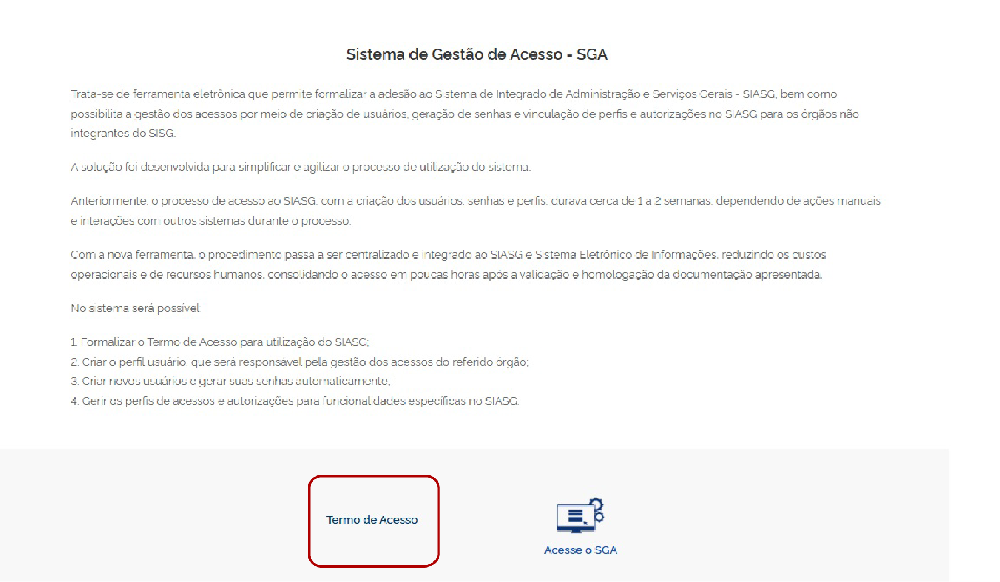

*Figura 2 – Página inicial do Sistema de Gestão de Acesso (SGA).*

O formulário eletrônico deverá ser preenchido com todas as informações solicitadas.

Ao selecionar a opção **Entidades Privadas sem Fins Lucrativos**, serão disponibilizadas as seguintes seções:

I. Dados da entidade privada sem fins lucrativos  
II. Dados do órgão concedente  
III. Dados do dirigente concedente  
IV. Dados do dirigente da entidade privada sem fins lucrativos  
V. Dados do responsável  
VI. De acordo

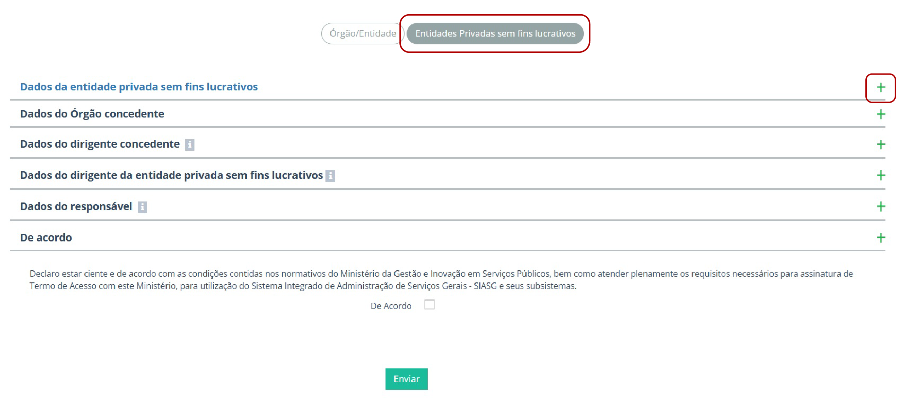

*Figura 3 – Seções do formulário de adesão.*

---

# 10.Perfis de Acesso

Os perfis de acesso no ecossistema Compras correspondem aos diferentes níveis de permissão atribuídos aos usuários das entidades privadas sem fins lucrativos, de acordo com suas responsabilidades e atribuições nos sistemas e serviços que utilizam.

A definição e a concessão dos perfis de acesso devem observar as responsabilidades atribuídas a cada usuário e os requisitos aplicáveis a cada sistema ou serviço, contribuindo para a segregação de funções, a segurança das operações, a integridade das informações e a conformidade com os normativos vigentes.

## 10.1 Perfis disponíveis

Os perfis disponíveis podem variar de acordo com o **sistema ou serviço que a entidade necessita utilizar** e com as funcionalidades disponibilizadas no SGA.

### Pregoeiro (Agente de Contratação)

Agente responsável pela condução dos procedimentos licitatórios eletrônicos, conforme as atribuições e os limites estabelecidos na regulamentação aplicável.

### Presidente da Comissão de Contratação

Responsável pela condução das atividades atribuídas à comissão de contratação, inclusive pelo recebimento, exame e julgamento dos documentos relativos às licitações e aos procedimentos auxiliares, conforme aplicável.

### Homologador

Autoridade competente responsável pelos atos de adjudicação e homologação do processo de contratação.

### Consulta

Permite o acesso para visualização das informações disponíveis, sem permissão para realizar alterações ou executar operações restritas a outros perfis.

### Gestão de Atas (Contratos.gov.br)

Permite o acesso às funcionalidades relacionadas à gestão de atas de registro de preços, conforme as permissões atribuídas ao perfil.

### Administrador de Unidade (Contratos.gov.br)

Responsável pela gestão de usuários no âmbito de uma unidade.

### Administrador do Órgão (Contratos.gov.br)

Responsável pela gestão de usuários e respectivos acessos no âmbito do órgão, conforme as permissões atribuídas ao perfil.

### Dispensa Eletrônica (Compra Direta)

Permite a atuação nas funcionalidades relacionadas aos processos de contratação direta por dispensa eletrônica, conforme as permissões atribuídas ao perfil.

### SICAF

Permite acesso às funcionalidades de cadastro e consulta de fornecedores, conforme as permissões atribuídas ao perfil.

### Autorizador do Órgão Comprador (Contrata+Brasil)

Autoridade competente responsável por autorizar a publicação da contratação e confirmar a escolha do fornecedor, conforme as funcionalidades e regras aplicáveis ao sistema.

### Demandante do Órgão Comprador (Contrata+Brasil)

Agente responsável pelo preenchimento do formulário de cadastro da oportunidade e pela seleção do fornecedor vencedor, conforme as funcionalidades e regras aplicáveis ao sistema.

---

# 11.Cadastramento de Usuários e Perfis

Para realizar o cadastramento de um usuário, preencha os campos solicitados e selecione o perfil de acesso correspondente às atividades que serão exercidas pelo usuário.

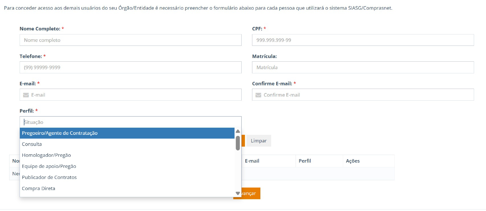

*Figura 10 – Cadastramento de usuários e seleção de perfis.*

!!! warning "IMPORTANTE"

    Para o perfil de **Pregoeiro (Agente de Contratação)**, é obrigatório o anexo do **ato de designação específico** para o exercício da função.

    Para o perfil de **Homologador**, deve ser anexado o **ato de designação ou o termo de posse** que comprove a condição de autoridade competente.

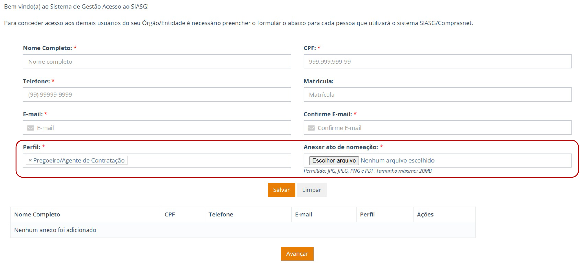

*Figura 11 – Seleção do perfil de acesso do usuário.*

!!! warning "ATENÇÃO"

    Após salvar os dados do usuário que utilizará o ecossistema Compras, o SGA permanecerá na mesma tela, permitindo a inclusão de novos usuários, se necessário.

    Para prosseguir para a próxima etapa, é obrigatório o cadastro de **pelo menos um usuário**.

    Caso seja necessário editar, excluir ou visualizar os dados inseridos, o sistema disponibiliza, no campo **"Ações"**, as seguintes funcionalidades:

    - Editar os dados inseridos no sistema;
    - Excluir os dados inseridos no sistema;
    - Visualizar os anexos inseridos no sistema.

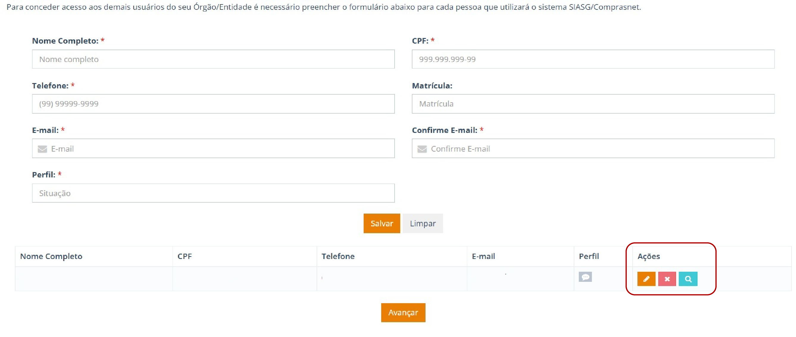

*Figura 12 – Funcionalidades de edição, exclusão e visualização de usuários cadastrados.*

Após concluir o cadastramento dos usuários, clique em **"Avançar"** para acessar a próxima tela.

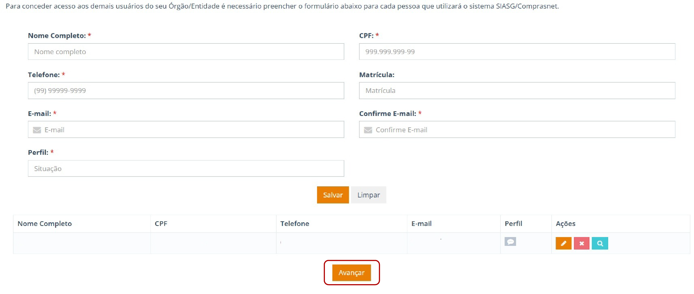

*Figura 13 – Avançar para a próxima etapa após o cadastramento dos usuários.*

---

# 12.Geração e Encaminhamento do Termo de Acesso

Após concluir o cadastramento dos usuários e perfis, o responsável pelo cadastro deverá gerar o Termo de Acesso no SGA.

Para isso:

- Clique em **"Gerar Termo de Acesso"**.
- O sistema realizará o download do arquivo.

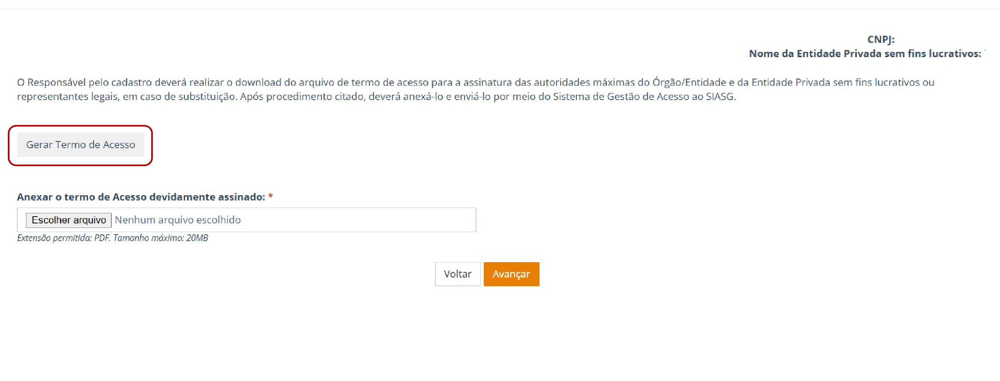

*Figura 14 – Geração do Termo de Acesso.*

Após a geração, o **Termo de Acesso deverá ser assinado pela autoridade máxima da entidade privada sem fins lucrativos ou por seu substituto legal**.

As assinaturas poderão ser realizadas **de forma física ou digital**.

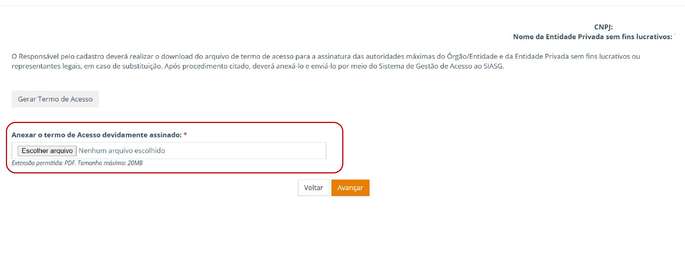

*Figura 15 – Anexação do Termo de Acesso.*

Após a assinatura, o responsável deverá **anexar o Termo de Acesso assinado no SGA** e prosseguir com o encaminhamento da solicitação para análise.

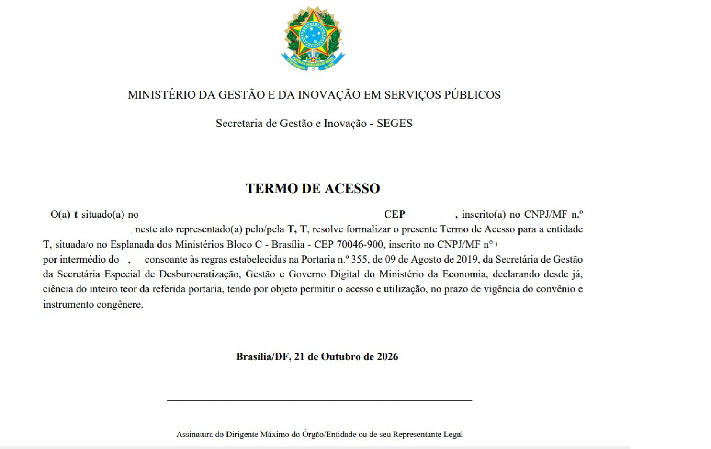

*Figura 16 – Modelo do Termo de Acesso gerado pelo Sistema de Gestão de Acesso.*

Para prosseguir com a solicitação, clique em **"Avançar"**.

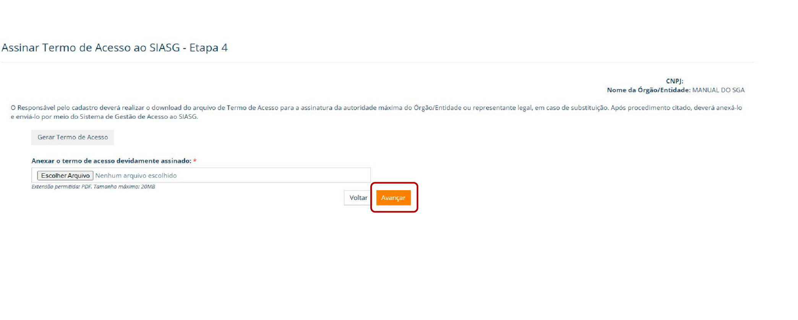

*Figura 17 – Avançar após a anexação do Termo de Acesso.*

Após o encaminhamento, a solicitação será submetida ao **fluxo de análise e validação previsto no SGA**.

O responsável poderá acompanhar o andamento da solicitação diretamente pelo sistema.

Para isso, clique na opção **"Ir para o sistema"**.

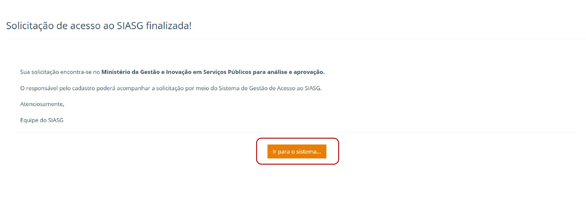

*Figura 18 – Solicitação encaminhada para análise e aprovação.*

---

# 13.Acompanhamento da Solicitação

Após o encaminhamento do Termo de Acesso, o responsável poderá acompanhar, no SGA, o andamento da solicitação e verificar eventuais pendências identificadas durante a análise.

## 13.1 Situações da solicitação

A tabela a seguir apresenta as principais situações que podem ser exibidas no sistema e a ação esperada do responsável.

| Situação do Sistema | Ação do Usuário |
|--------------------|-----------------|
| Aguardando validação | Aguardar a análise da solicitação pelo MGI (prazo de até 3 dias úteis). |
| Revalidar termo e usuário | Verificar as pendências relacionadas ao Termo de Acesso ou ao cadastro dos usuários. |
| Termo e usuário SIASG corrigidos | Após realizar as correções, encaminhar a solicitação para nova análise pelo MGI. |
| Termo e usuário SIASG válidos | Aguardar os procedimentos necessários para o cadastro da entidade e a criação da UASG (Unidade Administrativa de Serviços Gerais). |
| Aguardando habilitação do(s) usuário(s) SIASG | Aguardar a conclusão da habilitação dos usuários. |
| Processo de solicitação de acesso finalizado | O processo foi concluído e o sistema estará disponível para utilização, conforme os acessos habilitados. |

*Tabela 1 – Situações da solicitação e ações do responsável.*

!!! warning "IMPORTANTE"

    Os prazos e as situações apresentadas no SGA devem ser considerados conforme o andamento efetivo da solicitação no sistema.

---

## 13.2 Tratamento de pendências

Quando a solicitação for devolvida para correção, o responsável deverá consultar a pendência apresentada no SGA e realizar os ajustes necessários antes de encaminhar novamente a solicitação para análise.

### 13.2.1 Termo de Acesso sem assinatura

Caso o Termo de Acesso seja devolvido por ausência de assinatura, o sistema direcionará o responsável para a tela correspondente.

O responsável deverá:

1. realizar o download do Termo de Acesso;
2. providenciar a assinatura da autoridade competente ou de seu substituto legal;
3. anexar o Termo de Acesso devidamente assinado no SGA;
4. prosseguir com o encaminhamento da solicitação.

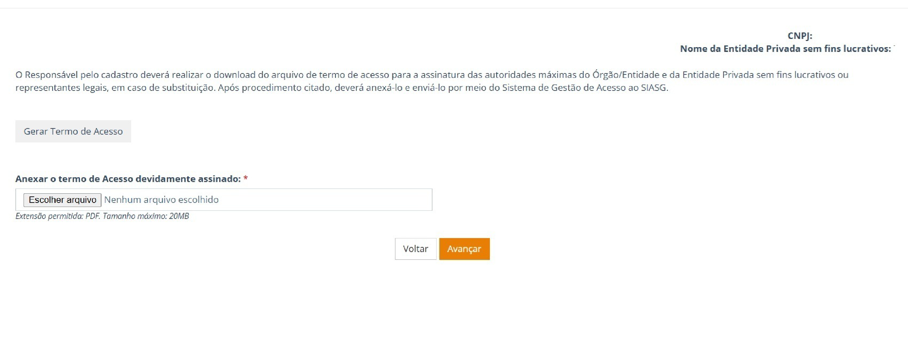

*Figura 19 – Tratamento de pendência relacionada ao Termo de Acesso.*

---

### 13.2.2 Inconsistências no cadastro de usuários

Caso a solicitação seja devolvida em razão de pendências no cadastro de usuários, o sistema direcionará o responsável para a tela correspondente.

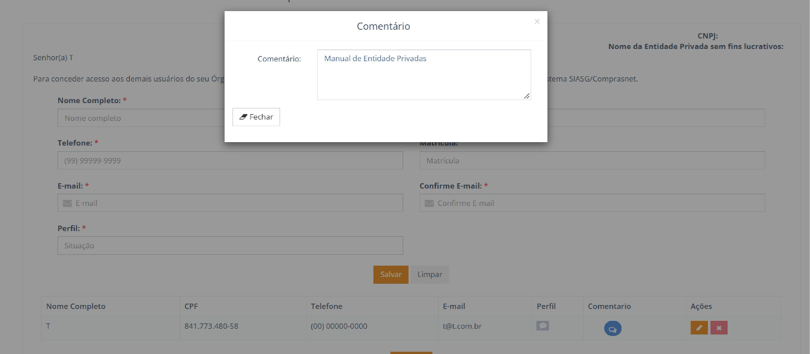

*Figura 20 – Inconsistências identificadas no cadastro de usuários.*

Na opção **"Comentário"**, o sistema apresentará uma mensagem encaminhada pelo Ministério, contendo a descrição específica de cada pendência identificada.

Para realizar a correção, o respons

---

# 14.Solicitação de Novos Acessos

Após o encaminhamento da solicitação, o responsável deverá acompanhar seu andamento no SGA e observar as mensagens e situações apresentadas pelo sistema, conforme descrito na **seção 12.1 – Situações da solicitação**.

Quando o Termo de Acesso e o cadastro dos usuários forem validados e os procedimentos necessários para a habilitação dos acessos forem concluídos, a solicitação será considerada finalizada.

Após a conclusão, o responsável poderá realizar o gerenciamento dos usuários cadastrados e, quando necessário, solicitar novos acessos ao ecossistema Compras.

Após a conclusão da solicitação inicial, o responsável pelo cadastro poderá solicitar novos acessos para usuários da entidade.

Para iniciar uma nova solicitação, deverá:

1. Acessar a página principal e clicar em **"Solicitar novos usuários"**.

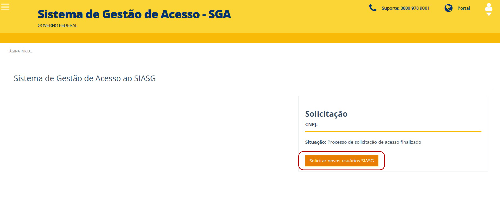

*Figura 27 – Solicitação de novos usuários no SIASG.*

---

Para cadastrar um usuário no ecossistema Compras, preencha todos os campos solicitados e selecione o perfil desejado.

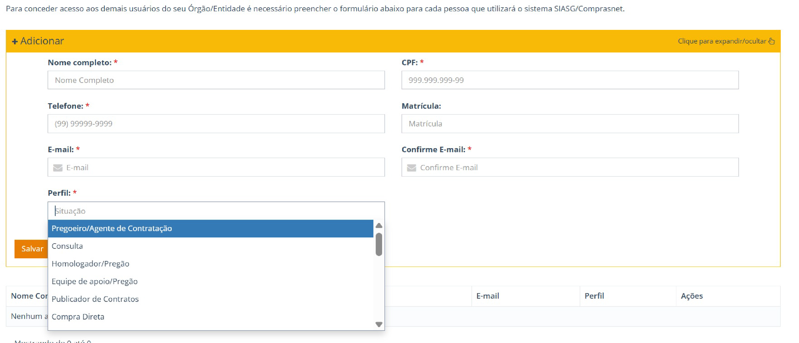

*Figura 28 – Cadastro de novo usuário e seleção de perfil de acesso.*

---

Para os perfis de Pregoeiro ou Agente de Contratação e Homologador, deverá ser anexado o respectivo ato de designação ou documento comprobatório exigido pelo sistema, conforme o perfil selecionado.

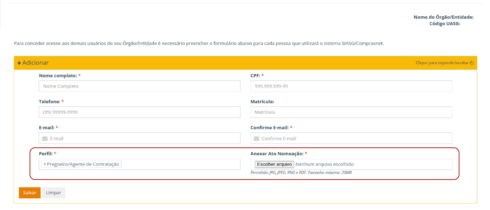

*Figura 29 – Anexação de documento comprobatório para o perfil selecionado.*

---

Após o salvamento dos dados, o sistema permanecerá na mesma tela, permitindo a inclusão de novos usuários, se necessário.

No campo **"Ações"**, o responsável poderá **editar, excluir ou visualizar os registros e os documentos anexados**, conforme as funcionalidades disponibilizadas pelo sistema.

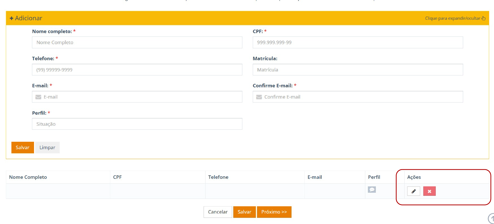

*Figura 30 – Funcionalidades de gerenciamento dos usuários cadastrados.*

---

Após a formação da lista de usuários, clique em **"Avançar"** para prosseguir à próxima etapa.

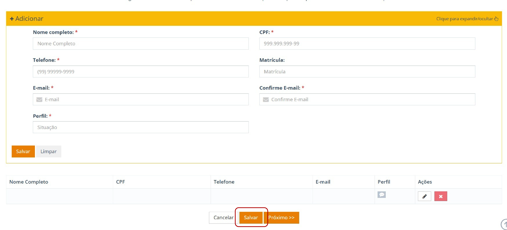

*Figura 31 – Avançar para a próxima etapa após a inclusão dos usuários.*

---

## 14.1 Geração e Encaminhamento de Ofício

O responsável pelo cadastro deverá clicar em **"Ofício dos Novos Usuários SIASG"**.

- O sistema realizará o download do arquivo.

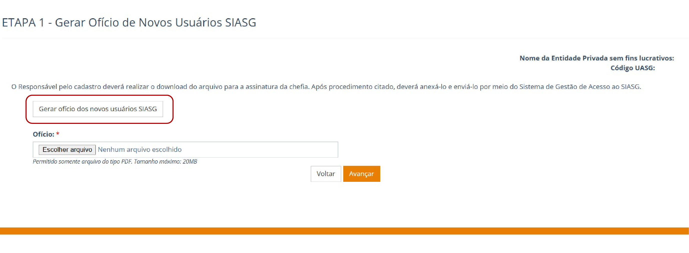

*Figura 32 – Geração de Ofício de Novos Usuários SIASG.*

---

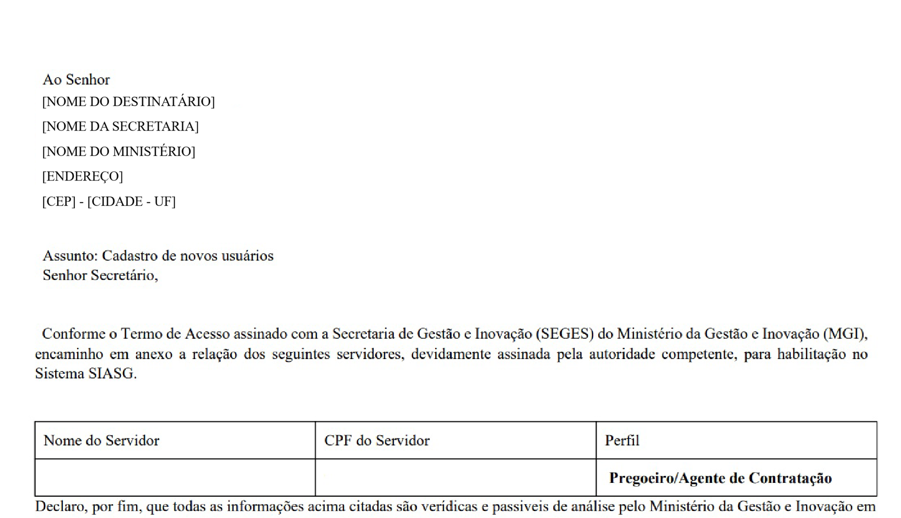

*Figura 33 – Anexação do Ofício de Novos Usuários SIASG.*

Em seguida, o ofício deverá ser assinado pela autoridade competente da entidade privada sem fins lucrativos, anexado ao sistema SGA e encaminhado para análise pelo Ministério.

---

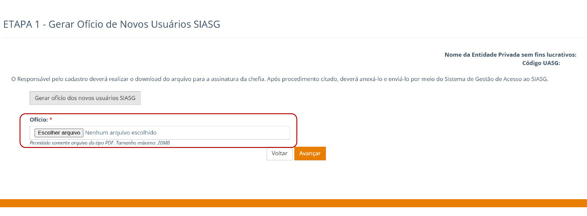

*Figura 34 – Avançar após a anexação do ofício assinado.*

Para concluir a solicitação de acesso, o responsável deverá clicar em **"Avançar"**.

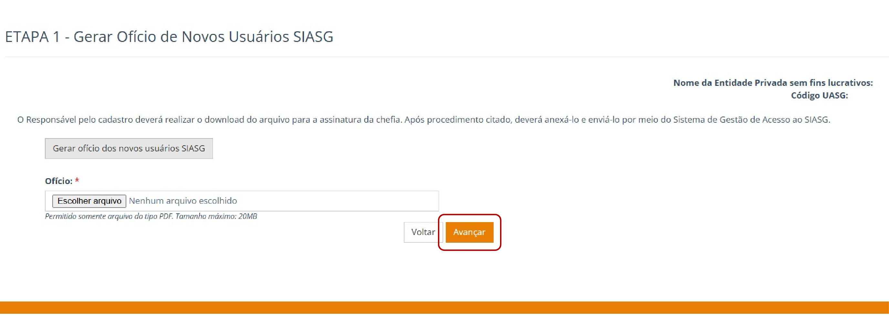

*Figura 35 – Ofício anexado e pronto para prosseguimento da solicitação.*

---

### Situações do sistema e ações do usuário

| Situação | Ação do Usuário |
|-----------|----------------|
| Ofício anexado | Aguardar a análise do Ministério da Gestão e da Inovação em Serviços Públicos (MGI). Prazo de até 3 dias úteis. |
| Solicitação de novos usuários com pendências | Consultar os comentários e verificar

---

# 15.Gestão dos Usuários

Para acessar a funcionalidade de gerenciamento dos usuários, clique no ícone de menu (três barras), localizado no canto superior esquerdo da tela.

Em seguida, clique em **"Usuários SIASG"** e selecione a opção **"Gerenciar usuários SIASG"**.

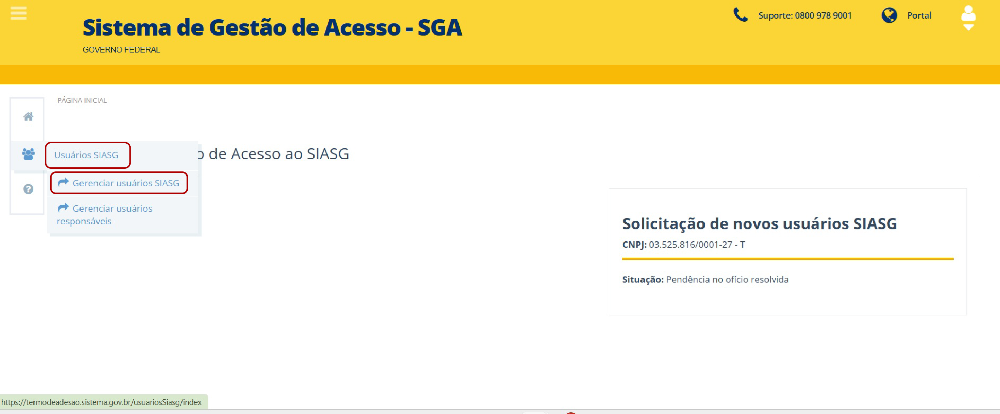

*Figura 43 – Acesso ao gerenciamento de usuários SIASG.*

---

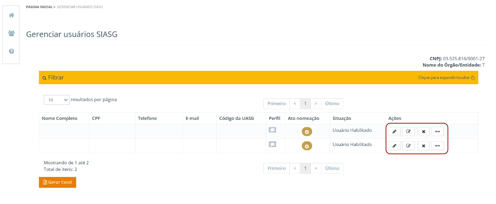

*Figura 44 – Tela de gerenciamento de usuários SIASG.*

## Significado das Ações

### Editar dados do usuário

Para editar um registro, clique no ícone correspondente.

O responsável pelo cadastro poderá alterar apenas o **nome, o telefone, o e-mail e a matrícula**.

Logo após realizar as alterações, clique em **"Salvar"**.

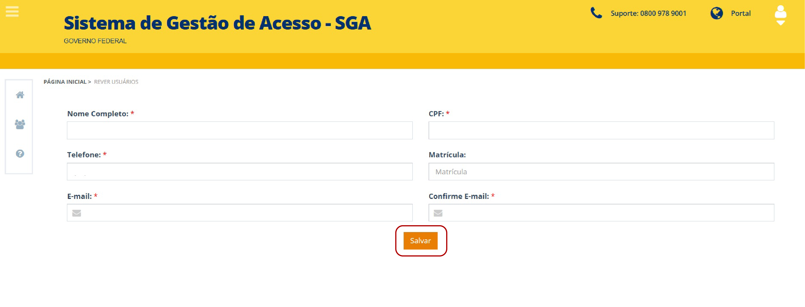

*Figura 45 – Edição dos dados do usuário.*

---

### Alterar perfil

Para alterar um registro, clique no ícone correspondente.

O sistema permitirá **selecionar ou modificar o perfil existente**, a partir da lista de perfis disponíveis.

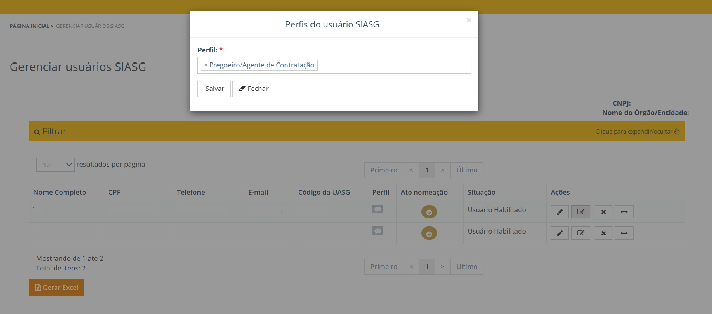

*Figura 46 – Alteração do perfil de acesso do usuário.*

---

### Excluir usuário

Para excluir um registro, clique no ícone correspondente.

O sistema exibirá uma mensagem de confirmação.

Clique em **"Não"** para cancelar o procedimento ou em **"Sim"** para confirmar a exclusão.

*Figura 47 – Confirmação da exclusão de usuário.*

!!! warning "ATENÇÃO"

    A funcionalidade de alteração da **UASG vinculada ao CPF do usuário** está disponível exclusivamente para a **Administração Pública**, permitindo ao órgão realizar a gestão de múltiplas UASGs.

    Para fins deste manual, **UASG (Unidade Administrativa de Serviços Gerais)** é o código utilizado no SIASG para identificar uma unidade administrativa responsável pela utilização dos sistemas e pela execução de atividades relacionadas à gestão de serviços gerais.

    Para as entidades privadas sem fins lucrativos, a criação e a vinculação da UASG são realizadas no processo de adesão, conforme explicado na seção de acompanhamento da solicitação.

    A entidade não deverá realizar essa alteração diretamente.

---

## 

---

# 16.Acesso ao SGA com Gov.br

Para acessar o Sistema de Gestão de Acesso (SGA), o responsável pelo cadastro deverá utilizar sua conta Gov.br.

1. Acesse a página do Sistema de Gestão de Acesso (SGA) no Portal Compras.
2. Na parte inferior da página, clique em **"Acesse o SGA"**.

[Acessar a página do SGA no Portal Compras](https://www.gov.br/compras/pt-br/sistemas/conheca-o-compras/sistema-de-gestao-de-acesso-ao-siasg-sga/sistema-de-gestao-de-acesso-ao-siasg-sga-1/a-de-gestao-de-acesso-ao-siasg-sga)

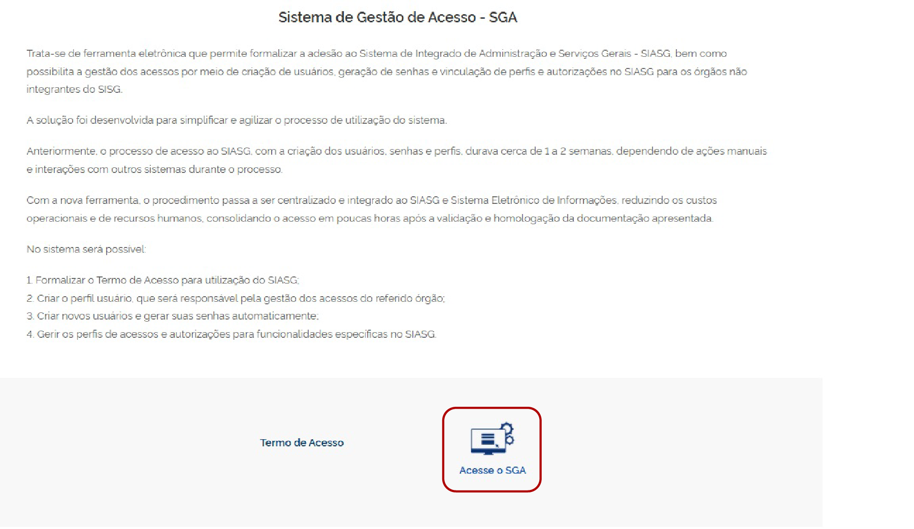

*Figura 55 – Acesso ao Sistema de Gestão de Acesso no Portal Compras.*

---

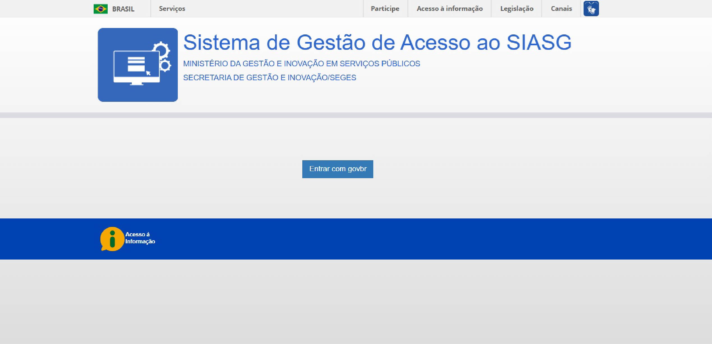

*Figura 56 – Autenticação na plataforma Gov.br.*

!!! info "OBSERVAÇÃO"

    Para realizar a gestão dos usuários e acompanhar ou gerenciar as solicitações no Sistema de Gestão de Acesso (SGA), é necessário que o responsável pelo cadastro possua uma conta ativa na plataforma Gov.br.

---

# 17.Disposições Finais

O Sistema de Gestão de Acesso (SGA) constitui instrumento estratégico para o fortalecimento da governança, da segurança e da padronização do acesso ao ecossistema Compras do Governo Federal.

Este manual consolida orientações técnicas e procedimentais destinadas a apoiar as entidades privadas sem fins lucrativos na correta utilização do sistema, contribuindo para o aprimoramento da eficiência administrativa, da transparência e da conformidade com os normativos vigentes.

O presente documento possui caráter orientativo e procedimental. Eventuais atualizações dos sistemas ou alterações normativas poderão implicar revisões futuras do conteúdo aqui apresentado.

---

# 18.Perguntas Frequentes (FAQ)

## 1. Entidades privadas sem fins lucrativos podem utilizar o SGA?

Sim. As entidades privadas sem fins lucrativos que atendam aos requisitos estabelecidos na regulamentação vigente poderão solicitar acesso ao ecossistema Compras.gov.br por meio do Sistema de Gestão de Acesso (SGA).

---

## 2. Quem pode ser cadastrado como responsável pelo SGA?

Pode ser cadastrada como responsável pelo SGA a pessoa indicada pela entidade privada sem fins lucrativos para realizar a gestão do Termo de Acesso, dos usuários e dos respectivos acessos no sistema.

---

## 3. É possível cadastrar mais de um responsável?

Sim. O sistema permite o cadastramento de mais de um responsável. Antes de excluir o último responsável cadastrado, a entidade deverá cadastrar outro responsável, de modo a evitar que fique sem responsável para realizar a gestão dos usuários e dos respectivos acessos.

---

## 4. Quem deve assinar o Termo de Acesso?

O Termo de Acesso deverá ser assinado pelo dirigente máximo da entidade privada sem fins lucrativos ou por seu substituto legal, conforme os requisitos aplicáveis ao procedimento.

---

## 5. A conta Gov.br é obrigatória?

Sim. O responsável pelo SGA deve possuir uma conta ativa na plataforma Gov.br para acessar e realizar a gestão das solicitações no Sistema de Gestão de Acesso.

---

## 6. A ausência de documentos impede o prosseguimento da solicitação?

Sim. O preenchimento correto dos dados e a anexação dos documentos exigidos são necessários para o prosseguimento da solicitação.

---

## 7. O que acontece se o Termo de Acesso for devolvido com pendências?

O sistema apresentará a situação correspondente à pendência e permitirá ao responsável consultar os comentários, corrigir as informações ou documentos necessários e encaminhar a solicitação para nova análise.

---

## 8. O sistema envia notificações por e-mail?

Sim. O responsável poderá receber notificações relacionadas ao andamento da solicitação e às eventuais pendências no endereço de e-mail informado no cadastro.

---

## 9. O que fazer em caso de desligamento de um usuário?

A entidade deverá providenciar a exclusão ou a alteração do acesso do usuário desligado, conforme as funcionalidades disponíveis no SGA, de modo a manter atualizados os acessos institucionais.

---

## 10. É permitido compartilhar login e senha?

Não. As credenciais de acesso são pessoais e intransferíveis e não devem ser compartilhadas com terceiros.

---

## 11. A solicitação ou alteração de um perfil significa que o acesso está automaticamente habilitado?

Não. A solicitação ou alteração de perfil está sujeita aos procedimentos de análise, validação e habilitação previstos no fluxo do SGA.

---

# Ficha Institucional

## Ministério da Gestão e da Inovação em Serviços Públicos (MGI)

**Ministra**  
Esther Dweck

---

## Secretaria de Gestão e Inovação (SEGES)

**Secretário**  
Roberto Seara Machado Pojo Rego

**Secretária-Adjunta**  
Regina Lemos de Andrade

---

## Diretoria de Normas e Sistemas de Logística (DELOG)

**Diretor**  
Everton Batista dos Santos

---

## Coordenação-Geral de Soluções Inovadoras em Logística (CGSIL)

**Coordenador-Geral**  
Alexandre Augusto Villain da Silva

---

**Equipe Técnica**

**Coordenação de Qualidade de Atendimento (COQUAT)**

**Coordenação Técnica** 
Camilla Pais Faccin Bottecchia

**Especialistas Técnicos**

- Alexandre Almeida de Mota Matos
- Emy Karla Macedo Pereira
- Fernanda Correia de Castro
- Jurandir Gomes de Oliveira
- Maria de Fátima Gomes Moreira
- Vera Márcia Lopes Vieira de Souza

**Coordenação de Comunicação e Marketing (Comkt/Delog/Seges/MGI)**

**Coordenação**  
Marina Milena Silva

**Equipe**  

- André Siqueira de Azevedo  
- Carmen Bárbara da Silva Pereira  
- Êmili Adami Rossetti  
- Regiane Feltrin de Melo
  

---

# Ficha Técnica

| Item | Informação |
|--------|-------------|
| Título do Documento | Manual do Sistema de Gestão de Acesso (SGA) – Entidades Privadas sem Fins Lucrativos |
| Versão | 1.0 |
| Data da Publicação | 11/2026 |
| Órgão | Ministério da Gestão e da Inovação em Serviços Públicos (MGI) |
| Unidade Responsável | Secretaria de Gestão e Inovação (SEGES) |
| Aprovação | Everton Batista dos Santos – Diretor de Normas e Sistemas de Logística |
| Coordenação-Geral | Alexandre Augusto Villain da Silva – Coordenador-Geral |
| Equipe Técnica Especializada | Alexandre Almeida de Mota Matos Emy Karla Macedo Pereira Fernanda Correia de Castro Jurandir Gomes de Oliveira Maria de Fátima Gomes Moreira Vera Márcia Lopes Vieira de Souza |
| Coordenação Técnica | Camilla Pais Faccin Bottecchia – Coordenadora |
| Coordenação de Comunicação e Marketing (COMKT) | Marina Milena Silva – Coordenadora |
| Equipe de Comunicação e Marketing | André Siqueira de Azevedo Carmen Bárbara da Silva Pereira Êmili Adami Rossetti Regiane Feltrin de Melo
| Histórico de Revisões | V 1.0 – 11/2026 – Criação do Manual |
| Contato | seges@gestao.gov.br (61) 2020-6025 |

---

# Histórico de Versões

| Versão | Data | Descrição da Alteração | Unidade Responsável |
|---------|---------|---------|---------|
| 1.0 | 01/10/2026 | Elaboração do Manual | COQUAT / DELOG / SEGES / MGI |

---

  <button onclick="window.print()" style="background-color: #0056b3; color: white; padding: 10px 20px; border: none; border-radius: 5px; font-size: 16px; cursor: pointer; box-shadow: 0 2px 4px rgba(0,0,0,0.2);">
    🖨️ Imprimir esta página
  </button>

