

Tamanho do texto:

<button onclick="diminuirFonte()"
style="padding: 6px 12px; font-weight: bold; cursor: pointer; border: 1px solid #ccc; border-radius: 4px; background: #f8f9fa;">
A-
</button>

<button onclick="resetarFonte()"
style="padding: 6px 12px; font-weight: bold; cursor: pointer; border: 1px solid #ccc; border-radius: 4px; background: #f8f9fa;">
A
</button>

<button onclick="aumentarFonte()"
style="padding: 6px 12px; font-weight: bold; cursor: pointer; border: 1px solid #ccc; border-radius: 4px; background: #f8f9fa;">
A+
</button>

<button onclick="window.print()"
style="background-color: #0056b3; color: white; padding: 6px 16px; border: none; border-radius: 5px; font-size: 14px; cursor: pointer; box-shadow: 0 2px 4px rgba(0,0,0,0.2);">
🖨️ Imprimir ou baixar esta página
</button>

PÚBLICO-ALVO: ENTIDADES PRIVADAS SEM FINS LUCRATIVOS

# Manual do Sistema de Gestão de Acesso (SGA)

# 1.Apresentação
Este manual tem como objetivo orientar as entidades privadas sem fins lucrativos que recebem recursos públicos por meio de parcerias com a Administração Pública na utilização do Sistema de Gestão de Acesso (SGA) e no acesso ao ecossistema Compras do Governo Federal. 

O documento apresenta, de forma prática e objetiva, as orientações necessárias para solicitar a adesão ao sistema, realizar cadastros, gerenciar usuários, definir perfis de acesso, formalizar o Termo de Acesso e acompanhar as solicitações no SGA. 

As orientações foram organizadas de maneira sequencial para apoiar o usuário em todas as etapas do processo, desde a solicitação de adesão até a administração dos acessos da entidade no ecossistema Compras. 

---

# 2.Introdução   
O Sistema de Gestão de Acesso (SGA) é a ferramenta responsável pelo gerenciamento e controle dos acessos de usuários das entidades privadas sem fins lucrativos ao ecossistema Compras do Governo Federal. 

O Sistema Integrado de Administração de Serviços Gerais (SIASG) compõe o conjunto de sistemas utilizados pela Administração Pública Federal para a execução dos processos relacionados às contratações e às compras governamentais no âmbito do ecossistema Compras. 

O controle de acessos é fundamental para garantir a segurança das informações, a adequada distribuição de responsabilidades e o cumprimento das normas aplicáveis. Nesse contexto, o SGA centraliza o processo de adesão das entidades, abrangendo atividades como o cadastro institucional, a definição de perfis de acesso, a gestão de usuários e a formalização do Termo de Acesso. 

Dessa forma, o SGA contribui para garantir que o acesso às soluções que integram o ecossistema Compras ocorra de maneira segura, controlada, rastreável e em conformidade com a legislação e os normativos vigentes. 

---

# 3.Lista de Siglas

| Sigla | Significado |
|--------|-------------|
| CGSIL | Coordenação-Geral de Soluções Inovadoras em Logística |
| COQUAT | Coordenação de Qualidade de Atendimento | 
| DELOG | Diretoria de Normas e Sistemas de Logística |
| MGI | Ministério da Gestão e da Inovação em Serviços Públicos |
| SEGES | Secretaria de Gestão e Inovação |
| SERPRO | Serviço Federal de Processamento de Dados |
| SGA | Sistema de Gestão de Acesso |
| SIASG | Sistema Integrado de Administração de Serviços Gerais |
| SISG | Sistema de Serviços Gerais |
| UASG | Unidade Administrativa de Serviços Gerais |
| SoD | Segregação de Funções (Segregation of Duties)|

---

# 4.Glossário

| Termo | Definição |
|--------|------------|
| Autoridade Competente da Entidade Privada | Pessoa que possui competência legal, estatutária, contratual ou administrativa para praticar ou autorizar determinado ato de gestão. |
| Dirigente Concedente | Dirigente máximo do órgão responsável pela autorização e formalização da concessão. |
| Dirigente da Entidade Privada sem Fins Lucrativos | Dirigente máximo da entidade responsável pela sua representação institucional. |
| Entidade privada sem fins lucrativos | Entidade que recebe recursos públicos provenientes de convênios ou instrumentos congêneres e que pode solicitar acesso ao SIASG por meio do SGA. |
| Órgão concedente | Órgão ou entidade pública responsável pela celebração do convênio ou instrumento congênere. |
| Perfil de acesso | Conjunto de permissões atribuídas ao usuário no sistema. |
| Responsável pelo cadastro | Pessoa indicada pela entidade para administrar usuários e acessos no SGA. |
| Substituto Legal | Pessoa designada para exercer temporariamente as atribuições do titular. |
| Termo de Acesso | Documento que formaliza as condições de acesso e utilização do sistema. |
| UASG - Unidade Administrativa de Serviços Gerais | Código utilizado para identificar unidades administrativas no SIASG. |

---

# 5.Objetivo
Este manual foi elaborado com a finalidade de orientar as entidades privadas sem fins lucrativos que recebem recursos públicos por meio de parcerias com a administração pública quanto aos procedimentos necessários para utilização do Sistema de Gestão de Acesso (SGA), incluindo: 

I. o preenchimento do formulário de adesão e a geração do termo de acesso;

II. o cadastramento e a gestão de usuários;

III. a definição e a atribuição de perfis de acesso;

IV. as orientações relacionadas à gestão dos acessos no ecossistema Compras.gov.br.  

---

# 6.Enquadramento Institucional e Base Legal
A utilização do Sistema de Gestão de Acesso (SGA) no ecossistema Compras.gov.br deve observar os normativos e as diretrizes aplicáveis às compras governamentais e à gestão de usuários.

O SGA é destinado, entre outros públicos, às entidades privadas sem fins lucrativos que recebem recursos públicos por meio de convênios ou instrumentos congêneres, conforme disposto na Portaria nº 355, de 9 de agosto de 2019.

Os principais normativos relacionados ao tema são:

I. o <a href="https://www.planalto.gov.br/ccivil_03/decreto/antigos/d1094.htm" target="_blank" rel="noopener noreferrer">Decreto nº 1.094, de 23 de março de 1994</a>, que dispõe sobre o Sistema de Serviços Gerais (SISG) e o Sistema Integrado de Administração de Serviços Gerais (SIASG);

II. a <a href="https://www.gov.br/compras/pt-br/acesso-a-informacao/legislacao/portarias/portaria-no-355-de-09-de-agosto-de-2019" target="_blank" rel="noopener noreferrer">Portaria nº 355, de 9 de agosto de 2019</a>, da Secretaria de Gestão do então Ministério da Economia, que institui o Sistema de Gestão de Acesso (SGA) ao SIASG e estabelece as diretrizes e condições para sua utilização, inclusive por entidades privadas sem fins lucrativos que recebem recursos públicos por meio de convênios ou instrumentos congêneres.

---

# 7. Sistema de Gestão de Acesso (SGA)

## 7.1 O que é o Sistema de Gestão de Acesso   
O **Sistema de Gestão de Acesso (SGA)** é a ferramenta utilizada para solicitar e gerenciar o acesso ao **Sistema Integrado de Administração de Serviços Gerais (SIASG)**. 

No caso das entidades privadas sem fins lucrativos que recebem recursos públicos por meio de convênios ou instrumentos congêneres, o SGA permite solicitar acesso ao SIASG, cadastrar usuários e definir os perfis de acesso necessários à utilização do sistema, conforme as regras vigentes. 

## 7.2 Relação entre SISG, SIASG e SGA   
O **Sistema de Serviços Gerais (SISG)** reúne os órgãos e as entidades da Administração Pública Federal direta, autárquica e fundacional responsáveis pela gestão de serviços e recursos administrativos. 

O **Sistema Integrado de Administração de Serviços Gerais (SIASG)** é a plataforma utilizada para realizar atividades relacionadas à gestão de materiais, contratação de serviços e compras governamentais. 

Já o **Sistema de Gestão de Acesso (SGA)** é a ferramenta usada para solicitar e administrar o acesso ao SIASG. Ele atende, entre outros públicos, órgãos e entidades que não integram o SISG e entidades privadas sem fins lucrativos que recebem recursos públicos por meio de convênios ou instrumentos congêneres. 

Os órgãos e as entidades que fazem parte do SISG **não precisam solicitar acesso ao SIASG por meio do SGA**, pois já estão habilitados a utilizar a plataforma em razão de sua participação no sistema. 

## 7.3 Quem deve solicitar adesão   
Para os fins deste manual, devem solicitar adesão por meio do SGA as **entidades privadas sem fins lucrativos que recebem recursos públicos por meio de convênios ou instrumentos congêneres e que necessitam utilizar o SIASG**, observadas as regras e os procedimentos aplicáveis. 

A partir do próximo capítulo, são apresentados os procedimentos necessários para a **solicitação de adesão e o gerenciamento dos acessos da entidade no SGA**.

---

# 8.Visão Geral do Processo de Adesão
O processo de adesão ao Sistema de Gestão de Acesso (SGA) compreende etapas que envolvem a verificação da necessidade de acesso, a solicitação institucional, o cadastramento de usuários e perfis de acesso, a formalização do Termo de Acesso, a análise e validação da solicitação, e a habilitação dos acessos, incluindo, quando aplicável, o tratamento de pendências. 

De forma geral, o processo segue as seguintes etapas: 

I. **verificação da necessidade de acesso**: a entidade privada sem fins lucrativos deve verificar se atende aos requisitos aplicáveis ao serviço ou sistema que pretende utilizar no ecossistema Compras;  

II. **solicitação de acesso institucional**: preenchimento dos dados da entidade, do Órgão concedente, dos dirigentes e do responsável pelo cadastro, bem como anexação dos documentos exigidos;  

III.  **cadastramento de usuários e perfis**: inclusão dos usuários que utilizarão o ecossistema Compras e indicação dos respectivos perfis de acesso, observados os requisitos aplicáveis;   

IV. **formalização do Termo de Acesso**: geração, assinatura e encaminhamento do Termo de Acesso pelo SGA;  

V.  **análise e validação**: análise da solicitação pelo Ministério da Gestão e da Inovação em Serviços Públicos (MGI), com verificação das informações e documentos apresentados;  

VI. **tratamento de pendências**: caso sejam identificadas inconsistências, o responsável pelo cadastro deverá realizar as correções solicitadas e encaminhar novamente a solicitação para análise;  

VII. **habilitação dos acessos**: após a validação da solicitação, serão realizados os procedimentos necessários para a habilitação dos usuários e respectivos perfis no ecossistema Compras.   

## 8.1 Fluxo de Gestão de Acesso ao SIASG (SGA) ##
A imagem a seguir mostra as principais etapas do processo de gestão de acesso no SGA, desde o início da solicitação pela entidade privada sem fins lucrativos até a habilitação dos usuários.

O fluxo apresenta as etapas de **verificação da necessidade de acesso, solicitação institucional, cadastramento de usuários e perfis, formalização do Termo de Acesso, análise e validação, tratamento de pendências e habilitação dos acessos**.

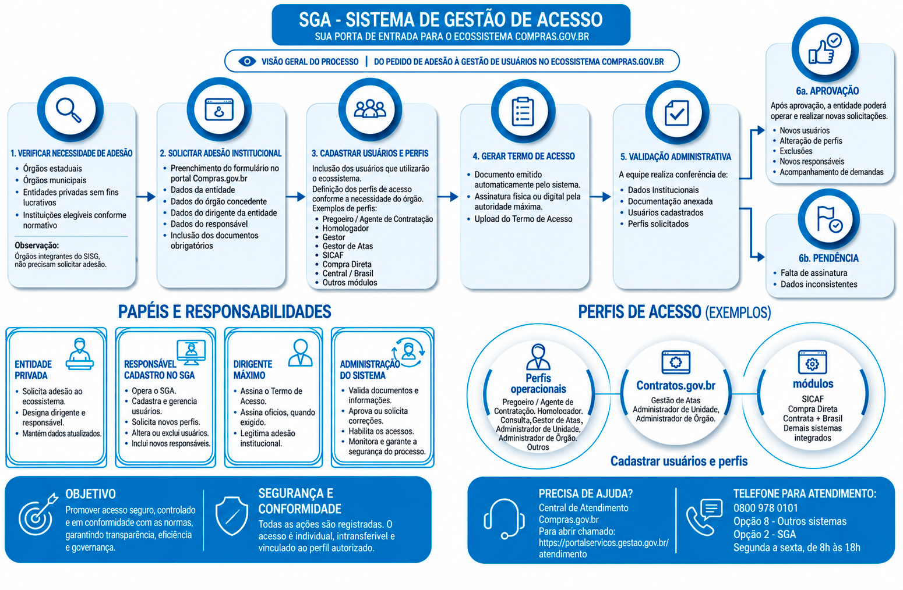

*Figura 1 - Fluxo de Gestão de Acesso ao SIASG (SGA).*

---

# 9. Preenchimento do Formulário (Como realizar a adesão) 
Antes de iniciar a solicitação de adesão ao Sistema de Gestão de Acesso (SGA), a entidade privada sem fins lucrativos deverá reunir as informações e os documentos necessários para o preenchimento do formulário.

A preparação prévia contribui para reduzir a ocorrência de pendências e a necessidade de complementação de informações durante a análise da solicitação.

## 9.1 Checklist para iniciar a solicitação de adesão ao SGA   
A documentação exigida pode variar de acordo com o **perfil solicitado** e com as responsabilidades atribuídas à **entidade privada sem fins lucrativos** e ao **órgão concedente**. Por isso, consulte previamente os requisitos específicos do perfil a ser solicitado.

### 9.1.1 Acesso ao sistema   
☐ Conta Gov.br ativa para acesso ao SGA.  
☐ Conta Gov.br da pessoa indicada pela entidade para realizar a solicitação.

### 9.1.2 Informações e documentos da entidade   
☐ Dados cadastrais da entidade necessários ao preenchimento da solicitação.  
☐ Dados cadastrais atualizados e compatíveis com os documentos apresentados.  
☐ Documentos necessários à comprovação da constituição e da representação da entidade, quando exigidos.

### 9.1.3 Documentos do dirigente da entidade   
Para o **dirigente máximo da entidade privada sem fins lucrativos** ou seu **substituto legal**, quando aplicável:   
☐ Termo de Posse, ata de eleição, ato de nomeação ou documento equivalente.  
☐ Documento oficial de identificação.  
☐ Documento que comprove a condição de substituto legal, quando aplicável.

### 9.1.4 Documentos do dirigente ou representante do órgão concedente  
**Quando houver participação do órgão concedente no processo:**   
☐ Documento oficial de identificação, quando exigido.  
☐ Documento que comprove a condição de dirigente ou representante do órgão concedente, quando exigido.  
☐ Ato de designação ou documento equivalente, quando exigido para o perfil ou para determinada etapa do processo.

### 9.1.5 Atos de designação e documentos comprobatórios  
**Para os perfis que exigem designação formal ou comprovação de atribuições:**   
☐ Ato de designação do responsável, quando aplicável.  
☐ Documento que comprove a vinculação, a representação ou a condição necessária para o exercício do perfil solicitado, quando aplicável.  
☐ Outros documentos comprobatórios eventualmente exigidos para o perfil solicitado.

!!! warning "Atenção"

    A documentação exigida pode variar conforme o perfil solicitado e a etapa do processo.

### 9.1.6 Assinaturas  
☐ Documentos que exigem assinatura devidamente assinados.  
☐ Assinaturas realizadas pelo dirigente máximo, pelo substituto legal ou pela pessoa competente, conforme o caso.

### 9.1.7 Arquivos para anexação  
**Antes de anexar os documentos ao SGA:**
☐ Documentos completos e legíveis.  
☐ Arquivos nos formatos aceitos pelo SGA: JPG, JPEG, PNG ou PDF.  
☐ Arquivos com tamanho máximo de 20 MB cada.  
☐ Documentos anexados compatíveis com as informações preenchidas no sistema.

### 9.1.8 Checklist final  
**Antes de iniciar a solicitação, confirme:**  
☐ Conta Gov.br ativa.  
☐ Dados cadastrais da entidade.  
☐ Documentos do dirigente da entidade.  
☐ Documentos necessários à comprovação da constituição e da representação da entidade, quando aplicável.  
☐ Documentos do dirigente ou representante do órgão concedente, quando exigidos.  
☐ Atos de designação e demais documentos comprobatórios exigidos para o perfil, quando aplicáveis.  
☐ Documentos específicos exigidos para o perfil a ser solicitado.  
☐ Documentação completa, legível e devidamente assinada, quando necessário.  
☐ Arquivos nos formatos aceitos pelo SGA e dentro dos limites de tamanho estabelecidos.

!!! warning "Atenção"

    Reúna todas as informações e documentos antes de iniciar o preenchimento. A ausência de informações ou documentos poderá gerar pendências e necessidade de complementação durante a análise da solicitação.

## 9.2 Acesso ao formulário
Para iniciar o processo de adesão, o interessado deverá acessar a página do <a href="https://www.gov.br/compras/pt-br/sistemas/conheca-o-compras/sistema-de-gestao-de-acesso-ao-siasg-sga" target="_blank" rel="noopener noreferrer"><strong>Sistema de Gestão de Acesso (SGA)</strong></a> no portal Compras.gov.br.
**Na página do SGA:**
I. localize, na parte inferior da página, a opção **"Termo de acesso"**;

II. selecione a opção correspondente para iniciar o preenchimento do formulário de adesão;

III. preencha as informações solicitadas e anexe os documentos necessários, conforme as orientações apresentadas neste manual.

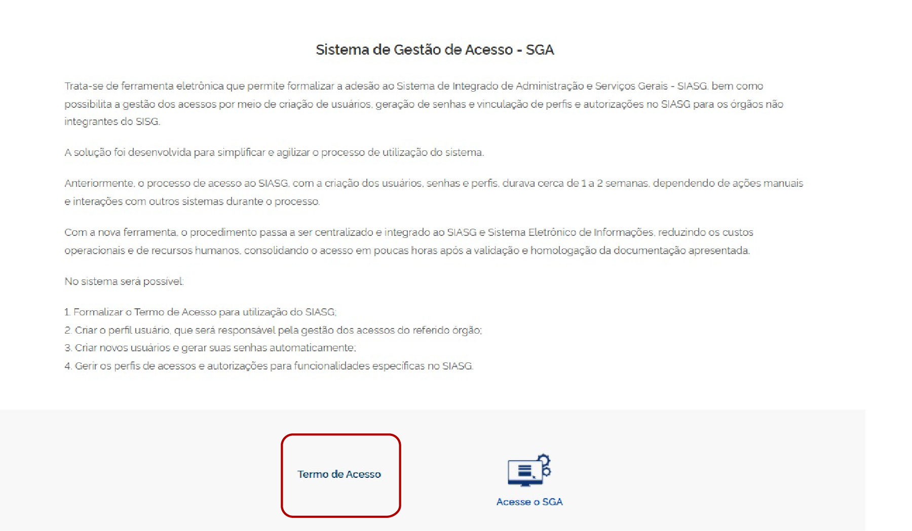

*Figura 2 - Página inicial do Sistema de Gestão de Acesso (SGA).*

Ao selecionar a opção **"Entidades privadas sem fins lucrativos"**, serão disponibilizadas as seguintes seções:

I. dados da entidade privada sem fins lucrativos;

II. dados do órgão concedente;

III. dados do dirigente concedente;

IV. dados do dirigente da entidade privada sem fins lucrativos;

V. dados do responsável;

VI. de acordo.

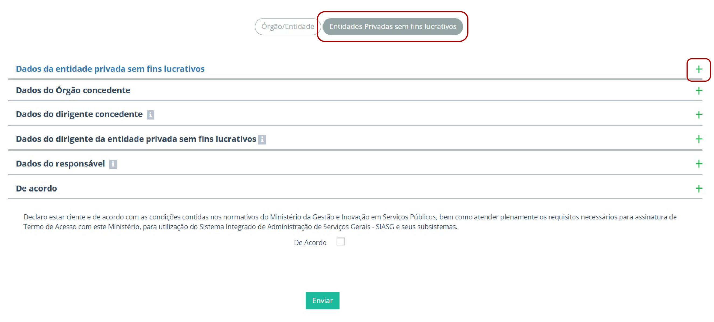

*Figura 3 - Seções do formulário de adesão.*

## 9.3 Dados da entidade privada sem fins lucrativos e do órgão concedente
Nesta etapa, o usuário deverá preencher o formulário com as informações institucionais da entidade privada sem fins lucrativos e do órgão concedente, conforme os campos disponibilizados pelo sistema.

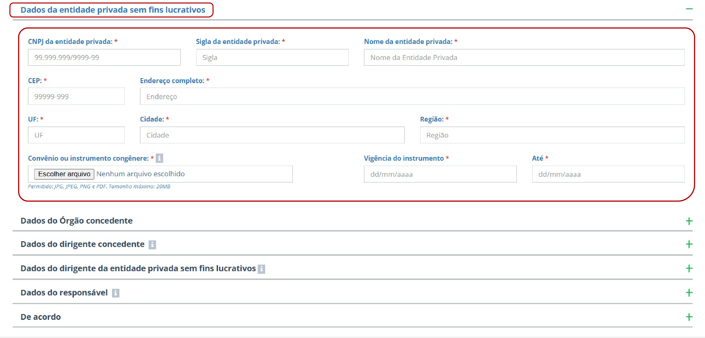

*Figura 4 - Seção "Dados da entidade privada sem fins lucrativos".*

## 9.4 Dados do órgão concedente
Na sequência, o usuário deverá preencher os campos da seção **"Dados do órgão concedente"**.

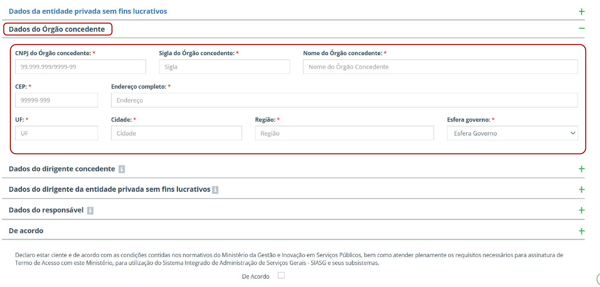

*Figura 5 - Seção "Dados do órgão concedente".*

## 9.5 Dados do dirigente do órgão concedente e do dirigente da entidade privada sem fins lucrativos
O formulário solicita informações distintas sobre o dirigente do órgão concedente e o dirigente da entidade privada sem fins lucrativos. As informações devem ser preenchidas conforme os respectivos documentos comprobatórios.

### 9.5.1 Dados do dirigente do órgão concedente
Corresponde à autoridade máxima ou ao dirigente máximo do órgão concedente, ou aos seus substitutos legais, quando aplicável.

**O usuário deverá informar:**
I. telefone válido, com DDD;

II. endereço de e-mail válido para contato, preferencialmente institucional.

**Deverão ser anexados os seguintes documentos:**
I. documento oficial de identificação com foto do dirigente máximo ou de seu substituto legal;

II. ato de designação ou Termo de Posse do dirigente máximo ou de seu substituto legal.

!!! warning "Atenção"

    O processo somente prosseguirá após:   
    * o preenchimento completo e correto de todos os dados;   
    * a anexação dos documentos exigidos.   

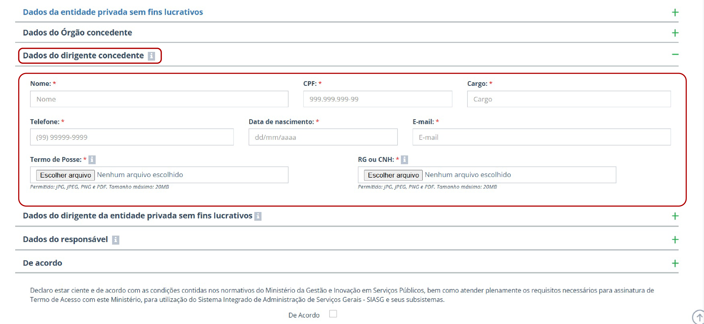

*Figura 6 - Seção "Dados do dirigente concedente".*

### 9.5.2 Dados do dirigente da entidade privada sem fins lucrativos  
Informe os dados do dirigente máximo da entidade privada sem fins lucrativos ou de seu substituto legal, quando aplicável.

O usuário deverá preencher os campos solicitados pelo sistema e anexar os documentos necessários à comprovação da identidade e da condição do dirigente.

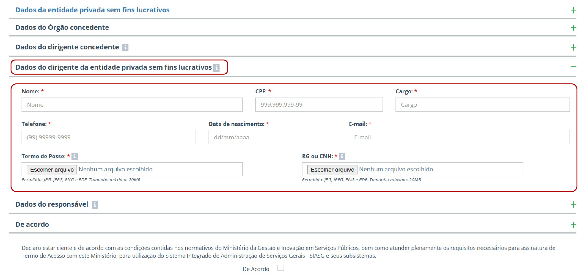

*Figura 7 - Seção "Dados do dirigente da entidade privada sem fins lucrativos".*

!!! warning "Atenção"

    Antes de prosseguir, confira se todos os dados foram preenchidos corretamente e se os documentos exigidos foram anexados de acordo com as orientações apresentadas pelo sistema.

## 9.6 Dados do responsável  
O responsável pelo cadastro corresponde à pessoa indicada pela autoridade competente da entidade privada sem fins lucrativos para realizar a gestão do cadastro do Termo de Acesso e a administração dos perfis dos usuários autorizados a utilizar o sistema.

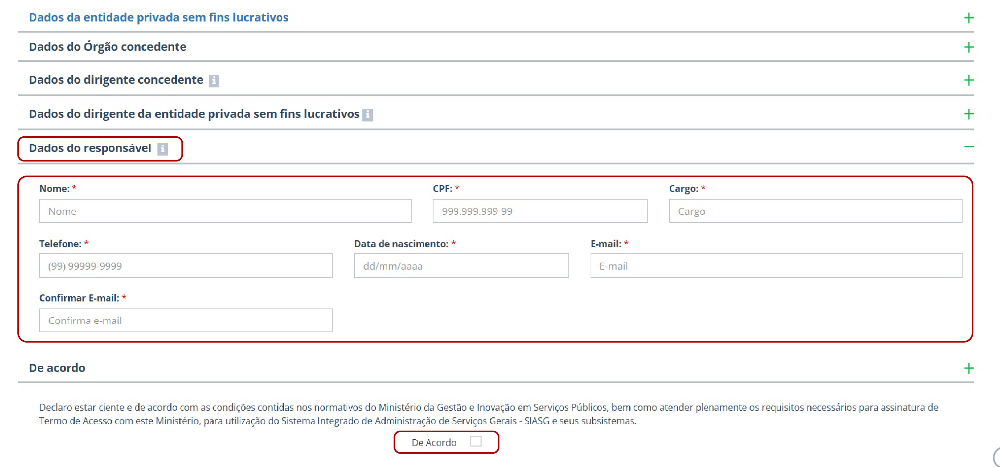

*Figura 8 - Seção "Dados do responsável" do formulário de adesão do SGA.*

**Após concluir o preenchimento das informações, o responsável deverá:**  
I. marcar a opção **"De acordo"**, para confirmar ciência e concordância com os termos;

II. clicar em **"Enviar"**, para prosseguir para a próxima etapa.

**Após o envio, a solicitação seguirá o fluxo de análise e validação previsto no SGA.**

## 9.7 Orientações para acesso do responsável ao Sistema de Gestão de Acesso (SGA)
Para consultar as solicitações no Sistema de Gestão de Acesso (SGA) e, posteriormente, administrar os perfis de acesso, o responsável pelo cadastro deverá possuir uma conta Gov.br ativa.

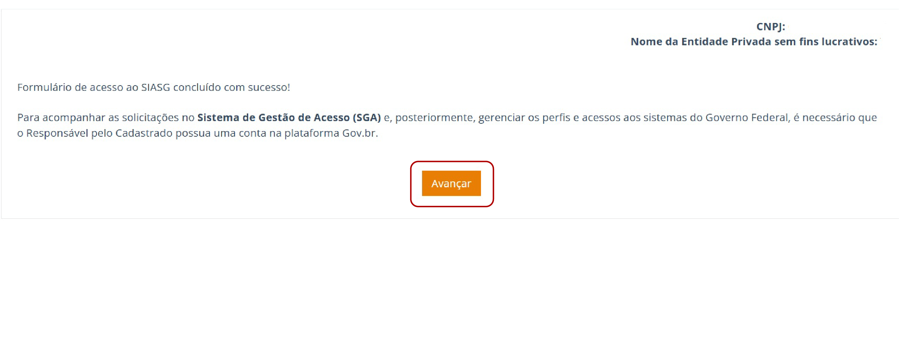

*Figura 9 - Mensagem do SGA.*

Clique no botão **"Avançar"**.

## 9.8 Acesso ao formulário
Para iniciar o processo de adesão, o interessado deverá acessar a página do <a href="https://www.gov.br/compras/pt-br/sistemas/conheca-o-compras/sistema-de-gestao-de-acesso-ao-siasg-sga" target="_blank" rel="noopener noreferrer"><strong>Sistema de Gestão de Acesso (SGA)</strong></a> no portal Compras.gov.br.
**Na página do SGA:**
I. localize, na parte inferior da página, a opção **"Termo de acesso"**;

II. selecione a opção correspondente para iniciar o preenchimento do formulário de adesão;

III. preencha as informações solicitadas e anexe os documentos necessários, conforme as orientações apresentadas neste manual.

*Figura 2 - Página inicial do Sistema de Gestão de Acesso (SGA).*

Ao selecionar a opção **"Entidades privadas sem fins lucrativos"**, serão disponibilizadas as seguintes seções:

I. dados da entidade privada sem fins lucrativos;

II. dados do órgão concedente;

III. dados do dirigente concedente;

IV. dados do dirigente da entidade privada sem fins lucrativos;

V. dados do responsável;

VI. de acordo.

*Figura 3 - Seções do formulário de adesão.*

## 9.9 Dados da entidade privada sem fins lucrativos e do órgão concedente

Nesta etapa, o usuário deverá preencher o formulário com as informações institucionais da entidade privada sem fins lucrativos e do órgão concedente, conforme os campos disponibilizados pelo sistema.

*Figura 4 - Seção "Dados da entidade privada sem fins lucrativos".*

## 9.10 Dados do órgão concedente

Na sequência, o usuário deverá preencher os campos da seção **"Dados do órgão concedente"**.

*Figura 5 - Seção "Dados do órgão concedente".*

## 9.11 Dados do dirigente do órgão concedente e do dirigente da entidade privada sem fins lucrativos

O formulário solicita informações distintas sobre o dirigente do órgão concedente e o dirigente da entidade privada sem fins lucrativos. As informações devem ser preenchidas conforme os respectivos documentos comprobatórios.

### 9.11.1 Dados do dirigente do órgão concedente   
Corresponde à autoridade máxima ou ao dirigente máximo do órgão concedente, ou aos seus substitutos legais, quando aplicável.

**O usuário deverá informar:**

I. telefone válido, com DDD;

II. endereço de e-mail válido para contato, preferencialmente institucional.

**Deverão ser anexados os seguintes documentos:**

I. documento oficial de identificação com foto do dirigente máximo ou de seu substituto legal;

II. ato de designação ou Termo de Posse do dirigente máximo ou de seu substituto legal.

!!! warning "Atenção"

    O processo somente prosseguirá após:
    
    * o preenchimento completo e correto de todos os dados;
    * a anexação dos documentos exigidos.

*Figura 6 - Seção "Dados do dirigente concedente".*

### 9.11.2 Dados do dirigente da entidade privada sem fins lucrativos   
Informe os dados do dirigente máximo da entidade privada sem fins lucrativos ou de seu substituto legal, quando aplicável.

O usuário deverá preencher os campos solicitados pelo sistema e anexar os documentos necessários à comprovação da identidade e da condição do dirigente.

*Figura 7 - Seção "Dados do dirigente da entidade privada sem fins lucrativos".*

!!! warning "Atenção"

    Antes de prosseguir, confira se todos os dados foram preenchidos corretamente e se os documentos exigidos foram anexados de acordo com as orientações apresentadas pelo sistema.

## 9.12 Dados do responsável  
O responsável pelo cadastro corresponde à pessoa indicada pela autoridade competente da entidade privada sem fins lucrativos para realizar a gestão do cadastro do Termo de Acesso e a administração dos perfis dos usuários autorizados a utilizar o sistema.

*Figura 8 - Seção "Dados do responsável" do formulário de adesão do SGA.*

**Após concluir o preenchimento das informações, o responsável deverá:**

I. marcar a opção **"De acordo"**, para confirmar ciência e concordância com os termos;

II. clicar em **"Enviar"**, para prosseguir para a próxima etapa.

**Após o envio, a solicitação seguirá o fluxo de análise e validação previsto no SGA.**

## 9.13 Orientações para acesso do responsável ao Sistema de Gestão de Acesso (SGA)  
Para consultar as solicitações no Sistema de Gestão de Acesso (SGA) e, posteriormente, administrar os perfis de acesso, o responsável pelo cadastro deverá possuir uma conta Gov.br ativa.

*Figura 9 - Mensagem do SGA.*

Clique no botão **"Avançar"**.  

---

# 10. Perfis de acesso   
Os perfis de acesso do ecossistema Compras correspondem aos diferentes níveis de permissão atribuídos aos usuários das entidades privadas sem fins lucrativos, de acordo com as atribuições e responsabilidades exercidas nos sistemas e serviços disponibilizados.

!!! warning "Atenção"

    A definição e a concessão dos perfis de acesso devem estar alinhadas às atribuições de cada usuário e aos requisitos específicos de cada sistema ou serviço. Essa medida é essencial para assegurar a adequada segregação de funções, a segurança das operações, a integridade das informações e a conformidade com a legislação e os normativos vigentes.

## 10.1 Perfis disponíveis   
Os perfis disponíveis podem variar de acordo com o sistema ou serviço que a entidade necessita utilizar e com as funcionalidades disponibilizadas pelo Sistema de Gestão de Acesso (SGA).

### Pregoeiro (agente de contratação)   
Agente responsável pela condução dos procedimentos licitatórios eletrônicos, observadas as competências e os limites estabelecidos na legislação e na regulamentação aplicáveis.

### Presidente da comissão de contratação   
Responsável pela coordenação e condução das atividades atribuídas à comissão de contratação, incluindo o recebimento, a análise e o julgamento de documentos relativos às licitações e aos procedimentos auxiliares, quando aplicável.

### Homologador   
Autoridade competente responsável pela adjudicação e pela homologação dos processos de contratação, nos termos da legislação vigente.

### Consulta   
Permite o acesso às informações disponibilizadas no sistema, sem autorização para realizar alterações ou executar operações restritas a outros perfis.

### Gestão de atas (contratos.gov.br)   
Permite o acesso às funcionalidades relacionadas à gestão de atas de registro de preços, conforme as permissões atribuídas ao perfil.

### Administrador de unidade (contratos.gov.br)   
Responsável pela gestão dos usuários e respectivos acessos no âmbito da unidade cadastrada.

### Administrador do órgão (contratos.gov.br)  
Responsável pela administração dos usuários e dos respectivos níveis de acesso no âmbito do órgão, conforme as permissões atribuídas ao perfil.

### Dispensa eletrônica (compra direta)   
Permite a atuação nas funcionalidades relacionadas aos processos de contratação direta por dispensa eletrônica, de acordo com as permissões atribuídas ao perfil.

### SICAF   
Permite o acesso às funcionalidades de cadastramento, atualização e consulta de fornecedores, conforme as permissões atribuídas ao perfil.

### Autorizador do órgão comprador (contrata+Brasil)   
Autoridade competente responsável por autorizar a publicação da contratação e confirmar a seleção do fornecedor, observadas as regras e funcionalidades do sistema.

### Demandante do órgão comprador (contrata+Brasil)   
Agente responsável pelo preenchimento do formulário de cadastro da oportunidade, pelo acompanhamento do processo e pela seleção do fornecedor vencedor, observadas as regras e funcionalidades do sistema.

!!! Warning "Atenção"

    Os perfis disponibilizados no SGA poderão ser alterados, ampliados ou descontinuados conforme a evolução dos sistemas e serviços que integram o ecossistema Compras.

---

# 11.Cadastramento de Usuários e Perfis  
Para realizar o cadastramento de um usuário, preencha os campos solicitados e selecione o perfil de acesso correspondente às atividades que serão exercidas por ele.

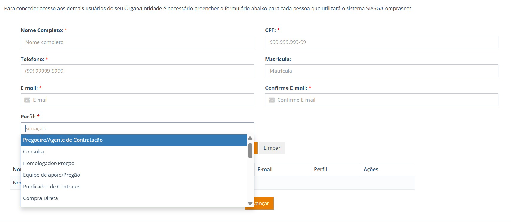

*Figura 10 - Cadastramento de usuários e seleção de perfis.*

!!! warning "Atenção"

    Para o perfil de **Pregoeiro (agente de contratação)**, é obrigatório anexar o **ato de designação específico** para o exercício da função.

    Para o perfil de **Homologador**, deverá ser anexado o **ato de designação** ou o **termo de posse** que comprove a condição de autoridade competente.

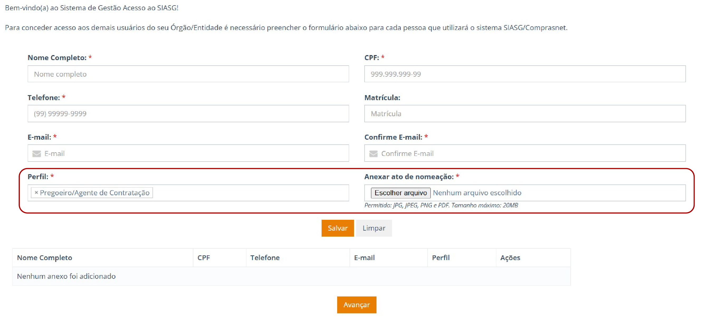

*Figura 11 - Seleção do perfil de acesso do usuário.*

!!! warning "Atenção"

    Após salvar os dados do usuário que utilizará o ecossistema Compras, o SGA permanecerá na mesma tela, permitindo a inclusão de novos usuários, se necessário.

    Para passar à próxima etapa, é obrigatório cadastrar **pelo menos um usuário**.

    Caso seja necessário editar, excluir ou visualizar os dados inseridos, o sistema disponibiliza, no campo **"Ações"**, as seguintes funcionalidades:

✏️ **Editar** os dados cadastrados no sistema.

❌ **Excluir** os dados cadastrados no sistema.

🔎 **Visualizar** os documentos anexados ao sistema.  

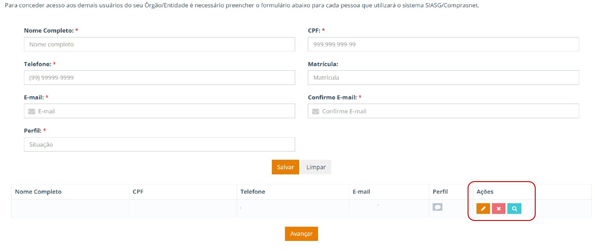

*Figura 12 - Funcionalidades de edição, exclusão e visualização de usuários cadastrados.*

Após concluir o cadastramento dos usuários, clique em **"Avançar"** para acessar a próxima etapa.

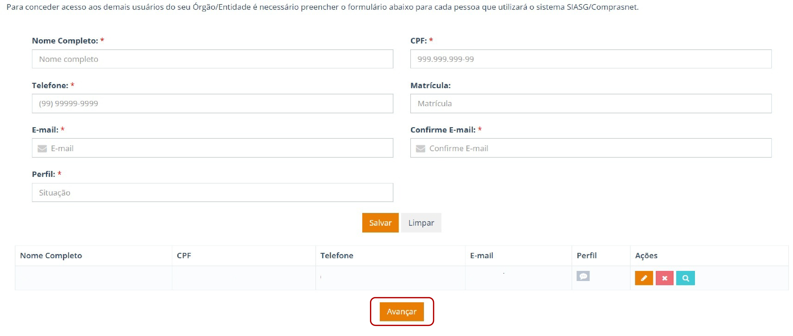

*Figura 13 - Avanço para a próxima etapa após o cadastramento dos usuários.*

---

# 12.Geração e Encaminhamento do Termo de Acesso
Após concluir o cadastramento dos usuários e a atribuição dos respectivos perfis de acesso, o responsável pelo cadastro deverá gerar o termo de acesso no Sistema de Gestão de Acesso (SGA).

Para isso:

- Clique em **"Gerar termo de acesso"**.
- O sistema realizará o download automático do arquivo.

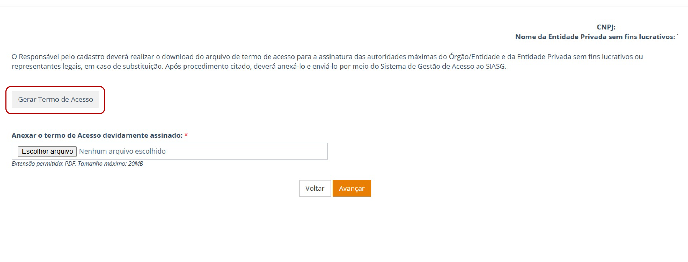

*Figura 14 - Geração do Termo de Acesso.*

Após a geração do documento, o **termo de acesso deverá ser assinado pela autoridade máxima da entidade privada sem fins lucrativos ou por seu substituto legal**, conforme aplicável.

As assinaturas poderão ser realizadas de forma física ou digital.

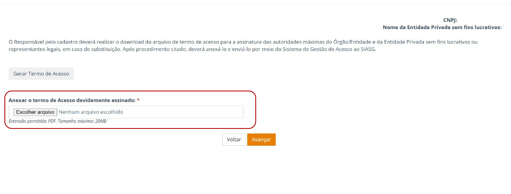

*Figura 15 - Anexação do Termo de Acesso.*

Após a assinatura, o responsável deverá **anexar o termo de acesso assinado no SGA** e prosseguir com o encaminhamento da solicitação para análise.

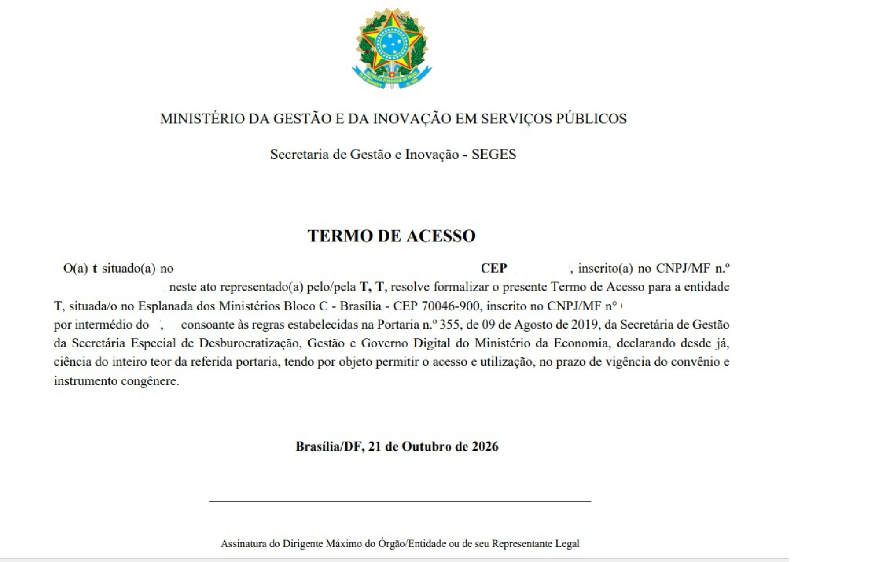

*Figura 16 - Modelo do Termo de Acesso gerado pelo Sistema de Gestão de Acesso.*

Para prosseguir com a solicitação, clique em **"Avançar"**.

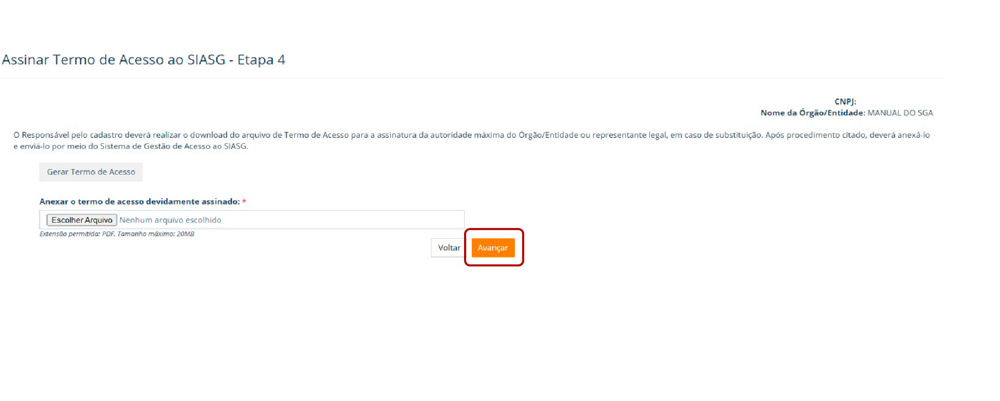

*Figura 17 - Avanço após a anexação do Termo de Acesso.*

Após o encaminhamento, a solicitação será submetida ao **fluxo de análise e validação previsto no SGA**. O responsável poderá acompanhar o andamento da solicitação diretamente no sistema.

Para acessar o acompanhamento da solicitação, clique na opção **"Ir para o sistema"**.

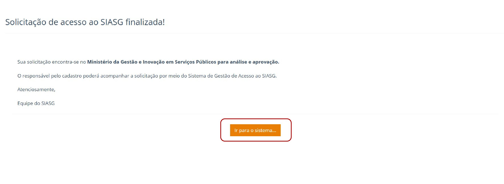

*Figura 18 - Solicitação encaminhada para análise e aprovação.*

---

# 13. Acompanhamento da Solicitação
Após o encaminhamento do Termo de Acesso, o responsável poderá acompanhar, no Sistema de Gestão de Acesso (SGA), o andamento da solicitação e verificar eventuais pendências identificadas durante a análise.

## 13.1 Situações da solicitação
A tabela a seguir apresenta as principais situações que podem ser exibidas pelo sistema e as respectivas ações esperadas do responsável.

| Situação no sistema | Ação do responsável |
|---------------------|--------------------|
| Aguardando validação | Aguardar a análise da solicitação pelo Ministério da Gestão e da Inovação em Serviços Públicos (MGI), cujo prazo é de até 3 dias úteis. |
| Revalidar termo e usuário | Verificar as pendências relacionadas ao Termo de Acesso ou ao cadastramento dos usuários. |
| Termo e usuário SIASG corrigidos | Após realizar as correções necessárias, encaminhar a solicitação para nova análise pelo MGI. |
| Termo e usuário SIASG válidos | Aguardar a conclusão dos procedimentos necessários para o cadastro da entidade e a criação da Unidade Administrativa de Serviços Gerais (UASG). |
| Aguardando habilitação do(s) usuário(s) SIASG | Aguardar a conclusão da habilitação dos usuários. |
| Processo de solicitação de acesso finalizado | O processo foi concluído, e o sistema estará disponível para utilização conforme os acessos habilitados. |

*Situações da solicitação e ações do responsável.*

!!! note "Nota"

    Os prazos e as situações apresentados no SGA devem ser considerados de acordo com o andamento efetivo da solicitação no sistema.

## 13.2 Tratamento de pendências
Quando a solicitação for devolvida para correção, o responsável deverá consultar a pendência apresentada no SGA e realizar os ajustes necessários antes de encaminhá-la novamente para análise.

### 13.2.1 Termo de acesso sem assinatura
Caso o termo de acesso seja devolvido por ausência de assinatura, o sistema direcionará o responsável para a tela correspondente, ele deverá:

I. realizar o download do termo de acesso;

II. providenciar a assinatura da autoridade competente ou de seu substituto legal;

III. anexar o termo de acesso devidamente assinado no SGA;

IV. prosseguir com o encaminhamento da solicitação.

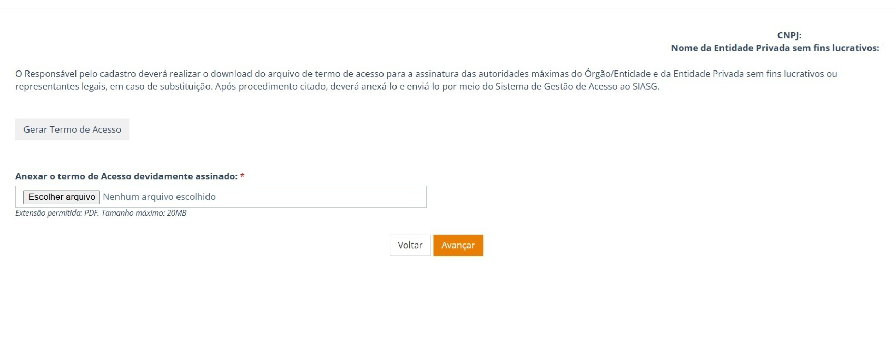

*Figura 19 - Tratamento de pendência relacionada ao termo de acesso.*

### 13.2.2 Inconsistências no cadastro de usuários   
Caso a solicitação seja devolvida em razão de pendências no cadastro de usuários, o sistema direcionará o responsável para a tela correspondente.

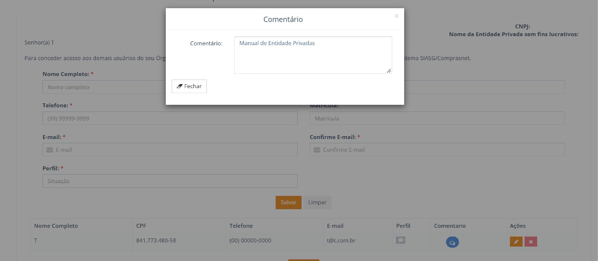

*Figura 20 - Inconsistências identificadas no cadastro de usuários.*

Na opção **"Comentário"**, o sistema apresentará uma mensagem contendo a descrição específica de cada pendência identificada.

Para realizar a correção, o responsável deverá clicar no ícone ✏️ **"Editar"** para alterar o registro do usuário.

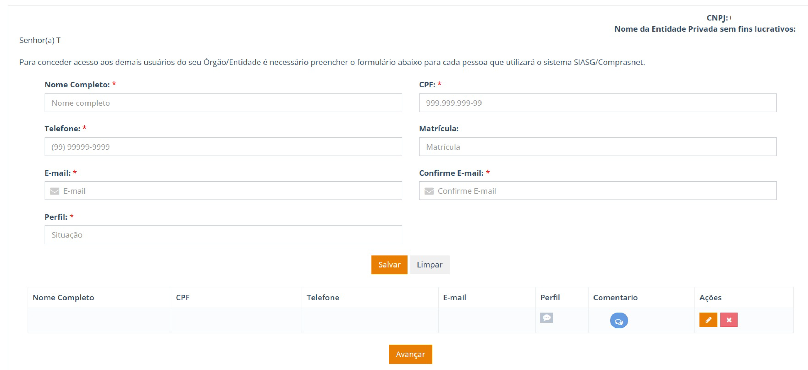

*Figura 21 - Ícone de edição do registro de usuário.*

Após realizar as alterações necessárias, clique em **"Salvar"** para registrar as modificações.

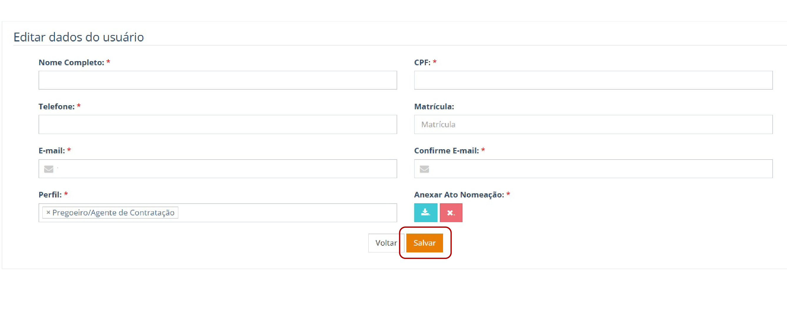

*Figura 22 - Botão de salvamento das alterações do usuário.*

Caso seja necessário remover o cadastro do usuário, clique no ícone ❌ **"Excluir"**.

O sistema exibirá a seguinte mensagem:

**"O usuário será excluído da solicitação. Deseja prosseguir?"**

Selecione **"Sim"** para confirmar a exclusão ou **"Não"** para cancelar a operação.

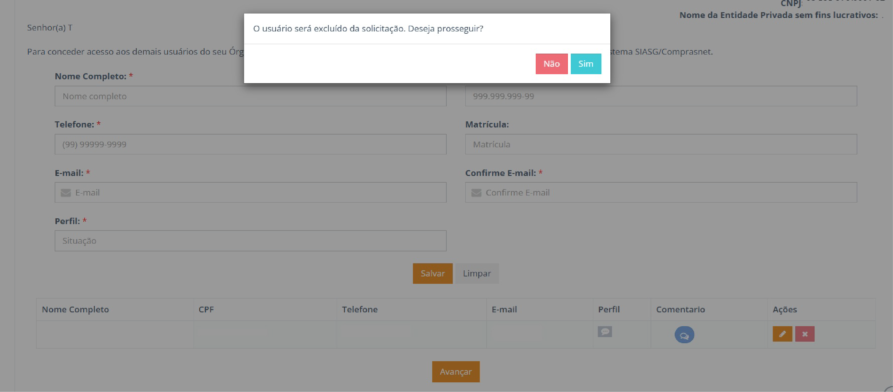

*Figura 23 - Botões para confirmar (sim) ou cancelar (não) a exclusão.*

!!! warning "Atenção"

    Caso a pendência apresentada não possa ser solucionada por meio das funcionalidades disponíveis no SGA, o responsável deverá entrar em contato com a <a href="https://portaldeservicos.gestao.gov.br/" target="_blank" rel="noopener noreferrer"><strong>Central de Atendimento</strong></a>.

## 13.3 Reenvio da solicitação após as correções   
Após realizar as correções necessárias, clique em **"Avançar"**. O sistema direcionará o usuário para a próxima tela.

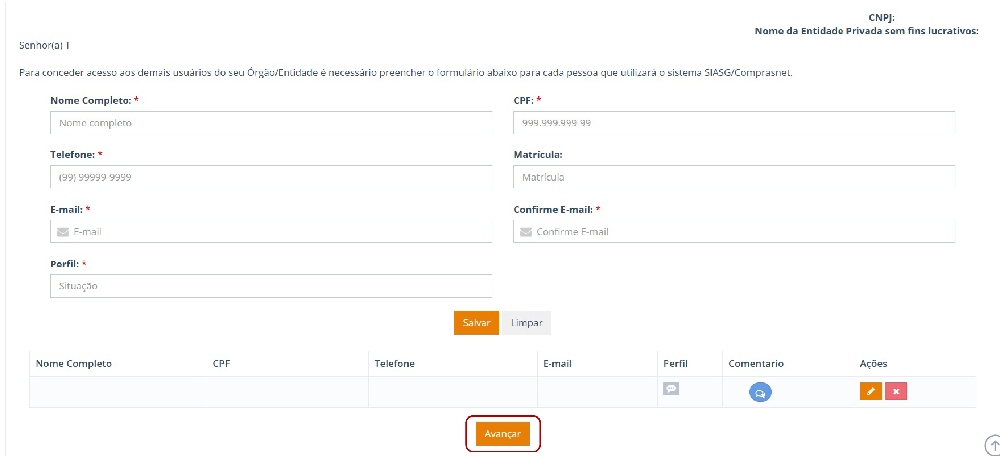

*Figura 24 - Tela de dados cadastrais dos usuários.*

Na etapa seguinte, clique em **"Gerar termo de acesso"**. O sistema exibirá o documento contendo as correções realizadas.

Na sequência, realize o download do Termo de Acesso, providencie as assinaturas necessárias e **anexe o termo de acesso devidamente assinado** ao sistema.

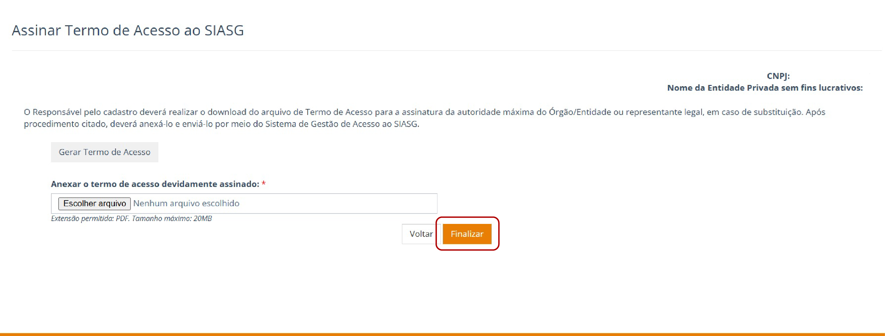

*Figura 25 - Assinatura do Termo de Acesso.*

Por fim, clique em **"Finalizar"** para encaminhar a solicitação corrigida para nova análise.

Após o envio, o sistema exibirá a situação **"Termo e usuário SIASG corrigidos"**.

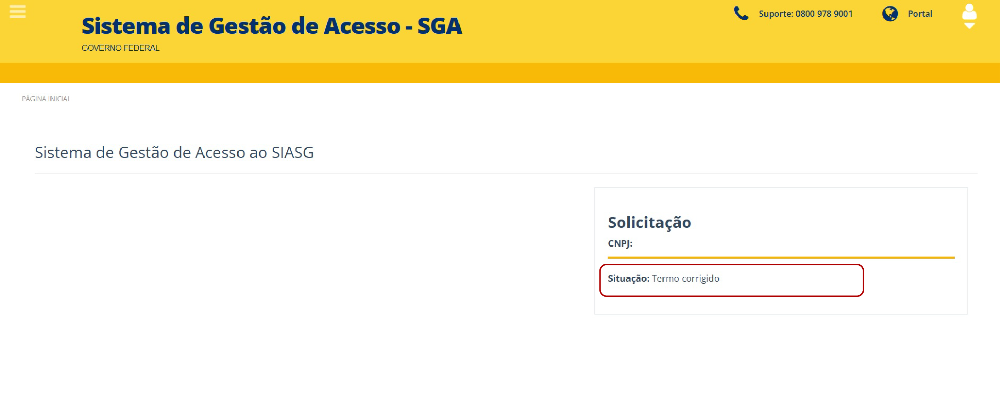

*Figura 26 - Situação da solicitação: "Termo e usuário SIASG corrigidos".*

## 13.4 Acompanhamento da solicitação   
Após o encaminhamento da solicitação, o responsável deverá acompanhar seu andamento no SGA e observar as mensagens e situações apresentadas pelo sistema, conforme descrito na seção **13.1 - Situações da solicitação**.

Quando o termo de acesso e o cadastro dos usuários forem validados, e os procedimentos necessários à habilitação dos acessos forem concluídos, a solicitação será considerada finalizada.

A partir desse momento, o responsável poderá gerenciar os usuários cadastrados e, quando necessário, solicitar novos acessos ao ecossistema Compras.

---

# 14.1 Geração e Encaminhamento de Ofício

# 15.Gestão dos Usuários

---

# 16.Acesso ao SGA com Gov.br

---

# 17.Disposições Finais

---

# 18.Perguntas Frequentes (FAQ)

## 1. Entidades privadas sem fins lucrativos podem utilizar o SGA?
Sim. As entidades privadas sem fins lucrativos que atendam aos requisitos estabelecidos na regulamentação vigente poderão solicitar acesso ao ecossistema Compras.gov.br por meio do Sistema de Gestão de Acesso (SGA).

## 2. Quem pode ser cadastrado como responsável pelo SGA?
Pode ser cadastrada como responsável pelo SGA a pessoa indicada pela entidade privada sem fins lucrativos para realizar a gestão do Termo de Acesso, dos usuários e dos respectivos acessos no sistema.

## 3. É possível cadastrar mais de um responsável?
Sim. O sistema permite o cadastramento de mais de um responsável. Antes de excluir o último responsável cadastrado, a entidade deverá cadastrar outro responsável, de modo a evitar que fique sem responsável para realizar a gestão dos usuários e dos respectivos acessos.

## 4. Quem deve assinar o termo de acesso?
O termo de acesso deverá ser assinado pelo dirigente máximo da entidade privada sem fins lucrativos ou por seu substituto legal, conforme os requisitos aplicáveis ao procedimento.

## 5. A conta Gov.br é obrigatória?
Sim. O responsável pelo SGA deve possuir uma conta ativa na plataforma Gov.br para acessar e realizar a gestão das solicitações no Sistema de Gestão de Acesso.

## 6. A ausência de documentos impede o prosseguimento da solicitação?
Sim. O preenchimento correto dos dados e a anexação dos documentos exigidos são necessários para o prosseguimento da solicitação.

## 7. O que acontece se o termo de acesso for devolvido com pendências?
O sistema apresentará a situação correspondente à pendência e permitirá ao responsável consultar os comentários, corrigir as informações ou documentos necessários e encaminhar a solicitação para nova análise.

## 8. O sistema envia notificações por e-mail?
Sim. O responsável poderá receber notificações relacionadas ao andamento da solicitação e às eventuais pendências no endereço de e-mail informado no cadastro.

## 9. O que fazer em caso de desligamento de um usuário?
A entidade deverá providenciar a exclusão ou a alteração do acesso do usuário desligado, conforme as funcionalidades disponíveis no SGA, de modo a manter atualizados os acessos institucionais.

## 10. É permitido compartilhar login e senha?
Não. As credenciais de acesso são pessoais e intransferíveis e não devem ser compartilhadas com terceiros.

## 11. A solicitação ou alteração de um perfil significa que o acesso está automaticamente habilitado?
Não. A solicitação ou alteração de perfil está sujeita aos procedimentos de análise, validação e habilitação previstos no fluxo do SGA.

---

# Ficha Institucional

## Ministério da Gestão e da Inovação em Serviços Públicos (MGI)

**Ministra**  
Esther Dweck

## Secretaria de Gestão e Inovação (SEGES)

**Secretário**  
Roberto Seara Machado Pojo Rego

**Secretária-Adjunta**  
Regina Lemos de Andrade

## Diretoria de Normas e Sistemas de Logística (DELOG)

**Diretor**  
Everton Batista dos Santos

## Coordenação-Geral de Soluções Inovadoras em Logística (CGSIL)

**Coordenador-Geral**  
Alexandre Augusto Villain da Silva

**Equipe Técnica**

**Coordenação de Qualidade de Atendimento (COQUAT)**

**Coordenação Técnica** 
Camilla Pais Faccin Bottecchia

**Especialistas Técnicos**
- Alexandre Almeida de Mota Matos
- Emy Karla Macedo Pereira
- Fernanda Correia de Castro
- Jurandir Gomes de Oliveira
- Maria de Fátima Gomes Moreira
- Vera Márcia Lopes Vieira de Souza

**Coordenação de Comunicação e Marketing (Comkt/Delog/Seges/MGI)**

**Coordenação**  
Marina Milena Silva

**Equipe**  
- André Siqueira de Azevedo  
- Carmen Bárbara da Silva Pereira  
- Êmili Adami Rossetti  
- Regiane Feltrin de Melo
  
---

# Ficha Técnica

| Item | Informação |
|--------|-------------|
| Título do Documento | Manual do Sistema de Gestão de Acesso (SGA) – Entidades Privadas sem Fins Lucrativos |
| Versão | 1.0 |
| Data da Publicação | 11/2026 |
| Órgão | Ministério da Gestão e da Inovação em Serviços Públicos (MGI) |
| Unidade Responsável | Secretaria de Gestão e Inovação (SEGES) |
| Aprovação | Everton Batista dos Santos – Diretor de Normas e Sistemas de Logística |
| Coordenação-Geral | Alexandre Augusto Villain da Silva – Coordenador-Geral |
| Equipe Técnica Especializada | Alexandre Almeida de Mota Matos Emy Karla Macedo Pereira Fernanda Correia de Castro Jurandir Gomes de Oliveira Maria de Fátima Gomes Moreira Vera Márcia Lopes Vieira de Souza |
| Coordenação Técnica | Camilla Pais Faccin Bottecchia – Coordenadora |
| Coordenação de Comunicação e Marketing (COMKT) | Marina Milena Silva – Coordenadora |
| Equipe de Comunicação e Marketing | André Siqueira de Azevedo Carmen Bárbara da Silva Pereira Êmili Adami Rossetti Regiane Feltrin de Melo
| Histórico de Revisões | V 1.0 – 11/2026 – Criação do Manual |
| Contato | seges@gestao.gov.br (61) 2020-6025 |

---

# Histórico de Versões

| Versão | Data | Descrição da Alteração | Unidade Responsável |
|---------|---------|---------|---------|
| 1.0 | 11/2026 | Elaboração do Manual | COQUAT / DELOG / SEGES / MGI |

---

  <button onclick="window.print()" style="background-color: #0056b3; color: white; padding: 10px 20px; border: none; border-radius: 5px; font-size: 16px; cursor: pointer; box-shadow: 0 2px 4px rgba(0,0,0,0.2);">
    🖨️ Imprimir esta página
  </button>

