

Tamanho do texto:

<button onclick="diminuirFonte()"
style="padding: 6px 12px; font-weight: bold; cursor: pointer; border: 1px solid #ccc; border-radius: 4px; background: #f8f9fa;">
A-
</button>

<button onclick="resetarFonte()"
style="padding: 6px 12px; font-weight: bold; cursor: pointer; border: 1px solid #ccc; border-radius: 4px; background: #f8f9fa;">
A
</button>

<button onclick="aumentarFonte()"
style="padding: 6px 12px; font-weight: bold; cursor: pointer; border: 1px solid #ccc; border-radius: 4px; background: #f8f9fa;">
A+
</button>

<button onclick="window.print()"
style="background-color: #0056b3; color: white; padding: 6px 16px; border: none; border-radius: 5px; font-size: 14px; cursor: pointer; box-shadow: 0 2px 4px rgba(0,0,0,0.2);">

🖨️ Imprimir ou baixar esta página

</button>

# 14. Solicitação de Novos Acessos

Após a conclusão do cadastro inicial, o responsável poderá solicitar novos acessos para usuários da entidade. 

Para iniciar o procedimento, deverá: 
I. Acessar a página principal e clicar em **"Solicitar novos usuários"**.

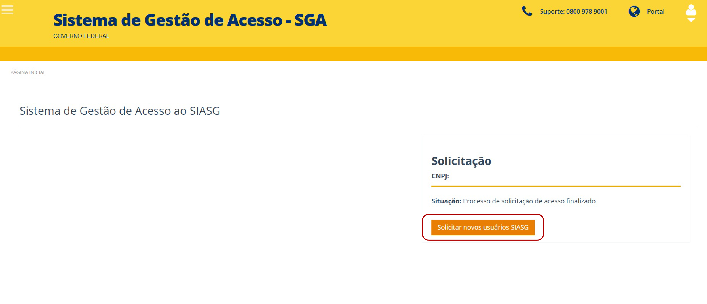

*Figura 27 – Solicitação de novos usuários no SIASG.*

Para cadastrar um usuário no ecossistema Compras, preencha todos os campos solicitados e selecione o perfil desejado.

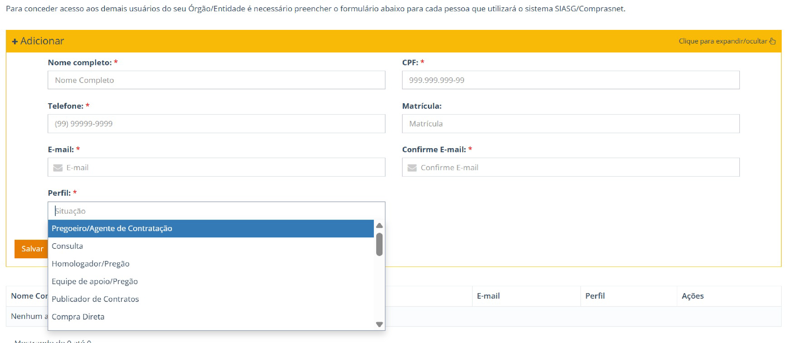

*Figura 28 – Cadastro de novo usuário e seleção de perfil de acesso.*

Para os perfis de Pregoeiro ou Agente de Contratação e Homologador, deverá ser anexado o respectivo ato de designação ou documento comprobatório exigido pelo sistema, conforme o perfil selecionado.

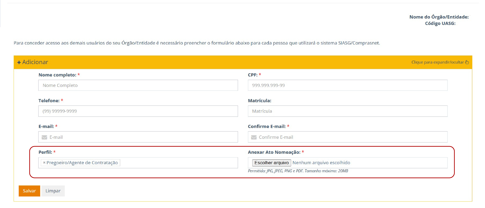

*Figura 29 – Anexação de documento comprobatório para o perfil selecionado.*

Após o salvamento dos dados, o sistema permanecerá na mesma tela, permitindo a inclusão de novos usuários, se necessário.

No campo **"Ações"**, o responsável poderá **editar, excluir ou visualizar os registros e os documentos anexados**, conforme as funcionalidades disponibilizadas pelo sistema.

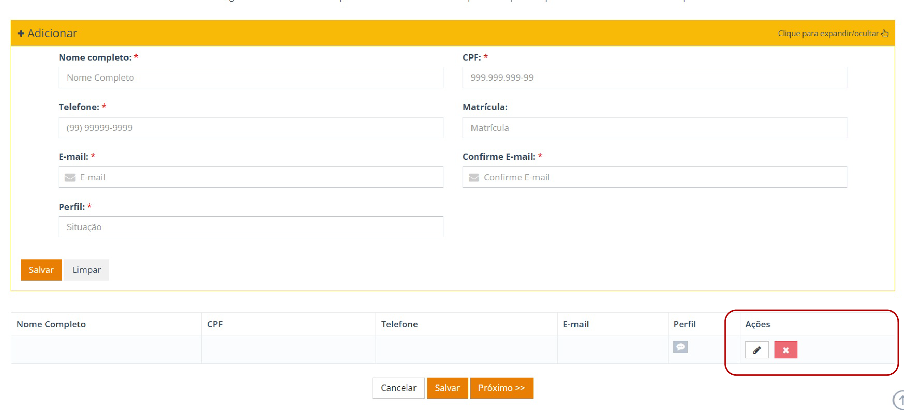

*Figura 30 – Funcionalidades de gerenciamento dos usuários cadastrados.*

Após a formação da lista de usuários, clique em **"Salvar"** para prosseguir à próxima etapa.

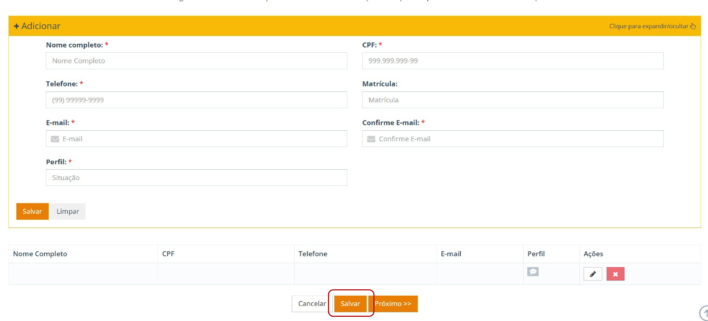

*Figura 31 – Avançar para a próxima etapa após a inclusão dos usuários.*

---

## 14.1 Geração e Encaminhamento de Ofício

O responsável pelo cadastro deverá clicar em **"Ofício dos Novos Usuários SIASG"**. O sistema realizará o download do arquivo.

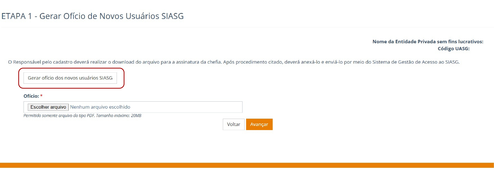

*Figura 32 – Geração de Ofício de Novos Usuários SIASG.*

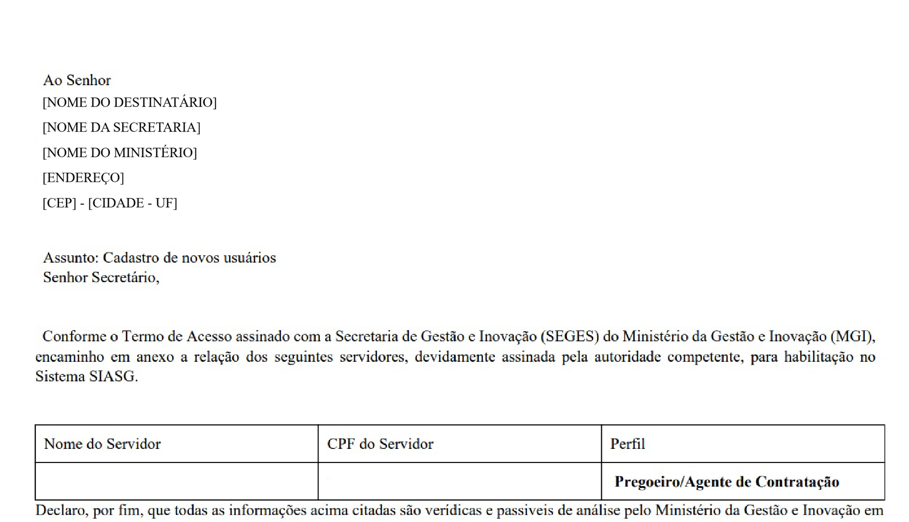

*Figura 33 – Anexação do Ofício de Novos Usuários SIASG.*

Em seguida, o ofício deverá ser assinado pela autoridade competente da entidade privada sem fins lucrativos, anexado ao sistema SGA e encaminhado para análise pelo Ministério.

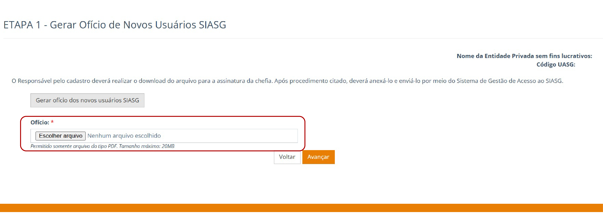

*Figura 34 – Avançar após a anexação do ofício assinado.*

Para concluir a solicitação de acesso, o responsável deverá clicar em **"Avançar"**.

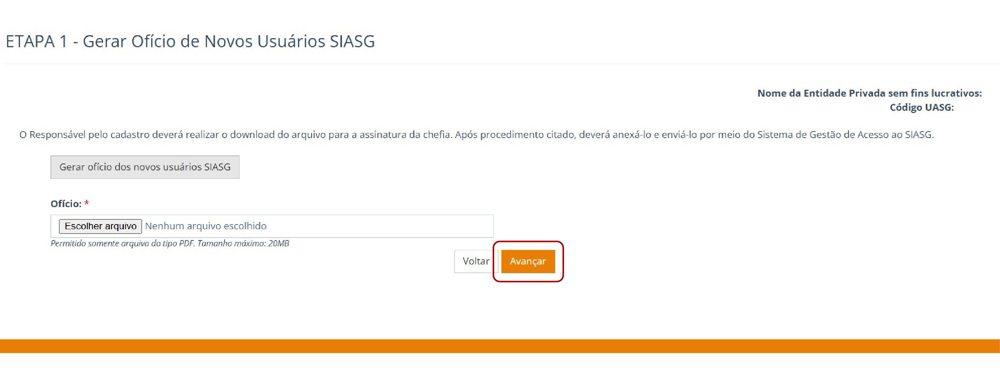

*Figura 35 – Ofício anexado e pronto para prosseguimento da solicitação.*

###  Situações do sistema e ações do usuário

| Situação | Ação do Usuário |
|-----------|----------------|
| Ofício anexado | Aguardar a análise do Ministério da Gestão e da Inovação em Serviços Públicos (MGI). Prazo de até 3 dias úteis. |
| Solicitação de novos usuários com pendências | Consultar os comentários e verificar |
| Pendência no ofício resolvida | Aguardar a avaliação do MGI |
| Solicitação de novos usuários aprovada | Aguardar a conclusão da habilitação pelo MGI |
| Usuários habilitados | O sistema estará apto a receber novas solicitações| 

## 14.2 Pendências na Solicitação de Novos Usuários  

Quando houver pendência relacionada à solicitação de novos usuários, o sistema exibirá mensagem: **“Rever Solicitação de Usuários SIASG”**. 

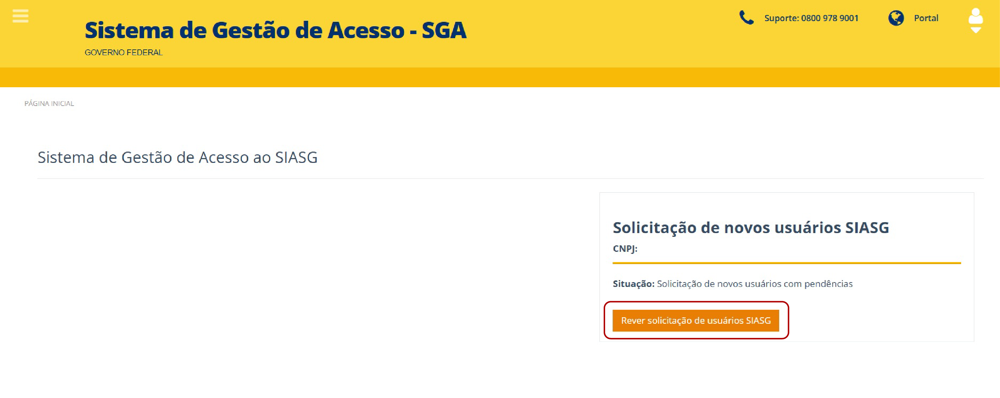

*Figura 36 -  Mensagem de Pendência na Solicitação de Novos Usuários*

Ao selecionar a opção **“Rever solicitação de Usuários SIASG”**, o responsável poderá visualizar os comentários inseridos pelo Ministério e identificar as providências necessárias para regularização.

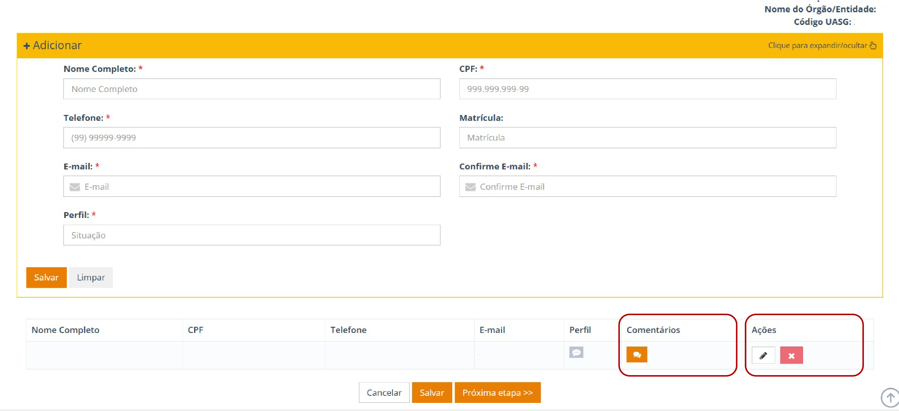

*Figura 37 - Comentário e ações disponíveis na solicitação de usuários SIASG*

Para visualizar as informações enviadas pelo Ministério, clique no ícone de **“Comentários”**. 

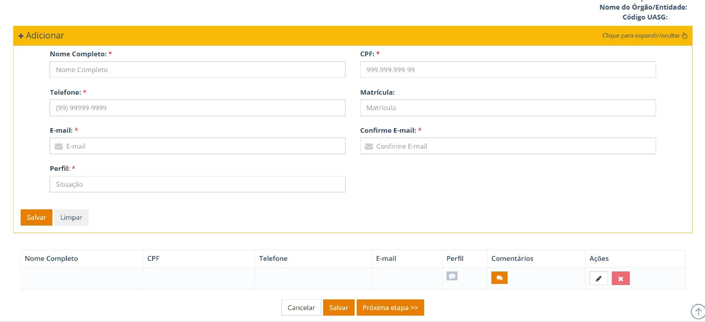

*Figura 38 -  Visualização de comentários do Ministério da Gestão* 

Para corrigir uma pendência, clique no ícone correspondente à edição do registro.  O sistema permitirá atualizar os dados cadastrados ou, quando aplicável, anexar a nomeação do pregoeiro ou o ato designação do homologador. 

Clique em **“Salvar”** para efetivar a alteração.

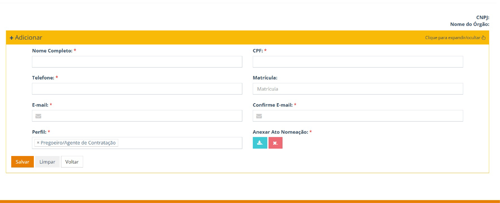

*Figura 39 - Ação de salvar alterações no sistema SGA*

Caso seja necessário excluir um usuário da solicitação, clique no ícone correspondente (A letra **"X"** em branco dentro de um quadrado vermelho). 

O sistema exibirá uma mensagem **“Deseja realmente excluir este usuário?”** Com as opções **“Não”** e **“Sim”**

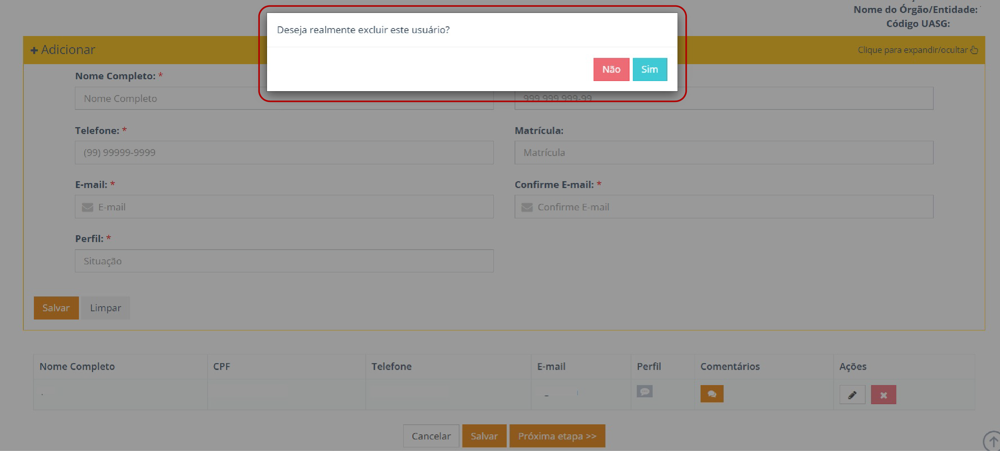

*Figura 40 -  Confirmação de exclusão de usuário*

Após realizar as correções necessárias, clique em **“Próxima Etapa”** para dar continuidade ao processo.

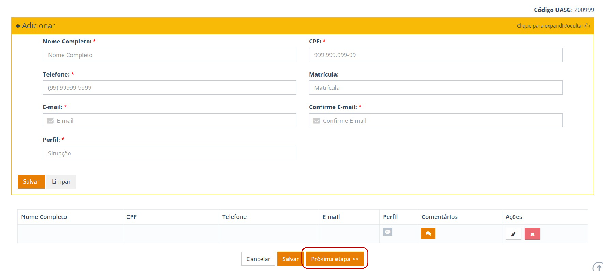

*Figura 41 -  Ação **“Próxima Etapa”** no sistema.

Na etapa seguinte, selecione a opção “Gerar Ofício dos Novos Usuários SIASG” para gerar o documento atualizado. 

O responsável deverá: 

Providenciar a assinatura da autoridade competente da entidade privada sem fins lucrativos    
Anexar o ofício assinado    
Após o upload, clicar em **“Avançar”**    

 
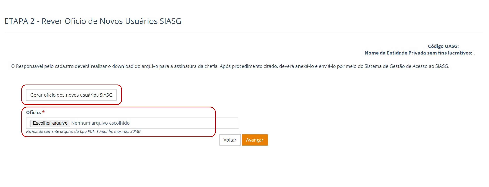

 *Figura 42 - Ação **“Avançar”** na etapa de envio do ofício. 

 !!! Warning "Atenção"  
 
    Após o reencaminhamento das informações e documentos corrigidos, a solicitação retornará para análise do Ministério. O responsável deverá acompanhar o andamento da solicitação no SGA. 

---

<button onclick="window.print()"
style="background-color: #0056b3; color: white; padding: 6px 16px; border: none; border-radius: 5px; font-size: 14px; cursor: pointer; box-shadow: 0 2px 4px rgba(0,0,0,0.2);">

🖨️ Imprimir ou baixar esta página

</button>

