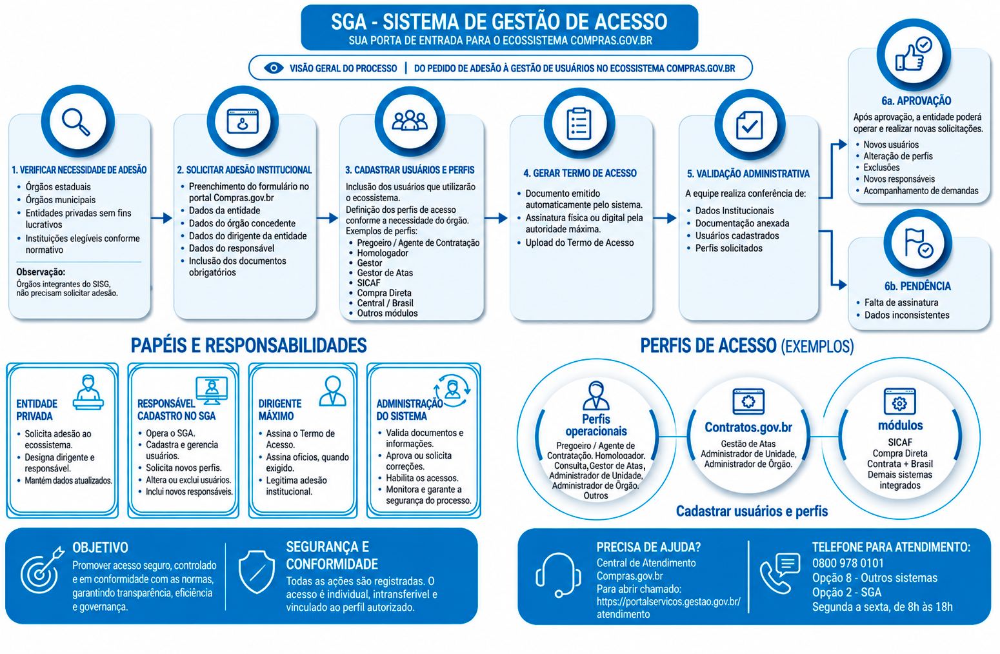

Tamanho do texto:

<button onclick="diminuirFonte()"
style="padding: 6px 12px; font-weight: bold; cursor: pointer; border: 1px solid #ccc; border-radius: 4px; background: #f8f9fa;">
A-
</button>

<button onclick="resetarFonte()"
style="padding: 6px 12px; font-weight: bold; cursor: pointer; border: 1px solid #ccc; border-radius: 4px; background: #f8f9fa;">
A
</button>

<button onclick="aumentarFonte()"
style="padding: 6px 12px; font-weight: bold; cursor: pointer; border: 1px solid #ccc; border-radius: 4px; background: #f8f9fa;">
A+
</button>

<button onclick="window.print()"
style="background-color: #0056b3; color: white; padding: 6px 16px; border: none; border-radius: 5px; font-size: 14px; cursor: pointer; box-shadow: 0 2px 4px rgba(0,0,0,0.2);">

🖨️ Imprimir ou baixar esta página

</button>

# 8. Visão Geral do Processo de Adesão

O processo de adesão ao Sistema de Gestão de Acesso (SGA) compreende etapas que envolvem a verificação da necessidade de acesso, a solicitação institucional, o cadastramento de usuários e perfis de acesso, a formalização do Termo de Acesso, a análise e validação da solicitação e a habilitação dos acessos, incluindo, quando aplicável, o tratamento de pendências.

De forma geral, o processo segue as seguintes etapas:

I. **Verificação da necessidade de acesso**: a entidade privada sem fins lucrativos deve verificar se atende aos requisitos aplicáveis ao serviço ou sistema que pretende utilizar no ecossistema Compras.

II. **Solicitação de acesso institucional**: preenchimento dos dados da entidade, do órgão concedente, dos dirigentes e do responsável pelo cadastro, bem como anexação dos documentos exigidos.

III. **Cadastramento de usuários e perfis**: inclusão dos usuários que utilizarão o ecossistema Compras e indicação dos respectivos perfis de acesso.

IV. **Formalização do Termo de Acesso**: geração, assinatura e encaminhamento do Termo de Acesso pelo SGA.

V. **Análise e validação**: análise da solicitação pelo Ministério da Gestão e da Inovação em Serviços Públicos (MGI).

VI. **Tratamento de pendências**: realização das correções solicitadas, quando necessário.

VII. **Habilitação dos acessos**: habilitação dos usuários e respectivos perfis após a validação.

## 8.1  Fluxo de Gestão de Acesso ao SIASG (SGA)

O fluxo a seguir apresenta, de forma consolidada, as principais etapas do processo de gestão de acesso no SGA, desde o início da solicitação pela entidade privada sem fins lucrativos até a habilitação dos usuários.

O fluxo contempla as etapas de **verificação da necessidade de acesso, solicitação institucional, cadastramento de usuários e perfis, formalização do Termo de Acesso, análise e validação, tratamento de pendências e habilitação dos acessos**.

*Figura 1 – Fluxo de Gestão de Acesso ao SIASG (SGA).*

<button onclick="window.print()"
style="background-color: #0056b3; color: white; padding: 6px 16px; border: none; border-radius: 5px; font-size: 14px; cursor: pointer; box-shadow: 0 2px 4px rgba(0,0,0,0.2);">

🖨️ Imprimir ou baixar esta página

</button>

