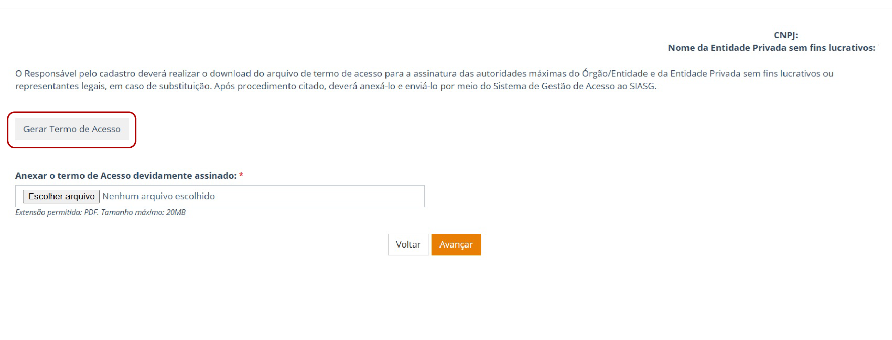
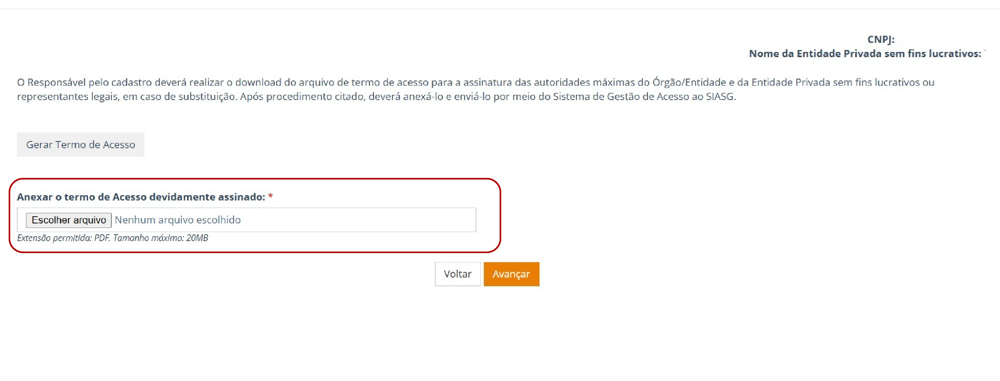
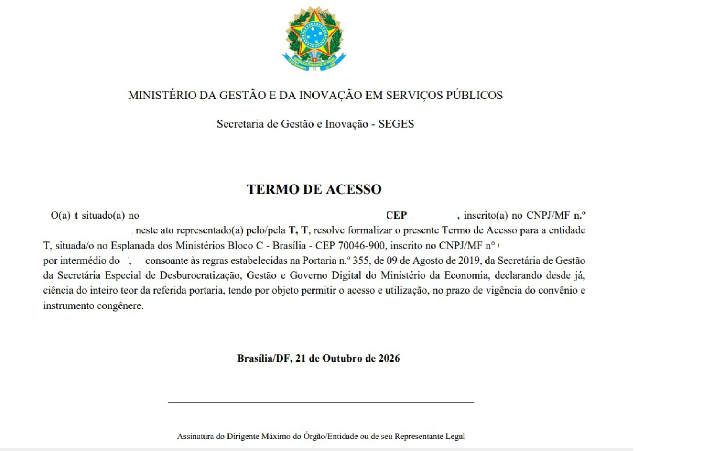
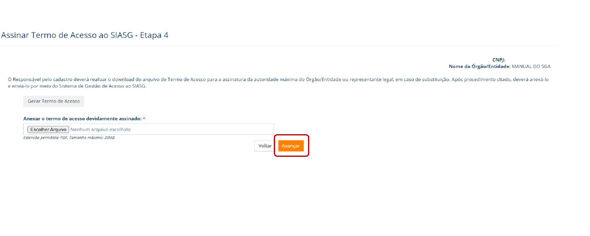
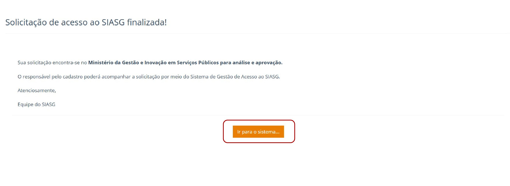

Tamanho do texto:

<button onclick="diminuirFonte()"
style="padding: 6px 12px; font-weight: bold; cursor: pointer; border: 1px solid #ccc; border-radius: 4px; background: #f8f9fa;">
A-
</button>

<button onclick="resetarFonte()"
style="padding: 6px 12px; font-weight: bold; cursor: pointer; border: 1px solid #ccc; border-radius: 4px; background: #f8f9fa;">
A
</button>

<button onclick="aumentarFonte()"
style="padding: 6px 12px; font-weight: bold; cursor: pointer; border: 1px solid #ccc; border-radius: 4px; background: #f8f9fa;">
A+
</button>

<button onclick="window.print()"
style="background-color: #0056b3; color: #ffffff; padding: 6px 16px; border: none; border-radius: 5px; font-size: 14px; cursor: pointer; box-shadow: 0 2px 4px rgba(0,0,0,0.2);">
🖨️ Imprimir ou baixar esta página
</button>

# 12. Geração e encaminhamento do termo de acesso

Após concluir o cadastramento dos usuários e a atribuição dos respectivos perfis de acesso, o responsável pelo cadastro deverá gerar o termo de acesso no Sistema de Gestão de Acesso (SGA).

Para isso:

- Clique em **"Gerar termo de acesso"**.
- O sistema realizará o download automático do arquivo.

*Figura 14 - Geração do Termo de Acesso.*

Após a geração do documento, o **termo de acesso deverá ser assinado pela autoridade máxima da entidade privada sem fins lucrativos ou por seu substituto legal**, conforme aplicável.

As assinaturas poderão ser realizadas de forma física ou digital.

*Figura 15 - Anexação do Termo de Acesso.*

Após a assinatura, o responsável deverá **anexar o termo de acesso assinado no SGA** e prosseguir com o encaminhamento da solicitação para análise.

*Figura 16 - Modelo do Termo de Acesso gerado pelo Sistema de Gestão de Acesso.*

Para prosseguir com a solicitação, clique em **"Avançar"**.

*Figura 17 - Avanço após a anexação do Termo de Acesso.*

Após o encaminhamento, a solicitação será submetida ao **fluxo de análise e validação previsto no SGA**.

O responsável poderá acompanhar o andamento da solicitação diretamente no sistema.

Para acessar o acompanhamento da solicitação, clique na opção **"Ir para o sistema"**.

*Figura 18 - Solicitação encaminhada para análise e aprovação.*

---

<button onclick="window.print()"
style="background-color: #0056b3; color: #ffffff; padding: 6px 16px; border: none; border-radius: 5px; font-size: 14px; cursor: pointer; box-shadow: 0 2px 4px rgba(0,0,0,0.2);">
🖨️ Imprimir ou baixar esta página
</button>

