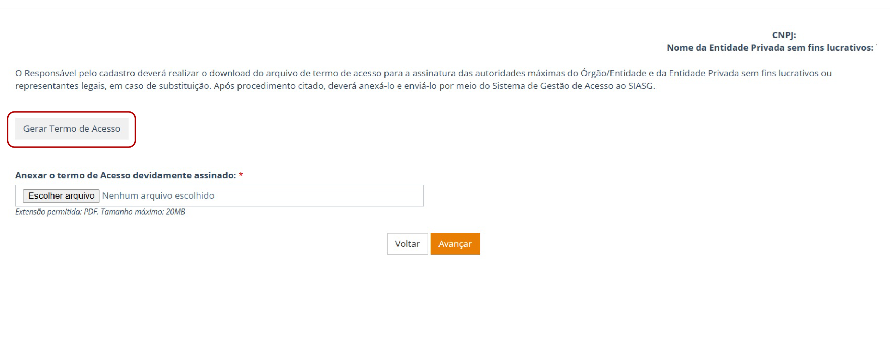
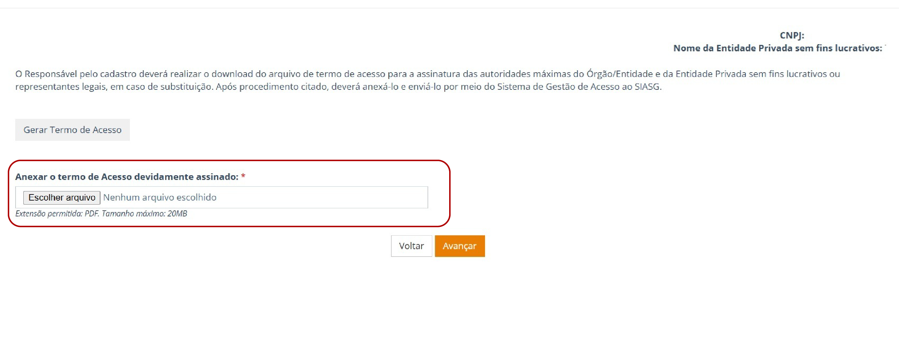
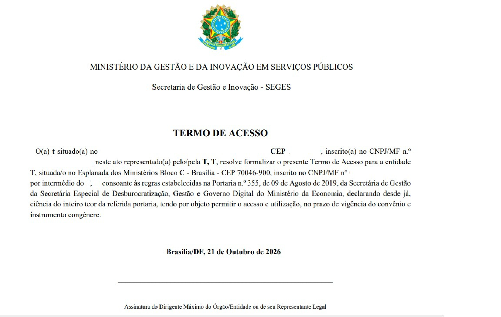
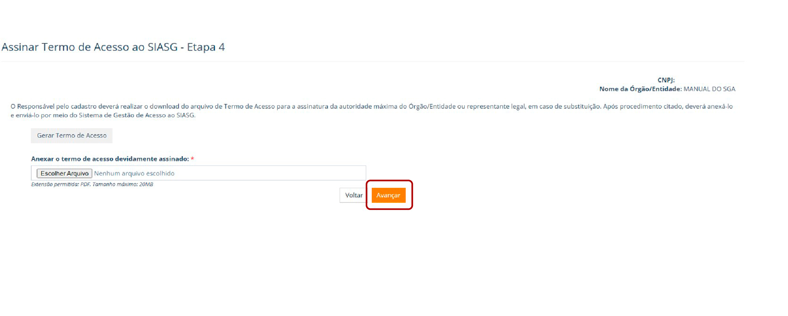
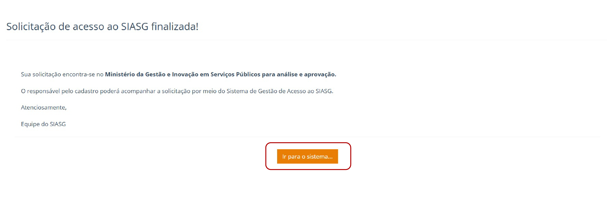

# Geração e Encaminhamento do Termo de Acesso

Após concluir o cadastramento dos usuários e perfis, o responsável pelo cadastro deverá gerar o Termo de Acesso no SGA.

Para isso:

- Clique em **"Gerar Termo de Acesso"**.
- O sistema realizará o download do arquivo.

*Figura 14 – Geração do Termo de Acesso.*

Após a geração, o **Termo de Acesso deverá ser assinado pela autoridade máxima da entidade privada sem fins lucrativos ou por seu substituto legal**.

As assinaturas poderão ser realizadas **de forma física ou digital**.

*Figura 15 – Anexação do Termo de Acesso.*

Após a assinatura, o responsável deverá **anexar o Termo de Acesso assinado no SGA** e prosseguir com o encaminhamento da solicitação para análise.

*Figura 16 – Modelo do Termo de Acesso gerado pelo Sistema de Gestão de Acesso.*

Para prosseguir com a solicitação, clique em **"Avançar"**.

*Figura 17 – Avançar após a anexação do Termo de Acesso.*

Após o encaminhamento, a solicitação será submetida ao **fluxo de análise e validação previsto no SGA**.

O responsável poderá acompanhar o andamento da solicitação diretamente pelo sistema.

Para isso, clique na opção **"Ir para o sistema"**.

*Figura 18 – Solicitação encaminhada para análise e aprovação.*
