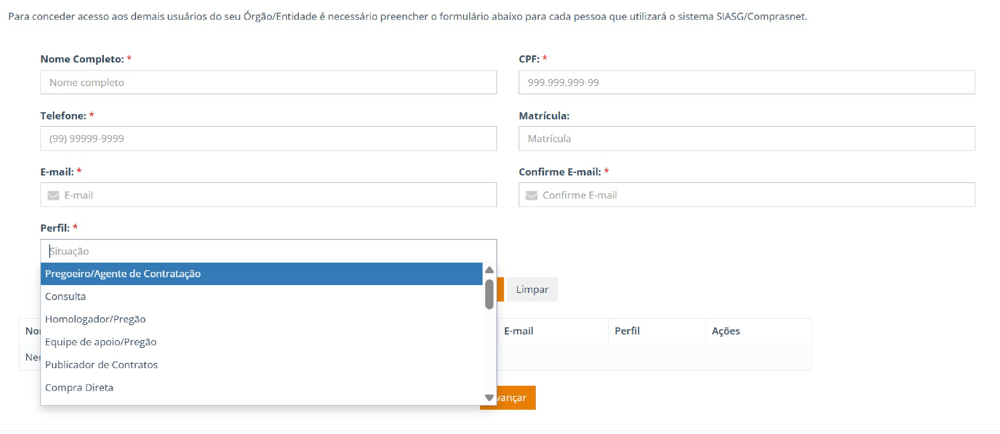
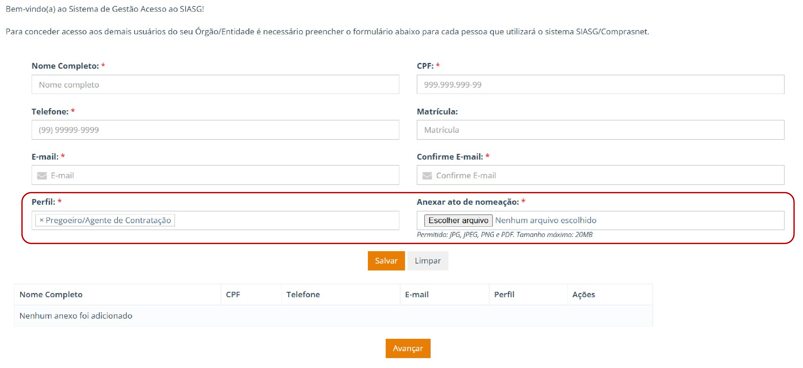
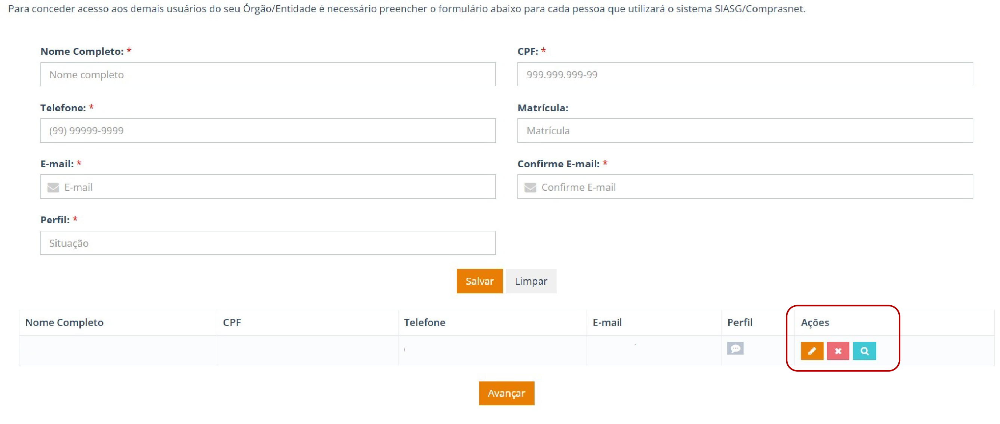
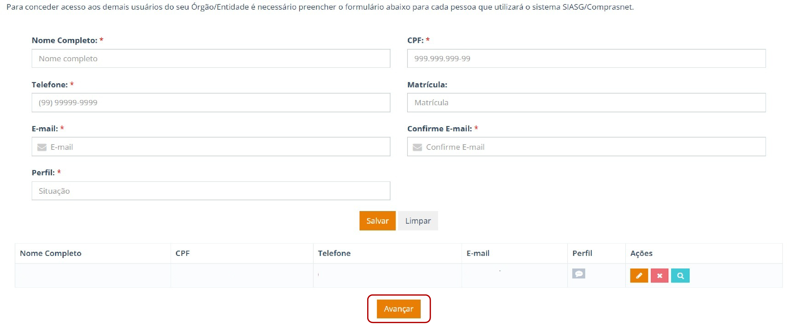

Tamanho do texto:

<button onclick="diminuirFonte()"
style="padding: 6px 12px; font-weight: bold; cursor: pointer; border: 1px solid #ccc; border-radius: 4px; background: #f8f9fa;">
A-
</button>

<button onclick="resetarFonte()"
style="padding: 6px 12px; font-weight: bold; cursor: pointer; border: 1px solid #ccc; border-radius: 4px; background: #f8f9fa;">
A
</button>

<button onclick="aumentarFonte()"
style="padding: 6px 12px; font-weight: bold; cursor: pointer; border: 1px solid #ccc; border-radius: 4px; background: #f8f9fa;">
A+
</button>

<button onclick="window.print()"
style="background-color: #0056b3; color: white; padding: 6px 16px; border: none; border-radius: 5px; font-size: 14px; cursor: pointer; box-shadow: 0 2px 4px rgba(0,0,0,0.2);">

🖨️ Imprimir ou baixar esta página

</button>

# 11. Cadastramento de Usuários e Perfis

Para realizar o cadastramento de um usuário, preencha os campos solicitados e selecione o perfil de acesso correspondente às atividades que serão exercidas pelo usuário.

*Figura 10 – Cadastramento de usuários e seleção de perfis.*

!!! warning "ATENÇÃO!"

    Para o perfil de **Pregoeiro (Agente de Contratação)**, é obrigatório o anexo do **ato de designação específico** para o exercício da função.

    Para o perfil de **Homologador**, deve ser anexado o **ato de designação ou o termo de posse** que comprove a condição de autoridade competente.

*Figura 11 – Seleção do perfil de acesso do usuário.*

!!! warning "ATENÇÃO!"

    Após salvar os dados do usuário que utilizará o ecossistema Compras, o SGA permanecerá na mesma tela, permitindo a inclusão de novos usuários, se necessário.

    Para prosseguir para a próxima etapa, é obrigatório o cadastro de **pelo menos um usuário**.

    Caso seja necessário editar, excluir ou visualizar os dados inseridos, o sistema disponibiliza, no campo **"Ações"**, as seguintes funcionalidades:

    - Editar os dados inseridos no sistema;
    - Excluir os dados inseridos no sistema;
    - Visualizar os anexos inseridos no sistema.

*Figura 12 – Funcionalidades de edição, exclusão e visualização de usuários cadastrados.*

Após concluir o cadastramento dos usuários, clique em **"Avançar"** para acessar a próxima tela.

*Figura 13 – Avançar para a próxima etapa após o cadastramento dos usuários.*

<button onclick="window.print()"
style="background-color: #0056b3; color: white; padding: 6px 16px; border: none; border-radius: 5px; font-size: 14px; cursor: pointer; box-shadow: 0 2px 4px rgba(0,0,0,0.2);">

🖨️ Imprimir ou baixar esta página

</button>

